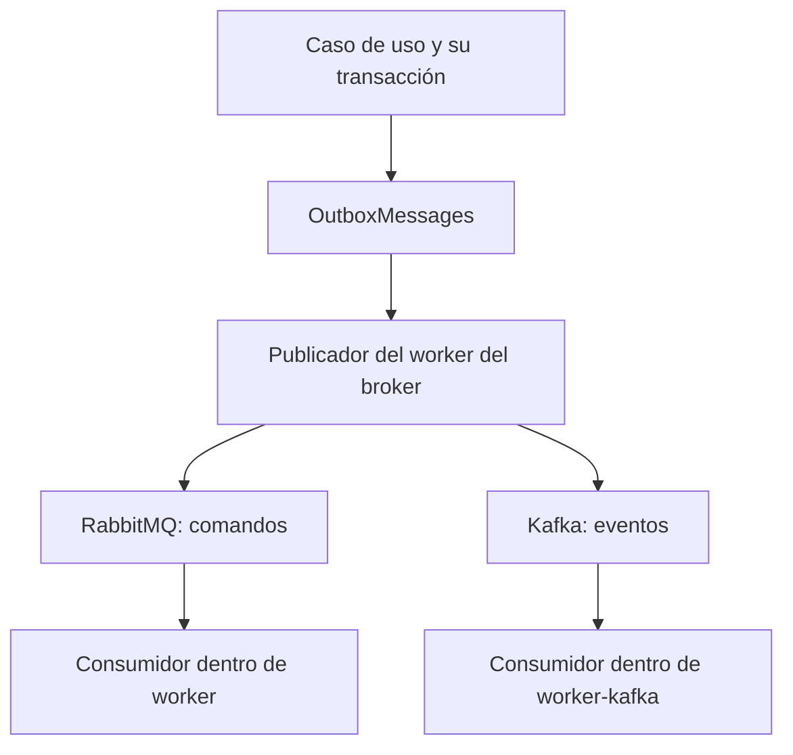

# Guía para agregar un caso al transactional outbox de NexoRuta

Revisado contra la rama publicada `feature/mailpitypassword` el 18/10/2026. Ruta sugerida en el repositorio: `backend/docs/workflow/transactional-outbox.md`.

Esta guía describe cómo extender la implementación existente. Los ejemplos `EnvioEstadoCambiadoV1` y `KafkaEnvioEstadoCambiadoOutboxHandler` son propuestas para un caso futuro; no son clases que ya existan.

## 1. La regla que debemos conservar

Un caso nuevo se agrega a **la misma tabla `OutboxMessages` y al worker existente de su broker**. Agregar un contrato, una cola, un tópico o una clase handler no exige agregar una tabla outbox, un proyecto ejecutable ni un servicio Compose.

| Pieza existente | Responsabilidad |
| --- | --- |
| `OutboxMessages` | Guarda mensajes que deben publicarse, su contrato, prioridad, reserva y resultado de publicación. |
| `worker` | Proceso RabbitMQ: publica desde el outbox y aloja consumidores de seguimiento y correo. |
| `worker-kafka` | Proceso Kafka: publica desde el outbox y aloja el consumidor que persiste eventos en MongoDB. |
| `OutboxHandlerRegistry` | Resuelve qué handler publica cada combinación de tipo, versión y destino. |
| `ProcessedMessages` | Guarda marcas de procesamiento por `MessageId + Consumer`. Actualmente lo usa seguimiento. |
| `EstadoEntrega` | Informa el resultado particular del correo: `Pending`, `Delivered`, `Expired` o `Failed`. |

**No crear** `MiCasoOutboxMessages`, `SecurityOutboxMessages`, otro repositorio de reservas ni un contenedor `worker-mi-caso`. Un proyecto nuevo o una separación de procesos requiere una decisión de arquitectura explícita.

## 2. El recorrido completo



La API guarda el cambio de negocio y el mensaje en PostgreSQL. El publicador reclama una fila con `claim_outbox`, resuelve su ruta, espera la confirmación del broker y llama a `finish_outbox`. El consumidor procesa el mensaje y confirma Rabbit o el offset de Kafka después de completar su efecto durable.

**Hay dos handlers distintos en este recorrido:** `IOutboxMessageHandler.HandleAsync` se encarga de PUBLICAR; el consumidor se encarga de EJECUTAR el trabajo. Registrar el primero no crea automáticamente el segundo.

`Publicado` indica aceptación por el broker. No implica que un consumidor haya terminado, que un correo haya llegado a la bandeja de entrada ni que un documento ya exista en MongoDB.

## 3. Antes de escribir código: definir el contrato

Completá esta ficha para cada mensaje:

| Decisión | Ejemplo futuro |
| --- | --- |
| Acción o hecho | Ocurrió un cambio de estado de un envío. |
| Tipo y versión | `EnvioEstadoCambiado`, versión `1`. |
| Destino | `OutboxDestino.Kafka`. |
| Ámbito y clave | `OutboxScope.Envio`, clave igual a `EnvioId`. |
| Prioridad inicial | `OutboxPriority.Normal`, definida en servidor. |
| Contrato JSON | IDs, estado, versión del envío y fecha del hecho. |
| Clave Kafka | `EnvioId`, si sus eventos deben mantener orden. |
| Consumidor y efecto | Definir qué servicio leerá el evento y qué guardará. Si todavía no hay consumidor, documentarlo. |
| Deduplicación | `eventId` estable; marca transaccional o índice único en el almacén del consumidor. |
| Reintentos y fallo definitivo | Definir qué se reintenta y dónde queda un mensaje que no puede procesarse. |
| Datos sensibles | Identificar qué debe cifrarse y qué nunca debe publicarse. |

RabbitMQ transporta comandos de trabajo, como generar seguimiento o enviar un correo. Kafka transporta hechos, como `EnvioCreado` o `PasswordRecoveryRequested`. Si una operación necesita ambos, guardá **dos filas con IDs diferentes** dentro de la misma transacción. No mandes el mismo comando de correo a Kafka para usarlo como auditoría.

El payload es el contrato del mensaje. No copies la request HTTP completa, un JWT, una entidad EF ni la contraseña de un usuario.

## 4. Registrar el tipo, la versión y su ámbito

Revisá `src/NexoRuta.Infrastructure/Outbox/OutboxMessage.cs`:

- Agregá el identificador a `OutboxMessageTypes` o al catálogo de contratos adoptado por el módulo.
- Registrá la combinación permitida en `ForShipment` o `ForIdentity`, con su prioridad inicial y estado de entrega, si corresponde.
- Usá los enums existentes: `OutboxDestino`, `OutboxScope`, `OutboxPriority` y `OutboxEstado`.
- El JSON debe ser un objeto y los IDs deben ser válidos.

Actualmente `ForShipment` y `ForIdentity` tienen una lista cerrada de combinaciones: un tipo nuevo será rechazado hasta que se registre allí. Evitá saltear esas fábricas con un constructor sin validación.

En un mensaje de envío, `OperadorId` y `EnvioId` son obligatorios y `ClaveAmbito == EnvioId`. En uno de identidad, los dos IDs de envío son nulos y `ClaveAmbito` identifica al usuario. Una notificación de organización que no pertenezca a un envío ni a una identidad necesita un ámbito nuevo bien definido; no se le debe inventar un `EnvioId`.

La versión pertenece al contrato. El código actual usa `OutboxContractVersions.Current = 1` en varias rutas. **No cambies ese valor global a `2` para versionar un solo mensaje**: agregá una versión específica y mantené las rutas que todavía necesiten procesar mensajes V1.

Ejemplo de payload tipado futuro:

```csharp
public sealed record EnvioEstadoCambiadoV1(
    Guid EventId,
    Guid EnvioId,
    Guid OperadorId,
    string Estado,
    long VersionEnvio,
    DateTimeOffset OccurredAt);
```

Elegí la capa del contrato según sus dependencias y las reglas del módulo. Conservá nombres y tipos JSON estables. Un nuevo campo de payload no requiere una nueva columna SQL.

## 5. Guardar el mensaje en la transacción del negocio

Para un envío, extendé la escritura del repositorio que realiza la transición. Seguí el patrón de `EfEnviosRepository.GuardarAsync` y de `BeginOrJoinAsync`.

Ejemplo conceptual después de validar y aplicar la transición en memoria o en SQL:

```csharp
var eventId = Guid.CreateVersion7();
var payload = JsonSerializer.Serialize(
    new EnvioEstadoCambiadoV1(
        EventId: eventId,
        EnvioId: envio.Id,
        OperadorId: envio.OperadorId,
        Estado: envio.Estado.ToString(),
        VersionEnvio: versionPersistida,
        OccurredAt: DateTimeOffset.UtcNow),
    new JsonSerializerOptions(JsonSerializerDefaults.Web));

db.OutboxMessages.Add(OutboxMessage.ForShipment(
    operatorId: envio.OperadorId,
    shipmentId: envio.Id,
    type: OutboxMessageTypes.ShipmentStateChanged,
    destination: OutboxDestino.Kafka,
    payload: payload,
    id: eventId));

await db.SaveChangesAsync(ct);
```

En este ejemplo se deben agregar `ShipmentStateChanged` y la rama correspondiente de la fábrica. `versionPersistida` representa la versión de la transición del dominio, no una columna cuya existencia se presupone.

El cambio del envío y el INSERT del mensaje deben confirmar o revertir juntos. Reutilizá el mismo `DbContext` y la transacción exterior; no abras una segunda transacción ni hagas un commit anticipado que pueda dejar solo una de las dos escrituras. Cuando existe una transacción del middleware, `BeginOrJoinAsync` participa en ella.

Para recuperación, `EfOutboxRepository.EnqueuePasswordRecoveryAsync` usa `nexoruta_app.enqueue_password_recovery`, que registra el par autorizado. Es una operación de negocio acotada, no un INSERT genérico para todos los mensajes de identidad. Un nuevo caso debe tener una vía de escritura autorizada equivalente, sin duplicar la infraestructura de reserva y finalización.

La API no llama al broker ni a SMTP desde esta escritura. Si falla la persistencia, no puede publicarse un mensaje de una operación que no confirmó.

## 6. Alinear las restricciones SQL y RLS

El registro C# no basta. La base también tiene una lista de contratos permitidos.

| Superficie existente | Qué revisar al agregar el caso |
| --- | --- |
| `NexoRutaDbContext`: mapping de `OutboxMessage` | `CK_OutboxMessages_Contract`, ámbito, prioridad y estado de entrega. |
| Migración `20261011022107_AddOutboxMessages` | Restricciones del esquema, FK e índices. |
| Migración `20261017201732_EnablePostgreSqlRls` | Políticas de INSERT, funciones autorizadas y validación del trabajo. |
| `RlsSqlFunctionContract` | Declaraciones de funciones nuevas o firmas que realmente cambien. |
| Snapshot y Designer EF | Coherencia con la cadena de migraciones adoptada. |

La política actual `outbox_api_insert` está diseñada para **el alta del envío**: comprueba `selected_operator_id`, `shipment_id`, el comercio y dos contratos concretos. No sirve automáticamente para emitir cualquier evento posterior del envío. Para una transición, autorizá esa operación desde el acceso persistido y el envío validado; no simules un alta ni aceptes como autoridad los IDs del formulario.

Para identidad, conservá las funciones acotadas y la validación de payload/usuario. No agregues SELECT general a la API ni una política `WITH CHECK (true)` para que el INSERT funcione.

Si el consumidor escribe datos de negocio, derivá su contexto del mensaje persistido y validado. `begin_tracking_job` es específico de seguimiento: no lo uses para autorizar cualquier otro tipo. Añadí la validación acotada que necesite el nuevo trabajo, conservando el patrón existente y los roles restringidos.

Las funciones privilegiadas deben mantener dueño controlado, `search_path` fijo y `EXECUTE` revocado a `PUBLIC`. RLS sigue con `ENABLE` y `FORCE`.

Durante el desarrollo actual se pueden ajustar las migraciones originales cuando se rehace coherentemente una instalación local desde cero. Eso puede requerir reiniciar únicamente el PostgreSQL de Compose, según el alcance autorizado. No hace falta una tabla nueva ni una cadena de migraciones por mensaje. Si un esquema ya se distribuyó a entornos que deben conservar sus datos, los cambios se despliegan con una migración de actualización.

Cambiar una migración aplicada no actualiza por sí solo una base existente: EF recuerda el ID en `__EFMigrationsHistory`. Comprobá siempre el esquema efectivo. No reinicies bases ni otros volúmenes como efecto automático de agregar un handler.

## 7. Agregar la ruta de publicación al worker existente

En `src/NexoRuta.Worker/Messaging/OutboxHandlerRegistry.cs`, cada implementación de `IOutboxMessageHandler` tiene una `OutboxHandlerRoute(Type, Version, Destination)` única. El registro rechaza rutas duplicadas y tipos desconocidos.

Ejemplo futuro para Kafka:

```csharp
public sealed class KafkaEnvioEstadoCambiadoOutboxHandler(
    KafkaEnvioCreadoPublisher publisher) : IOutboxMessageHandler
{
    public OutboxHandlerRoute Route { get; } = new(
        OutboxMessageTypes.ShipmentStateChanged,
        EnvioEstadoCambiadoContract.Version,
        OutboxDestino.Kafka);

    public Task HandleAsync(OutboxClaim message, CancellationToken ct)
        => publisher.PublicarEstadoCambiadoAsync(message, ct);
}
```

`EnvioEstadoCambiadoContract.Version` y `PublicarEstadoCambiadoAsync` se implementan con el caso. El productor compartido actual se llama `KafkaEnvioCreadoPublisher`, aunque también publica recuperación; reutilizá su productor. Un nombre más general puede adoptarse como refactor, sin crear otro proceso por evento.

Registrá la clase en la rama Kafka de `src/NexoRuta.Worker/Program.cs`:

```csharp
builder.Services.AddSingleton<IOutboxMessageHandler,
    KafkaEnvioEstadoCambiadoOutboxHandler>();
```

Para Rabbit, seguí `RabbitTrackingOutboxHandler` y `RabbitPasswordRecoveryEmailOutboxHandler`, reutilizando `RabbitMqOutboxPublisher`. Agregá la publicación y topología necesarias al mismo proceso.

El publisher valida tipo, versión, ámbito y contenido; publica en una cola o tópico definido por constantes y espera confirmación. No deja que el payload elija libremente el destino. Reutiliza la conexión/productor existente.

Los bucles `Worker` y `KafkaOutboxWorker` ya se encargan de claim, lease, errores y finish. No copies esos bucles para el nuevo tipo. El handler tampoco debe marcar `Publicado` por su cuenta.

## 8. Implementar el consumidor, si el caso lo necesita

Un consumidor puede ser una clase nueva dentro de `NexoRuta.Worker`, registrada en el proceso del broker correspondiente. Tener varias clases `BackgroundService` dentro del proceso es compatible con mantener solo `worker` y `worker-kafka` en Compose.

1. Validar tipo, versión, IDs y payload antes de ejecutar el efecto.
2. Validar el contexto persistido si escribe datos de negocio sujetos a RLS.
3. Detectar una reentrega con el mecanismo de idempotencia del destino.
4. Ejecutar el efecto y guardar su resultado durable.
5. Confirmar Rabbit o el offset Kafka solo después de ese resultado.
6. Ante errores, aplicar el reintento o destino de fallidos elegido, conservando el mismo `MessageId`.

En Kafka, si se reprocesa un mensaje fallido, no se debe confirmar un offset posterior que dé por completado el anterior. Conservá el orden y la estrategia de retry/seek/pausa del consumidor.

Las colas y tópicos pueden ser distintos por contrato. Eso permite reintentos, prefetch y concurrencia apropiados sin otro contenedor. Un fallo temporal de SMTP no debe cerrar el host ni detener los otros handlers. El efecto final no se ejecuta dentro del handler que solo publica al broker.

## 9. Elegir la idempotencia sin duplicar tablas

| Efecto del consumidor | Mecanismo existente o a extender |
| --- | --- |
| Escrituras PostgreSQL | `ProcessedMessages`, con clave `MessageId + Consumer`, y efecto guardados en la misma transacción. |
| Correo SMTP | Estado de entrega terminal por `MessageId`, como usa recuperación. |
| Documento MongoDB | Índice único por `eventId`; confirmar Kafka tras insertar o reconocer el duplicado. |
| Servicio externo | Su clave idempotente, si existe, usando un identificador estable del mensaje. |

`ProcessedMessages` no es un archivo de filas terminadas del outbox. No se mueven allí los mensajes `Publicado` o `Delivered`; las marcas y los mensajes tienen responsabilidades distintas.

Actualmente las políticas RLS de `ProcessedMessages` admiten el trabajo de seguimiento validado. Para usarla desde otro consumidor PostgreSQL, ampliá esas reglas de manera explícita y limitada al nuevo trabajo. No le concedas acceso global por conveniencia. Un nombre de consumidor estable permite que dos consumidores distintos procesen el mismo mensaje sin bloquearse mutuamente.

La marca se guarda después del efecto y dentro de su misma transacción. Comprobar una marca antes de empezar no resuelve por sí solo dos entregas concurrentes: necesitás la serialización o control de concurrencia correspondiente y la clave única. Seguimiento ya aplica un bloqueo transaccional por envío.

En un caso nuevo, definí también si hay idempotencia de negocio. La regla actual «una entrega inicial por envío» pertenece a seguimiento; no debe copiarse a una notificación que deba emitirse por cada cambio de estado.

SMTP no participa en la transacción PostgreSQL. Si acepta el correo y el proceso cae antes de guardar `Delivered`, puede enviarse otra vez. Agregar una fila a `ProcessedMessages` no elimina esa ventana. Mongo y PostgreSQL tampoco comparten una transacción: no añadas una marca PostgreSQL que pueda quedar confirmada sin el documento Mongo.

## 10. Correos, JSON y datos sensibles

Un correo futuro reutiliza el proceso Rabbit y la infraestructura existente. Puede agregar su contrato y plantilla o extender un contrato de correo tipado con plantillas permitidas, según la necesidad real. No requiere otro outbox ni `worker-otro-correo`.

Las funciones actuales `mark_outbox_email_delivery` y `get_outbox_email_delivery_state` están restringidas a `PasswordRecoveryEmail` de ámbito `Identidad`. Para otro correo, extendé su lista permitida y las políticas relacionadas; no supongas que el nombre genérico de la función ya autoriza cualquier tipo. Adaptá también el consumidor de fallidos para que registre `Failed` en el contrato correcto. Hoy `PasswordRecoveryEmailDeadLetterConsumer` persiste ese estado y confirma el mensaje de la cola de fallidos; por eso esa cola puede quedar vacía después de atender una falla definitiva.

El correo de recuperación se guarda y transporta así:

```json
{
  "protectedCommand": "<contenido protegido por Data Protection>"
}
```

El contenido descifrado incluye los datos que necesita el handler. Conservá la validación del `MessageId`, un propósito de protección definido y el anillo persistente compartido entre API y RabbitWorker. Un nuevo formato o propósito debe versionarse; no reutilices a ciegas el propósito de recuperación para datos incompatibles.

No registres el payload protegido o descifrado, el destinatario, el enlace, tokens, contraseñas ni respuestas SMTP. Registrá identificador, tipo, etapa y error seguro. Si el contenido tiene vencimiento, el consumidor debe comprobarlo antes del efecto externo.

## 11. Prioridad, orden y retención

- El modelo usa `Baja`, `Normal` y `Alta`; la fábrica elige la prioridad inicial. La request pública no la decide.
- `claim_outbox` aumenta la prioridad efectiva un nivel cada cinco minutos hasta `Alta`; desempata por fecha e ID. No copies el scheduler en un consumidor nuevo.
- Kafka bloquea un mensaje si existe otro anterior sin publicar para el mismo `Ambito + ClaveAmbito`. Usá una clave Kafka coherente con el orden que el caso requiere.
- La prioridad PostgreSQL ordena publicaciones. La prioridad RabbitMQ se aplica dentro de una cola que la soporte; no establece un orden global entre colas ni interrumpe trabajos en ejecución.
- La cola actual de seguimiento es classic sin prioridad configurada; su prioridad se aplica al publicar desde PostgreSQL. La de recuperación es quorum y usa las prioridades de RabbitMQ 4.3. No cambies argumentos de una cola existente sin revisar su compatibilidad.
- La aceptación del broker y el commit PostgreSQL son operaciones separadas: conservá IDs e idempotencia aunque Kafka tenga productor idempotente o Rabbit confirme publicaciones.
- Si agregás limpieza del outbox, revisá antes `begin_tracking_job`, RLS, marcas de procesamiento y redeliveries: actualmente un trabajo puede necesitar su fila persistida para validarse. Borrar todo lo `Publicado` puede romperlo.

## 12. Pruebas enfocadas para el nuevo caso

Ejecutá las pruebas que cubren la extensión, sin lanzar por defecto toda la solución:

- Se acepta la combinación registrada; tipo, versión, destino o ámbito incorrectos se rechazan.
- El cambio de negocio y su mensaje confirman juntos; un rollback no deja el mensaje publicable.
- La ruta resuelve el publisher correcto; una ruta duplicada o ausente falla de forma controlada.
- El broker confirma antes de marcar `Publicado`; una caída conserva un trabajo recuperable.
- El consumidor completa una entrega y reconoce su reentrega, también bajo concurrencia cuando corresponda.
- El rol restringido permite el caso correcto y rechaza otro envío, identidad o ámbito; no se prueba solo con un superusuario.
- La versión anterior sigue funcionando si deben convivir contratos.
- La prioridad y el orden del agregado se conservan si el nuevo caso los afecta.
- Un recorrido real produce el efecto esperado en su destino. Un contenedor saludable, por sí solo, no demuestra procesamiento.

Construí los proyectos afectados y comprobá EF si tocaste modelo/migraciones. Verificá Compose si agregaste configuración, cola o tópico. Ejecutá `git diff --check` sobre los repositorios modificados. Los cambios de contrato HTTP requieren actualizar OpenAPI; un mensaje interno nuevo no implica automáticamente un endpoint nuevo.

## 13. Lista de cierre para evitar la duplicación

- [ ] El caso usa `OutboxMessages`; no apareció otra tabla outbox.
- [ ] Compose mantiene únicamente `worker` y `worker-kafka` como procesos de mensajería.
- [ ] El contrato tiene tipo, versión, ámbito, prioridad y ruta definidos en servidor.
- [ ] Fábrica C#, restricciones SQL y RLS aceptan la misma combinación.
- [ ] El mensaje se guarda en la transacción de negocio apropiada.
- [ ] La ruta está registrada en `OutboxHandlerRegistry` y DI.
- [ ] El consumidor necesario está registrado dentro del proceso existente.
- [ ] Se reutilizan las funciones de claim/finish y las conexiones/productores del broker.
- [ ] La idempotencia se resuelve en el almacén o efecto correspondiente.
- [ ] Los datos sensibles siguen protegidos y los logs contienen solo información segura.
- [ ] Quedaron probadas la entrega real y una reentrega/falla relevante para el caso.
- [ ] La documentación explica el nuevo tipo y cómo observar su resultado.

## Referencias del código actual

Todos los enlaces apuntan a la rama revisada; pueden avanzar con sus próximos commits.

- [Modelo, fábricas y tipos del outbox](https://github.com/NexoRuta/NexoRuta-Backend/blob/feature/mailpitypassword/src/NexoRuta.Infrastructure/Outbox/OutboxMessage.cs)
- [Repositorio y llamadas a funciones SQL](https://github.com/NexoRuta/NexoRuta-Backend/blob/feature/mailpitypassword/src/NexoRuta.Infrastructure/Outbox/EfOutboxRepository.cs)
- [Registro de rutas de publicación](https://github.com/NexoRuta/NexoRuta-Backend/blob/feature/mailpitypassword/src/NexoRuta.Worker/Messaging/OutboxHandlerRegistry.cs)
- [Registro de los dos procesos en Program.cs](https://github.com/NexoRuta/NexoRuta-Backend/blob/feature/mailpitypassword/src/NexoRuta.Worker/Program.cs)
- [Publisher RabbitMQ compartido](https://github.com/NexoRuta/NexoRuta-Backend/blob/feature/mailpitypassword/src/NexoRuta.Worker/Messaging/RabbitMqOutboxPublisher.cs)
- [Publisher Kafka compartido](https://github.com/NexoRuta/NexoRuta-Backend/blob/feature/mailpitypassword/src/NexoRuta.Worker/Messaging/KafkaEnvioCreadoPublisher.cs)
- [Seguimiento e idempotencia PostgreSQL](https://github.com/NexoRuta/NexoRuta-Backend/blob/feature/mailpitypassword/src/NexoRuta.Infrastructure/Seguimiento/Processing/ProcesarGeneracionSeguimiento.cs)
- [Consumidor de correo](https://github.com/NexoRuta/NexoRuta-Backend/blob/feature/mailpitypassword/src/NexoRuta.Worker/Messaging/PasswordRecoveryEmailConsumer.cs)
- [Migración RLS, funciones y políticas](https://github.com/NexoRuta/NexoRuta-Backend/blob/feature/mailpitypassword/src/NexoRuta.Infrastructure/Persistence/Migrations/20261017201732_EnablePostgreSqlRls.cs)
