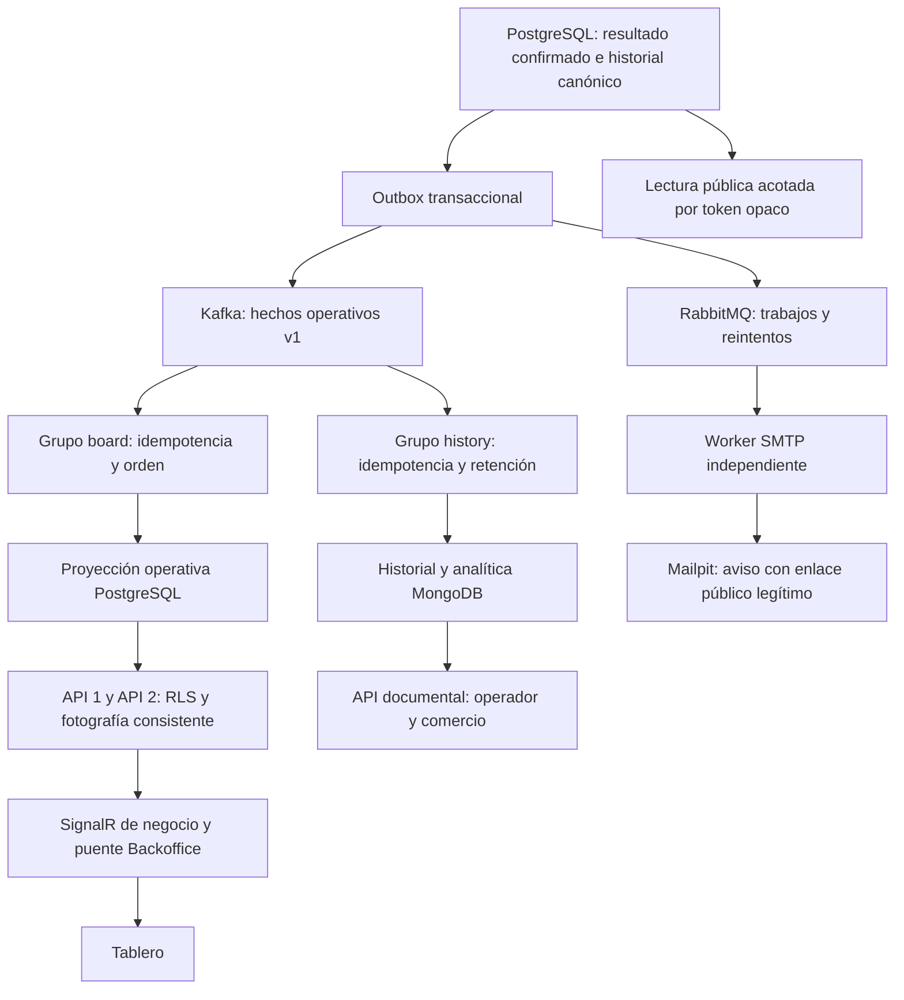

# Seguimiento, tablero y eventos operativos

Base consultada: superproyecto `25ffb1d8a7f34bb17623a99357d0b7b743ba8404`, Backend `74f2b3193844eb02febbecdc003d5c8b823d7588`, Frontend `51b9da73251ca1b44d06928799755369df8e6700`. Los gitlinks iniciales de entrega parcial se preservaron en la historia; las ramas feature parten de los `develop` remotos actualizados. Mobile no requiere cambios.

Fuentes: `docs/alcance/Laboratorio__NET_2026.pdf`, planilla original `docs/alcance/Calcs/Casos de Uso - Responsables.xlsm` leída como OOXML sin ejecutar macros, y `docs/cambios-requerimientos/Cambios de Requerimientos Planificados.pdf`. Los informes anteriores son antecedentes, no evidencia de estas ejecuciones.

| Requisito | Implementación | Evidencia automatizada |
|---|---|---|
| OPT-03 | Contrato aditivo `EventoOperativo` v1; outbox transaccional; consumidores `nexoruta-operational-board-v1` y `nexoruta-operational-history-v1` | `OperationalProjectionTests` |
| OPT-05 | MongoDB `operational_history_v1`, `_id` estable, filtros de operador/comercio, rango máximo 31 días, página 1–100, offset máximo 10000, orden por registro e identidad | `OperationalMongoIsolationTests`, consumidores y replay; API `/api/operacion/historial` |
| CU-29 / NFR-10 | `/tablero`, canal SignalR `/hubs/operacion`, puente Backoffice `/hubs/tablero`, fotografías completas con revisión, sesiones/permisos revalidados y RLS | `OperationalSignalRTests`, `OperationalBrowserTests` |
| CU-25/26 | Progreso y detalle público sin IDs, historial permitido, solicitud persistida por token y tratamiento operativo en `/reprogramaciones` | E2E de navegador, pruebas HTTP y aislamiento |
| AP-07 | Intervalo previsto de atención tomado de llegada manual y duración explícita; se publica solo con parada activa, proyección al día y horario futuro | Función `public_estimated_service_window`, E2E y escenarios sin estimación |
| CU-27 | Aviso por resultado canónico confirmado, outbox y RabbitMQ; estado de envío e identidad visual; enlace original cifrado recuperado por el worker | `RecipientMailpitTests`, fallo SMTP real en loopback y reintento |
| OPT-07 | Cobertura de líneas por capa, unión de suites; control estricto >70%, artefactos y resumen de CI | `scripts/coverage/report.py`, job `Backend coverage / Domain and Application >70%` |

## Semántica y preservación

PostgreSQL conserva transacciones, controles de dominio, custodia, RLS e historial canónico inmutable. Ningún consumidor cambia el envío, la ruta, la custodia o las versiones de bulto. Rendir, recibir físicamente y liberar un vehículo continúan siendo hechos distintos. El detalle público de bultos tiene páginas de 1–200 y offset máximo 10000, ordenadas por ordinal estable sin IDs ni códigos internos. En retiros, el estado público deriva de la custodia aceptada: pendiente de retiro, retirado, en depósito y entregado al comercio. El contador de entregados refiere al destinatario en entregas y al comercio en retiros; rendir no lo convierte en recibido en depósito. La solicitud pública registra intención; aprobarla reutiliza `ReprogramarAsync`, que exige el estado, la versión, los intentos y las reglas capturadas. No asigna una nueva ruta ni recibe carga. Planificar la visita posterior mantiene sus validaciones de elegibilidad y custodia.

Las versiones de entidad gobiernan los estados. La posición vigente se elige por fecha física y precisión, con desempate estable; una secuencia de recepción mayor no permite retrocederla. Una muestra futura se conserva como hecho recibido, pero no se convierte en posición actual. Historial y documentos conservan tanto `ocurridaEnUtc` como `registradaEnUtc`, junto con evento, correlación e inquilinos. La deduplicación PostgreSQL y MongoDB rechaza reutilizar una identidad con otro contenido.

Las fotografías del tablero se leen en una sola sentencia MVCC, junto con el estado de la proyección. Al reconectar se obtiene otra fotografía completa; no hay intervalo entre fotografía y suscripción a deltas, ni acumulación de filas repetidas. Cada API distribuye fotografías de la misma proyección compartida. Ambos saltos del canal de negocio usan WebSocket directo (`skipNegotiation`), para que la negociación no introduzca estado de conexión entre peticiones a distintas instancias. No depende de memoria compartida, afinidad de sesión ni del transporte de Blazor. El proxy debe permitir Upgrade WebSocket. La prueba usa un balanceador loopback real sobre dos Kestrel, detiene la primera API y reconecta contra la superviviente, conservando la fotografía y el aislamiento. Cada suscripción usa transacciones cortas y revalida acceso/permisos antes de leer; el bearer permanece en el servidor Backoffice.

El estado «Actualizada» requiere latidos recientes de todas las particiones, atraso Kafka cero y coincidencia entre hechos capturados en PostgreSQL y hechos proyectados. Por tanto también detecta un outbox pendiente aunque Kafka todavía no tenga ese evento. La falta de latidos por más de 15 segundos se presenta como indisponibilidad. El tablero conserva la última fotografía con advertencia y suspende la evaluación de riesgo actual. El historial documental devuelve su estado de actualización; MongoDB caído produce 503. El seguimiento público conserva la consulta canónica y omite la estimación si no puede demostrar vigencia.

## Riesgo y estimación

No se crea una franja comprometida a partir de una llegada estimada. Para Estandar/Urgente, el límite es la fecha de admisión más el plazo de esa modalidad de las reglas capturadas, usando la modalidad del cargo original inmutable. Si falta alguno de esos datos, el compromiso es desconocido. No se transforma la franja solicitada de un retiro en una promesa de entrega.

Con proyección vigente y envío pendiente: un plazo vencido es incumplido; una llegada planificada posterior al límite es riesgo; una llegada ausente o ya pasada deja la estimación indisponible. Una llegada dentro del plazo significa «sin riesgo detectado» con esos datos, no una garantía. Las entregas parciales siguen pendientes hasta completar el resultado. `EvaluadorRiesgoOperativo` ejecuta estas reglas en el servidor.

La ventana pública es un intervalo previsto de atención manual: llegada planificada y duración de servicio explícita. No se inventa una duración si no existe. Informa procedencia y fecha del registro en la proyección; no se atribuye a un cálculo de tráfico en vivo. El cálculo vial existente sigue disponible en Rutas con sus propias reglas de vigencia.

## Kafka, RabbitMQ, MongoDB y recursos

Kafka conserva hechos reutilizables por consumidores independientes y permite reconstruir lecturas. RabbitMQ conserva trabajos que requieren ejecución, confirmación, reintento y cola de fallidos: generación de enlaces y correos, además de los trabajos existentes. Ninguno acredita CU-28: no se agregaron webhooks salientes ni suscripciones externas.

El topic nuevo usa tres particiones en el overlay de servicios `backend/compose.operacion.yaml` y retención sin vencimiento automático (`retention.ms=-1`, `retention.bytes=-1`), necesaria para reconstruir entidades que pueden permanecer sin cambios. Su costo en disco crece con el volumen de eventos. Debe dimensionarse y observarse; cambiar esta retención requiere antes un mecanismo de snapshots/archivo verificable, fuera de esta entrega. Los topics publicados anteriores conservan su configuración. Las pruebas crean topics y grupos aleatorios y destinos nuevos; no eliminan topics ni cambian offsets ajenos.

MongoDB conserva 90 días desde la fecha original de registro mediante TTL `expiresAt`; un replay no extiende esa retención. `_id=eventId` deduplica. Los índices por operador/fecha/identidad, operador/envío/fecha/identidad, operador/comercio/fecha/identidad y operador/comercio/envío/fecha/identidad soportan el aislamiento y el orden paginado; el índice TTL elimina únicamente documentos derivados. La consulta excluye expirados aunque el barrido TTL aún no haya corrido. El historial canónico de PostgreSQL y el log de Kafka no se borran con ese TTL.

El bootstrap agrega snapshots derivados de las filas canónicas existentes mediante tablas temporales, sin actualizar filas de dominio ni enviar avisos históricos. Sus permisos de lectura temporales se restauran dentro de la misma migración; la compatibilidad se comprueba también con un migrador sin superusuario/BYPASSRLS. Los recibos de deduplicación y los contadores de frontera permanecen en PostgreSQL; su almacenamiento también crece. Hay un contador por operador, que serializa brevemente las capturas concurrentes de ese operador. El Kafka local conserva el heap configurado de 256–512 MiB; el broker, MongoDB, RabbitMQ y el worker añaden procesos, conexiones, buffers e índices. Cada fotografía tiene un límite de 5000 entidades; sobre ese límite se devuelve un error explícito, sin recortar silenciosamente el estado. Cada conexión del tablero consulta cada dos segundos; este mecanismo usa PostgreSQL como distribución compartida y aumenta las lecturas con el número de sesiones. No se afirma una capacidad de producción sin medirla.

Los consumidores confirman offsets solo tras persistir su efecto; un fallo reintenta desde el mismo offset. Un contrato inválido o una identidad con contenido divergente bloquea la partición y deja un registro de tipo/offset sin volcar payloads privados. Requiere corregir la causa y reconstruir en un destino aislado; no se descarta silenciosamente un hecho.

## Avisos al destinatario

Generan aviso: admisión inicial (o retiro solicitado inicial), recepción en depósito, salida en tránsito, entrega confirmada, parcial, pendiente de validación, sin validación, intento fallido, reprogramación aprobada, cancelación, extravío, devolución iniciada/completada y estados de retiro solicitado/asignado/retirado/fallido/en depósito/entregado al comercio. El primer aviso se agrega después del trabajo de generación del enlace para respetar su orden. No generan un correo de éxito: GPS, asignación ordinaria de ruta, comandos rechazados, conflictos, operaciones offline aún no aceptadas ni solicitudes públicas pendientes o rechazadas. Un resultado pendiente de validación usa ese texto explícito.

El aviso tiene unicidad por evento canónico, se bloquea durante su procesamiento y conserva la marca enviada. El consumidor ignora mensajes repetidos ya enviados y reintenta SMTP antes de confirmar RabbitMQ; tras diez entregas fallidas queda en la cola de fallidos para su tratamiento. Como SMTP no participa de la transacción PostgreSQL, una caída después de aceptar SMTP y antes de confirmar la marca puede repetir el envío físico. Se garantiza la identidad lógica persistida; no se promete exactamente una entrega física ante una confirmación SMTP incierta.

La demostración usa exclusivamente Mailpit y direcciones `example.test`. El worker recupera el token opaco original cifrado y construye una URL de `Tracking:PublicPortalBaseUrl`; no usa el endpoint de desarrollo. No incluye IDs internos ni evidencia privada en el correo o en el seguimiento público.

## Entorno de validación

Los escenarios locales se ejecutaron con MongoDB 8.0.34 sobre kernel 6.18.57. Los jobs de integración fijan `ubuntu-22.04` porque MongoDB 8 rechaza kernels 6.19–7.0.13 por [SERVER-125742](https://jira.mongodb.org/browse/SERVER-125742). Se mantienen el servidor real y su protección de arranque; no se sustituye por un mock ni se cambia su guardia. Los resultados crudos del CI, la versión del commit y los límites efectivamente verificados se recogen en `VALIDACION.md` y `evidencias/operacion.json`.
