# Capturas comparables

Datos sintéticos nuevos en cada ensayo. Se conservaron tarea y ancho. Las capturas de estas vistas se inspeccionaron durante la revisión; no sustituyen las aserciones HTTP, RLS, económicas y de navegación.

| Vista | Antes | Después |
| --- | --- | --- |
| Reporte, escritorio | 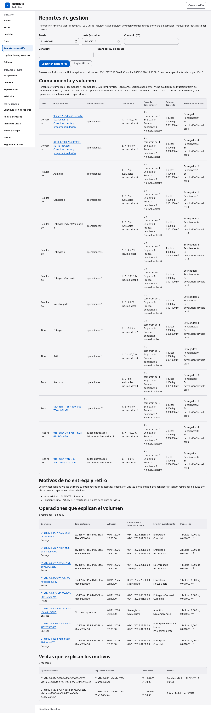 | 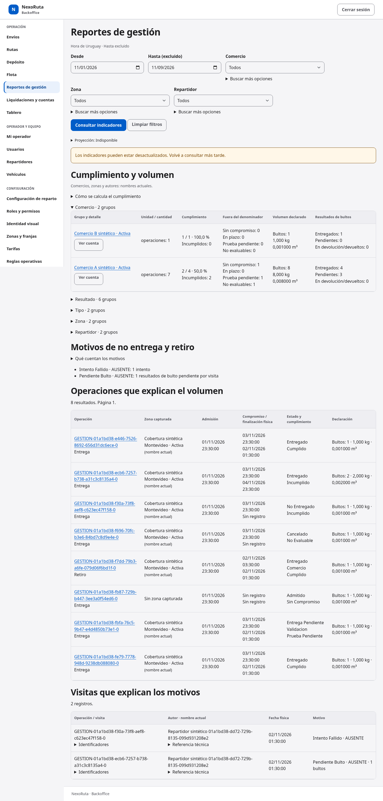 |
| Reporte, 320 px | 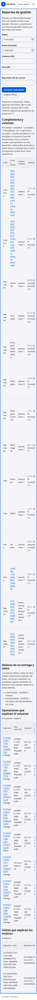 | 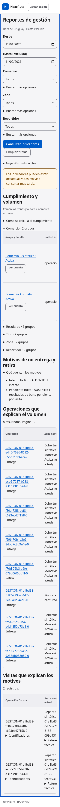 |
| Cuenta Backoffice, escritorio | 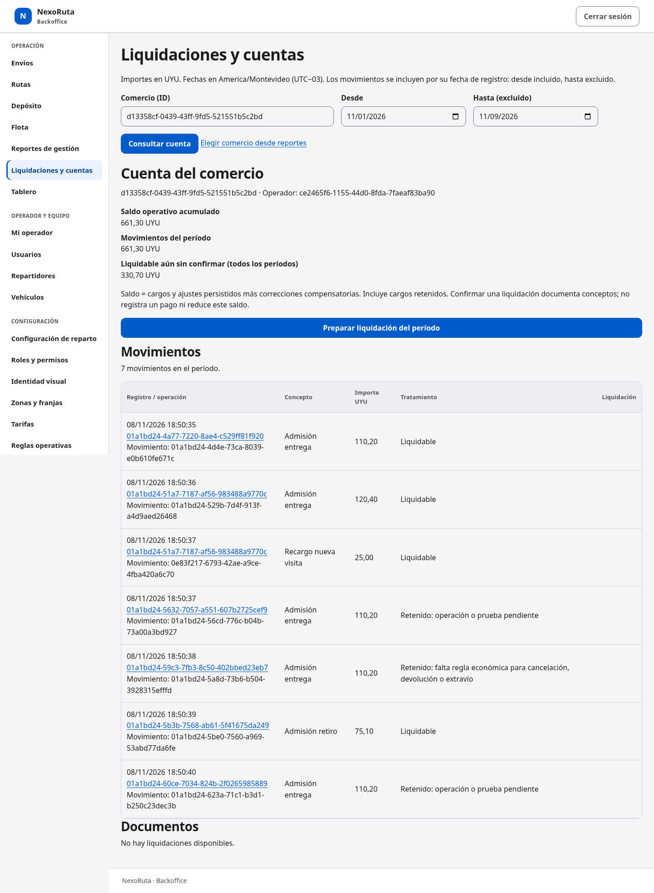 | 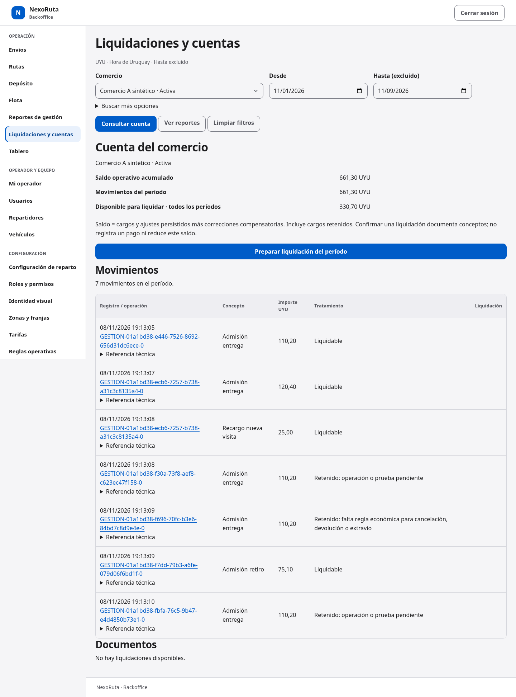 |
| Cuenta Backoffice, 320 px | 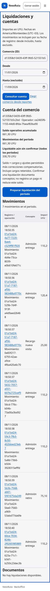 | 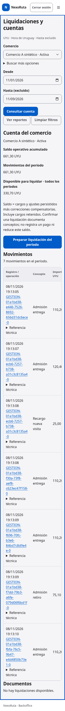 |
| Detalle, escritorio | 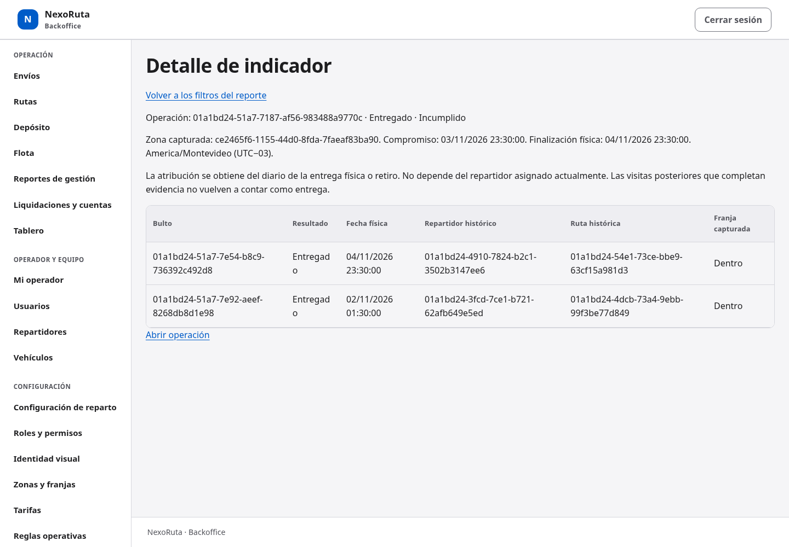 | 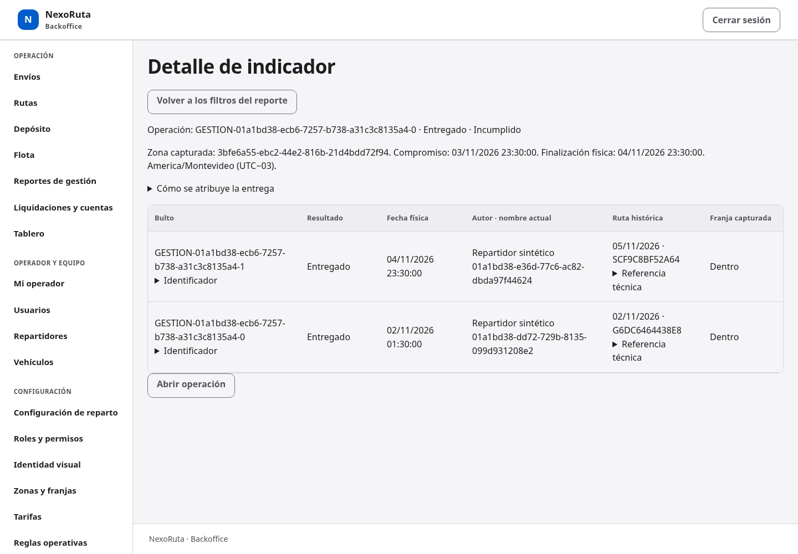 |
| Cuenta Commerce, 320 px | 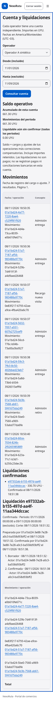 | 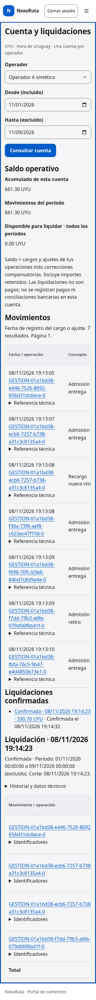 |
| Webhooks vacío | 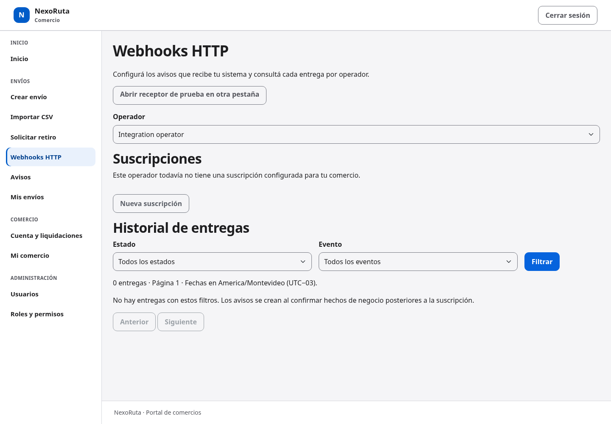 | 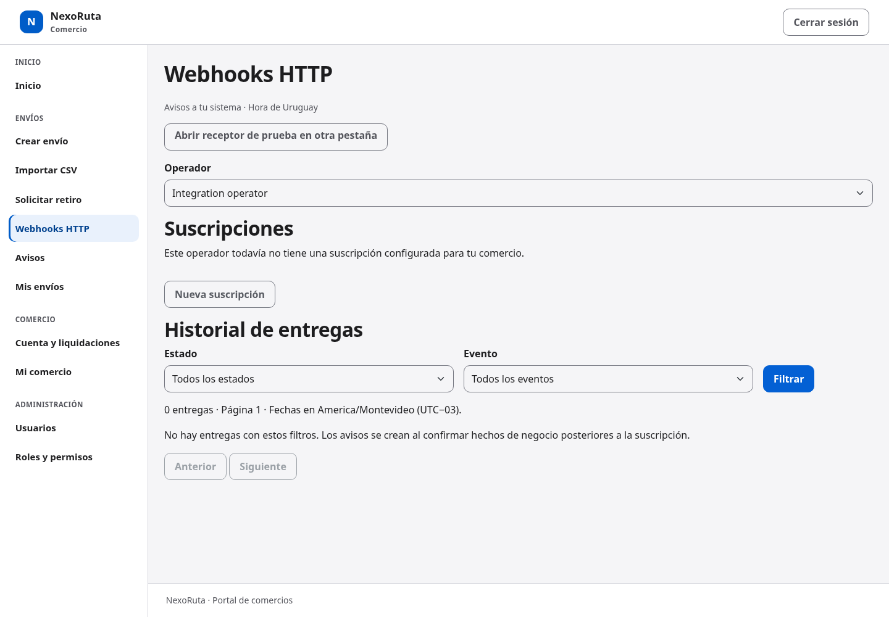 |
| Historial de webhooks | 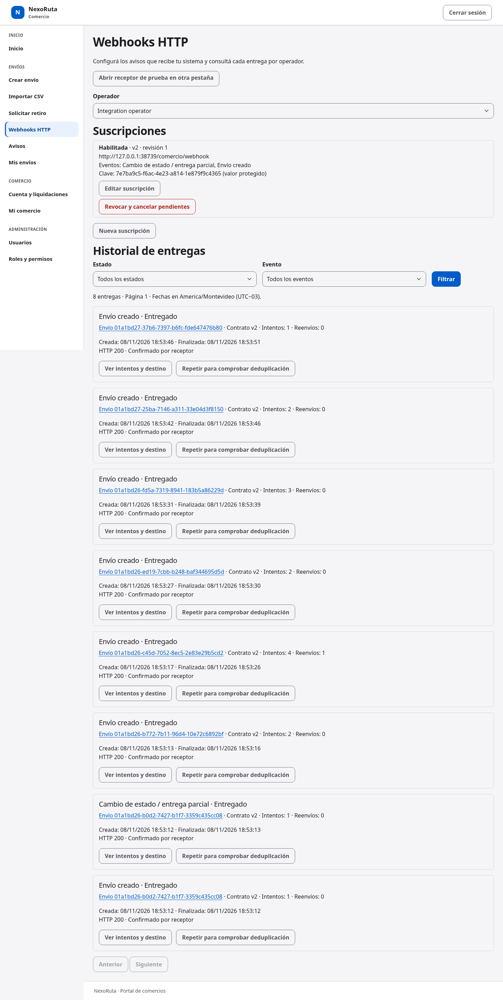 | 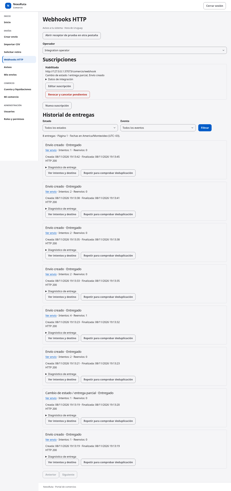 |
| Receptor vacío | 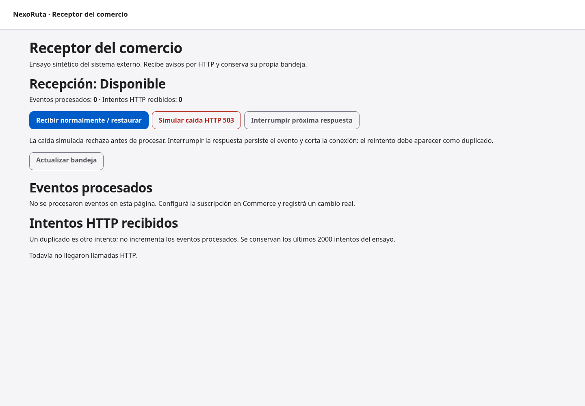 | 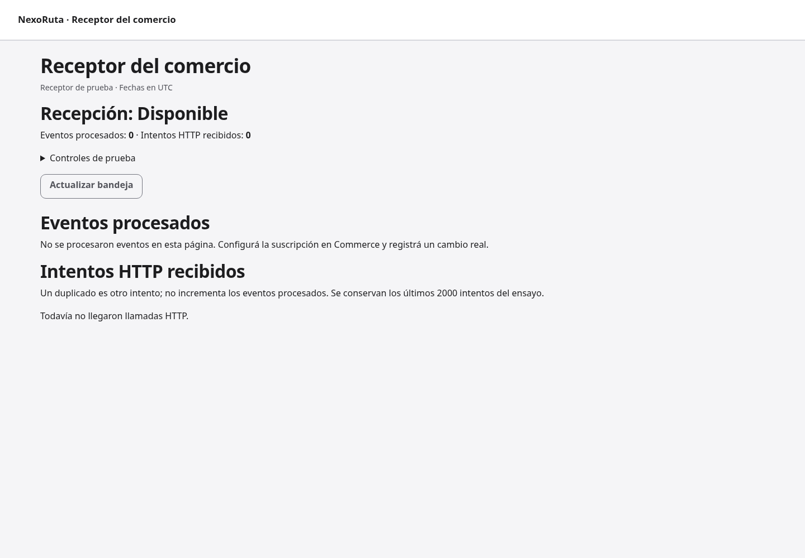 |
| Receptor, 320 px | 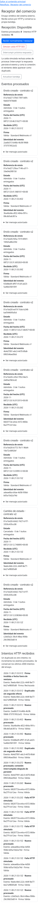 | 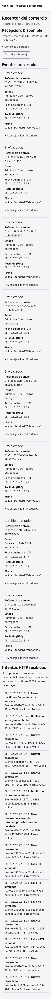 |

El zoom nativo de Chromium se comprueba por separado en las imágenes `zoom-nativo-*-200.png`: ventana de 1440 px con viewport CSS de 720 px, pixel ratio 2 y nivel de zoom 2. Las capturas son del viewport real; el resto de la página se conserva por desplazamiento vertical.
