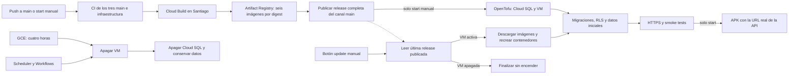

# NexoRuta: entorno de pruebas en Google Cloud

Despliegue integral mediante OpenTofu y GitHub Actions. La aplicación se utiliza
en sesiones de cuatro horas, con hasta cinco usuarios simultáneos, y conserva sus
datos entre sesiones. Ver [requisitos y decisiones](requirements.md) y
[costos de Santiago y escenarios de uso](costs.md).
La lista completa de **variables y secrets de GitHub por environment** está en
[github-environment.md](github-environment.md).
El [proyecto de demo creado con la CLI](project.md) es
`nexoruta-demo-20261022` (número `1090571196455`).

## Región y capacidad

Los servicios de aplicación, Cloud SQL, imágenes, builds, secretos y almacenamiento
se definen en **Santiago, `southamerica-west1`**. La VM usa `southamerica-west1-a`.
Al preparar este cambio se midieron ocho peticiones HTTPS con conexión reutilizada
por región desde este equipo a los endpoints oficiales de gcping: mediana de
**41,85 ms a Santiago y 58,35 ms a São Paulo**. Es una comparación puntual de red,
no una medición de la aplicación ni un compromiso de latencia.

La VM es **`c4-highcpu-8`: 8 vCPU y 16 GiB**. C3 no está disponible en Santiago.
C4 mantiene los 16 GiB solicitados y prioriza CPU. Usa discos Hyperdisk Balanced
de 20 GiB para arranque y 80 GiB para datos, con 3000 IOPS y 140 MiB/s por disco.
C4 no admite Persistent Disk: no cambiar estos discos a `pd-balanced`.
Cloud SQL es PostgreSQL 18 Enterprise, 2 vCPU y 8 GiB, 20 GiB SSD, sin HA,
solo IP privada, backups y recuperación puntual. Su memoria es independiente.

**Excepción de ubicación:** Cloud Scheduler no está disponible en Santiago.
El temporizador de control se crea en São Paulo e invoca Workflows en Santiago.
No interviene en el tráfico de los usuarios. Firebase/IAM son servicios globales.

## Qué define cada directorio

- `bootstrap/`: APIs, estado GCS, Artifact Registry, buckets de delivery, secretos,
  cuentas de servicio e IAM, WIF de GitHub, Firebase/Android, alertas de presupuesto,
  controlador de apagado y Cloud Scheduler.
- `demo/`: red, subred, SSH por IAP, puertos públicos 80/443, VM, IP estática,
  Hyperdisks, conexión privada a Cloud SQL, base, administrador de migraciones,
  claves/contraseñas generadas y DNS opcional.
- `deploy/gcp/` en la raíz del repo: imagen .NET común,
  Compose de despliegue, proxy Caddy y comprobaciones SQL.
- `scripts/gcp/`: bootstrap PowerShell, selección de commits, build, despliegue,
  verificación de sesiones y pruebas.



## Herramientas de terminal

Se necesitan Git, Python 3.10+, **OpenTofu 1.13.1**, Google Cloud CLI, GitHub CLI y
OpenSSH. PowerShell es suficiente en Windows; WSL no es un requisito del despliegue.
Docker y .NET son opcionales para operar desde tu PC: GitHub ejecuta las pruebas,
Cloud Build compila las imágenes y la VM instala Docker/Compose automáticamente.

```powershell
winget install --exact --id Google.CloudSDK
winget install --exact --id OpenTofu.Tofu --version 1.13.1
winget install --exact --id GitHub.cli
```

Refrescar el PATH en la terminal actual si se instalaron después de abrirla:

```powershell
$env:Path = [Environment]::GetEnvironmentVariable('Path','Machine') + ';' + [Environment]::GetEnvironmentVariable('Path','User')
git --version
python --version
gcloud version
tofu version
gh --version
ssh -V
```

## Bootstrap y autenticación

Usar un proyecto dedicado con facturación activa. La identidad de preparación
necesita habilitar APIs y administrar recursos de Compute, SQL, IAM/WIF, Storage,
Firebase, Workflows, Scheduler y, si se crea la alerta, presupuestos de facturación.
El consentimiento OAuth y la activación inicial de facturación pueden requerir
el navegador. GitHub usa WIF y tokens temporales, sin claves JSON de servicio.

```powershell
gcloud auth login
gcloud auth application-default login
gh auth login --web
gcloud projects list
gcloud billing accounts list

# Selecciona un proyecto existente; también se puede pasar -ProjectId explícito.
./scripts/gcp/setup.ps1
```

`setup.ps1` obtiene los IDs inmutables de GitHub, verifica facturación, genera la
configuración local, muestra y aplica el plan de bootstrap, migra su estado a
GCS y configura el environment/variables de GitHub. La cuenta de GitHub debe poder
administrar el repo madre. La alerta es USD 80/mes **antes de créditos**, con
umbrales de 50 %, 80 % y 100 %; es una alerta, no un límite de gasto. Si la cuenta
no permite crearla, usar `-SkipBudget` y configurar el presupuesto con su administrador.

El estado y los planes contienen contraseñas generadas. No publicarlos ni subirlos
como artifacts. Los buckets son privados, con acceso IAM limitado y versionado
para el estado. `backend.generated.tf`, `.tfvars*`, credenciales, planes y estados
locales están ignorados. Bootstrap y demo usan estados distintos en GCS.

En un proyecto con Firebase ya habilitado, importar la asociación existente si
OpenTofu informa que ya está registrada:

```powershell
tofu -chdir=infra/gcp/bootstrap import google_firebase_project.demo projects/ID_DEL_PROYECTO
```

Verificar cuota y disponibilidad de C4 de ocho vCPU antes del primer inicio:

```powershell
gcloud compute machine-types describe c4-highcpu-8 --zone=southamerica-west1-a
gcloud compute regions describe southamerica-west1 --format='json(quotas)'
```

## DNS, HTTPS y servicios externos

Sin dominio propio se generan nombres como `api.IP-CON-GUIONES.sslip.io`, con IP
estática y certificados públicos automáticos de Caddy. Es un servicio DNS externo
de demo y está sujeto a disponibilidad y límites de emisión de certificados.
Los seis hosts son `api`, `admin`, `backoffice`, `commerce`, `tracking` y `mail`.

Para un dominio propio:

```powershell
./scripts/gcp/setup.ps1 -ProjectId ID_DEL_PROYECTO -BaseDomain demo.ejemplo.uy -ManageDns
```

Tras el primer plan de demo, delegar el subdominio en los nameservers de Cloud DNS,
mostrados por `tofu output dns_name_servers`. Con `GCP_MANAGE_DNS=false`, crear
los registros en el proveedor existente apuntando a la IP estática. La emisión de
certificados necesita que esos nombres resuelvan y que 80/443 sean accesibles.

El bloque `x-app-settings` de `compose.yaml` configura las variables públicas de SMTP y Mapbox; el
environment `nexoruta-demo` de GitHub contiene las credenciales SMTP y Geoapify.
El runner combina ambas fuentes y las sincroniza al secreto privado
`nexoruta-demo-integrations` de GCP antes de iniciar o actualizar la demo. Usa Mailpit
inicialmente: los
correos se capturan en la demo, no se entregan a buzones externos.
Su interfaz HTTPS requiere usuario `demo` y la contraseña generada en el secreto
runtime. Para correo real, configurar un SMTP válido usando 587/465 según proveedor.

```powershell
# Configurar SMTP_HOST, SMTP_PORT, SMTP_SSL, SMTP_FROM y MAPBOX_PUBLIC_TOKEN en
# compose.yaml > x-app-settings. Solo los valores sensibles van en GitHub Secrets.
gh secret set SMTP_USERNAME --repo NexoRuta/NexoRuta --env nexoruta-demo
gh secret set SMTP_PASSWORD --repo NexoRuta/NexoRuta --env nexoruta-demo
gh secret set GEOAPIFY_API_KEY --repo NexoRuta/NexoRuta --env nexoruta-demo
```

Geoapify y Mapbox requieren cuentas/keys reales para probar sus integraciones.
Sus cobros no están cubiertos por el crédito de GCP. Firebase/FCM usa el proyecto
de demo y la identidad adjunta a la VM; el APK incorpora la configuración Android
generada en bootstrap, el token público Mapbox y la URL HTTPS de la API.
El APK usa una keystore de demo persistente en Secret Manager y un código de
versión creciente, para poder actualizarlo entre sesiones sin cambiar de firma.
No se suben la keystore ni su contraseña como artifacts.

## CI/CD entre los cuatro repositorios

El repo madre permanece en `main`; las fuentes de demo son lo último de `main` de
backend, frontend y mobile. El inicio manual resuelve los tres SHAs; CI prueba
esos commits y Cloud Build
construye esos mismos commits. La release registra SHAs, build ID, checksum del
bundle e imágenes fijadas por digest. No se construye código en la VM.

`.github/workflows/ci.yml` valida OpenTofu, workflows, Compose y scripts; compila y
prueba backend/frontend y las cuatro capas portables móviles. También ejecuta la
cadena de migraciones contra PostGIS con un administrador **sin superusuario**,
para detectar supuestos incompatibles con Cloud SQL antes del despliegue. Ese
escenario aproxima sus permisos y no sustituye probar el servicio administrado.

Los workflows `release.yml` de backend/frontend/mobile notifican al repo madre en
pushes a `main`. Reemplazan el despliegue anterior por SSH a una VPS ajena
a esta infraestructura. Requieren un token dedicado con permiso para enviar
`repository_dispatch` al repo madre:

```powershell
# gh solicita el valor de forma interactiva; no poner el token en argumentos.
gh secret set NEXORUTA_INTEGRATION_TOKEN --repo NexoRuta/NexoRuta-Backend --env nexoruta-demo
gh secret set NEXORUTA_INTEGRATION_TOKEN --repo NexoRuta/NexoRuta-Frontend --env nexoruta-demo
gh secret set NEXORUTA_INTEGRATION_TOKEN --repo NexoRuta/NexoRuta-Mobile --env nexoruta-demo
```

El token debe tener acceso al repo madre y el permiso requerido por GitHub para
repository dispatch (Contents: write). Si los submódulos son privados, configurar
además `SUBMODULES_TOKEN` de solo lectura sobre los tres repos en el environment
`nexoruta-demo` del repo madre. Crear ese environment también en cada componente
para su token de notificación. Ver [lista de configuración](github-environment.md).
El `GITHUB_TOKEN` de un repo no obtiene acceso a otros repos privados por sí solo.
Los cambios deben publicarse en **cada repo**, y los workflows del madre en `main`.

Un push a `main` prueba y publica una release nueva. **No inicia la VM ni actualiza
una demo activa.** Iniciar, actualizar y apagar requieren `workflow_dispatch`;
el script también rechaza operaciones de VM originadas en eventos automáticos.

En GitHub: **Actions → NexoRuta - publish images / manual VM controls → Run workflow**,
con branch `main`, y elegir una operación:

| Operación | Comportamiento |
| --- | --- |
| `start` | Obtiene lo último de los tres `main`, ejecuta CI, construye/publica imágenes e inicia una sesión de cuatro horas con esa release. |
| `update` | Lee la última release completa publicada de `main`, descarga imágenes del registry y recrea los contenedores. No compila ni inicia la VM; conserva el vencimiento. |
| `stop` | Apaga VM y Cloud SQL, conservando datos. |

El canal `main` se registra en `channels/main.json` del bucket privado de delivery
solo después de publicar las seis imágenes y los assets de la release. `update`
lee ese puntero una sola vez y valida el manifiesto: así todas las apps usan una
misma release por digest, aunque se publique otra durante la descarga. No mezcla
tags `latest` de distintos builds. Si una publicación está fallando o en curso,
se usa la última completa; esperar a que termine el workflow de publicación para
actualizar a ese cambio. Una VM apagada termina `update` sin ejecutar despliegue.
El update incluye backup, migraciones y comprobaciones de salud; también reinicia
las apps si la release seleccionada ya era la instalada.

Los cambios de infraestructura se aplican al iniciar la siguiente sesión.
Las comprobaciones CI sobre PRs no reciben credenciales GCP ni despliegan recursos.

## Operación habitual desde PowerShell

```powershell
# Tomar los tres main, probar, construir, activar SQL/VM, desplegar y generar APK.
gh workflow run demo-vm.yml --repo NexoRuta/NexoRuta --ref main -f operation=start

# Descargar la última release publicada y recrear las apps de una demo activa.
gh workflow run demo-vm.yml --repo NexoRuta/NexoRuta --ref main -f operation=update

# Apagar antes de las cuatro horas, tanto VM como base de datos.
gh workflow run demo-vm.yml --repo NexoRuta/NexoRuta --ref main -f operation=stop

gh run list --repo NexoRuta/NexoRuta --workflow demo-vm.yml
gh run watch ID_EJECUCION --repo NexoRuta/NexoRuta
gh run download ID_EJECUCION --repo NexoRuta/NexoRuta --name nexoruta-demo-android
```

El resumen muestra las URLs y el vencimiento. La VM instala Docker, monta el disco
persistente y conserva tanto Docker como containerd y los volúmenes. El despliegue
crea un backup SQL, prepara permisos de migración, aplica migraciones, aprovisiona
logins runtime sin `cloudsqlsuperuser`/`BYPASSRLS`, importa el catálogo de Uruguay,
crea cuentas/organizaciones iniciales y levanta todos los servicios.

Tras los healthchecks internos se comprueba HTTPS de las cinco apps y, en el primer
despliegue, login real contra la base. Los datos y contraseñas posteriores no se
reinician. Las cuentas iniciales son `admin@nexoruta.test`, `operador@nexoruta.test`
y `comercio@nexoruta.test`; sus contraseñas están en el secreto runtime, no en el repo.
Un fallo intenta restaurar los contenedores de la release anterior. **No revierte
migraciones automáticamente**: usar el backup y una operación administrativa
explícita si un cambio de esquema impide volver al código anterior.

## Plazo y costos residuales

Las cuatro horas comienzan al entrar la VM en RUNNING e incluyen instalación,
despliegue y pruebas. GCE tiene `max_run_duration=14400`, `STOP` y reinicio automático
deshabilitado. GitHub no queda ejecutándose durante cuatro horas. Otro `start`
con la VM ya encendida falla sin reiniciar ni extender el plazo.

Antes de provisionar se escribe una lease con un máximo de 30 minutos de gracia
para preparar SQL/VM. Al arrancar se registra su vencimiento real. Workflows
comprueba cada minuto si la VM se apagó o venció la lease y ordena detener Cloud
SQL. Si el runner falla antes de crear la VM, también cierra la base tras esa
gracia. Las transiciones de GCE y el apagado de SQL pueden agregar algunos minutos
de facturación. Las operaciones usan concurrency en GitHub y bloqueo del estado.

Apagar conserva discos, IP, backups, secretos e imágenes: esos recursos siguen
cobrando. Los precios anteriores de Iowa no corresponden a Santiago ni a C4.
El crédito de USD 300 dura 90 días desde el alta y se comparte con otros consumos
de la cuenta. La alerta de USD 80/mes deja margen para un proyecto de hasta tres
meses; monitorear también builds y almacenamiento. Las alertas no suspenden gasto.
Al cerrar el proyecto, exportar datos y retirar explícitamente las protecciones
de SQL/discos/bucket antes de `tofu destroy`; el cierre es una operación separada.

## Diagnóstico y validación

```powershell
gcloud compute instances describe nexoruta-demo --zone=southamerica-west1-a --format='json(status,scheduling,resourceStatus.scheduling,machineType)'
gcloud sql instances describe nexoruta-demo-db --format='json(state,settings.activationPolicy,settings.tier)'
gcloud compute ssh nexoruta-demo --zone=southamerica-west1-a --tunnel-through-iap
```

Dentro de la VM: `sudo docker stats --no-stream`, `free -h`,
`sudo journalctl -u google-startup-scripts.service` y
`sudo cat /var/log/nexoruta-bootstrap.log`. Los logs de deployment se guardan
privadamente en `/srv/nexoruta/logs/`; los archivos `.env` no se imprimen en Actions.
La identidad humana necesita OS Admin Login, acceso IAP y permiso actAs sobre la
cuenta runtime. El deployer de GitHub ya recibe esos permisos para ejecutar el
despliegue por IAP sin publicar el puerto SSH.

```powershell
python -m unittest discover -s scripts/gcp -p 'test_*.py' -v
tofu fmt -check -recursive infra/gcp
tofu -chdir=infra/gcp/bootstrap init -backend=false
tofu -chdir=infra/gcp/bootstrap validate
tofu -chdir=infra/gcp/demo init -backend=false
tofu -chdir=infra/gcp/demo validate
python scripts/gcp/validate_compose.py # necesita Docker CLI/Compose, no daemon
```

Referencias: [regiones](https://docs.cloud.google.com/compute/docs/regions-zones),
[gcping](https://github.com/GoogleCloudPlatform/gcping),
[C4 y discos admitidos](https://docs.cloud.google.com/compute/docs/general-purpose-machines),
[ubicaciones de Scheduler](https://docs.cloud.google.com/scheduler/docs/locations),
[límite nativo](https://docs.cloud.google.com/compute/docs/instances/limit-vm-runtime),
[restricciones de Cloud SQL](https://docs.cloud.google.com/sql/docs/postgres/users),
[WIF](https://github.com/google-github-actions/auth).
