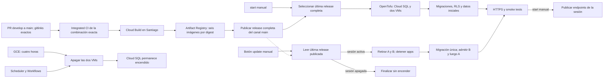

# NexoRuta: entorno de pruebas en Google Cloud

Despliegue integral mediante OpenTofu y GitHub Actions. La aplicación se utiliza
en sesiones de cuatro horas, con hasta cinco usuarios simultáneos, y conserva sus
datos entre sesiones. Ver [requisitos y decisiones](requirements.md) y
[costos de Santiago y escenarios de uso](costs.md).
La lista completa de **variables y secrets de GitHub por environment** está en
[github-environment.md](github-environment.md).
Para operar la demo desde Actions, seguí la [guía rápida de despliegue](guia-uso-actions.md).
Cada publicación queda identificada por un [tag de integración inmutable](integration-tags.md)
del repo madre, con los tres commits probados de los componentes. Se publica una
GitHub prerelease después de construir sus imágenes; no se crean PRs ni commits
automáticos sobre ramas.
El [proyecto de demo creado con la CLI](project.md) es
`nexoruta-demo-20261022` (número `1090571196455`).

## Región y capacidad

Los servicios de aplicación, Cloud SQL, imágenes, builds, secretos y almacenamiento
se definen en **Santiago, `southamerica-west1`**. Las VMs usan las zonas
`southamerica-west1-a` y `southamerica-west1-b`.
Al preparar este cambio se midieron ocho peticiones HTTPS con conexión reutilizada
por región desde este equipo a los endpoints oficiales de gcping: mediana de
**41,85 ms a Santiago y 58,35 ms a São Paulo**. Es una comparación puntual de red,
no una medición de la aplicación ni un compromiso de latencia.

La cuota global disponible es de 12 vCPU. Para conservar dos nodos dentro de ella,
cada VM usa `n4-custom-6-16384` (6 vCPU y 16 GiB); cada nodo conserva un disco
Hyperdisk Balanced de 80 GiB. La VM A conserva su disco y datos. La entrada pública
usa un Application Load Balancer global con IP fija; los nombres `*.IP.sslip.io`
apuntan a esa dirección. N4 no admite Persistent Disk: no cambiar estos discos a
`pd-balanced`.
Cloud SQL es PostgreSQL 18 Enterprise `db-g1-small`, 20 GiB SSD, sin HA,
con IP privada y siempre encendido. La demo no tiene backups ni recuperación puntual.

**Excepción de ubicación:** Cloud Scheduler no está disponible en Santiago.
El temporizador de control se crea en São Paulo e invoca Workflows en Santiago.
No interviene en el tráfico de los usuarios. Firebase/IAM son servicios globales.

## Qué define cada directorio

- `bootstrap/`: APIs, estado GCS, Artifact Registry, buckets de delivery, secretos,
  cuentas de servicio e IAM, WIF de GitHub, Firebase/Android, alertas de presupuesto,
  controlador de apagado y Cloud Scheduler.
- `demo/`: red, subred, SSH por IAP, VMs A/B, Application Load Balancer e IP global,
  Hyperdisks, conexión privada a Cloud SQL, base, administrador de migraciones,
  claves/contraseñas generadas y DNS opcional.
- `reproduction-project/`: módulo externo de creación/borrado controlado del
  proyecto descartable NFR-14; su estado vive en el bucket de control externo.
- `deploy/gcp/` en la raíz del repo: imagen .NET común,
  Compose de despliegue, proxy Caddy y comprobaciones SQL.
- `scripts/gcp/`: bootstrap PowerShell, selección de commits, build, despliegue,
  recreación/verificación NFR-14, sesiones y pruebas.



## Herramientas de terminal

Se necesitan Git, Python 3.10+, **OpenTofu 1.13.1**, Google Cloud CLI, GitHub CLI y
OpenSSH para operar desde una terminal. PowerShell o WSL sirven para estas tareas.
El despliegue remoto ejecuta CI en GitHub, construye imágenes en Cloud Build e
instala Docker/Compose en las VMs. Para validación local, `validate_compose.py`
necesita Docker CLI/Compose, pero no un daemon; las pruebas backend de integración
con Testcontainers sí necesitan un daemon Docker accesible. No se usa `.env` del
equipo como fuente de configuración de GitHub Actions.

```powershell
winget install --exact --id Google.CloudSDK
winget install --exact --id OpenTofu.Tofu --version 1.13.1
winget install --exact --id GitHub.cli
```

Refrescar el PATH en la terminal actual si se instalaron después de abrirla:

```powershell
$env:Path = [Environment]::GetEnvironmentVariable('Path','Machine') + ';' + [Environment]::GetEnvironmentVariable('Path','User')
git --version
python --version
gcloud version
tofu version
gh --version
ssh -V
```

## Bootstrap y autenticación

Usar un proyecto dedicado con facturación activa. La identidad de preparación
necesita habilitar APIs y administrar recursos de Compute, SQL, IAM/WIF, Storage,
Firebase, Workflows, Scheduler y, si se crea la alerta, presupuestos de facturación.
El consentimiento OAuth y la activación inicial de facturación pueden requerir
el navegador. GitHub usa WIF y tokens temporales, sin claves JSON de servicio.

```powershell
gcloud auth login
gcloud auth application-default login
gh auth login --web
gcloud projects list
gcloud billing accounts list

# Especifica el proyecto dedicado; también se puede ingresar cuando se solicite.
./scripts/gcp/setup.ps1 -ProjectId ID_DEL_PROYECTO
```

`setup.ps1` delega el primer bootstrap a `bootstrap_setup.py`. Antes de inicializar
OpenTofu, verifica el ID y número del proyecto explícito, el dueño/región del bucket
GCS, los IDs inmutables del repositorio/owner de GitHub, la facturación activa y la
capacidad `n4-custom-6-16384` en ambas zonas con al menos 12 vCPU regionales libres.
No cambia el proyecto global de gcloud. Los inputs y planes transitorios quedan en
un directorio privado y el plan rechaza cualquier delete/replacement. Un 403 o fallo
de red no se interpreta como estado ausente; un bucket existente sin estado remoto
no se adopta. Solo migra un estado local cuya identidad y propiedad del bucket
coinciden con el destino explícito.

El entorno creado es `nexoruta-demo`. La alerta es USD 80/mes **antes de créditos**, con
umbrales de 50 %, 80 % y 100 %; es una alerta, no un límite de gasto. Si la cuenta
no permite crearla, usar `-SkipBudget` y configurar el presupuesto con su administrador.

GitHub Actions usa WIF con el sujeto inmutable basado en IDs de repo/owner y
`nexoruta-demo`. El código actual del bootstrap acepta ese formato exacto. La
observación remota del 14/11/2026 encontró que el provider todavía aceptaba,
además, el sujeto anterior basado en nombre; ese cambio de bootstrap no se ha
aplicado en GCP. Consultar la [evidencia OIDC](../../docs/auditorias/nfr-14/evidencia/oidc-profile-2026-11-14.json)
y verificar el provider live antes de operar. Si falla WIF, no agregar subjects
comodín ni reactivar el formato antiguo; corregir la condición con una identidad
administrativa y revisar el plan exacto.

La cuenta de ejecución `nexoruta-demo-deployer` conserva actualmente
`roles/owner` y otros roles de proyecto en el módulo compartido. Es un riesgo
conocido, no una declaración de mínimo privilegio. La identidad que prepara
proyectos de ensayo y administra billing debe ser distinta; este bootstrap no
le concede permisos de organización ni de cuenta de facturación.

El estado y los planes contienen contraseñas generadas. No publicarlos ni subirlos
como artifacts. Los buckets son privados, con acceso IAM limitado y versionado
para el estado. `backend.generated.tf`, `.tfvars*`, credenciales, planes y estados
locales están ignorados. Bootstrap y demo usan estados distintos en GCS.

En un proyecto con Firebase ya habilitado, importar la asociación existente si
OpenTofu informa que ya está registrada:

```powershell
tofu -chdir=infra/gcp/bootstrap import google_firebase_project.demo projects/ID_DEL_PROYECTO
```

Verificar cuota y disponibilidad de N4 custom en ambas zonas:

```powershell
gcloud compute machine-types describe n4-custom-6-16384 --zone=southamerica-west1-a
gcloud compute machine-types describe n4-custom-6-16384 --zone=southamerica-west1-b
gcloud compute regions describe southamerica-west1 --format='json(quotas)'
```

## DNS, HTTPS y servicios externos

Sin dominio propio se usan nombres `*.IP-CON-GUIONES.sslip.io` que apuntan a la IP
global fija del Application Load Balancer. Google termina HTTPS con un certificado
gestionado y redirige HTTP a HTTPS. Es un servicio DNS externo de demo. Los hosts
son `api`, `admin`, `backoffice`, `commerce`, `tracking`, `monitor` y `mail`;
`mail` continúa disponible solo a través del nodo A.

Para un dominio propio:

```powershell
./scripts/gcp/setup.ps1 -ProjectId ID_DEL_PROYECTO -BaseDomain demo.ejemplo.uy -ManageDns
```

Tras el primer plan de demo, delegar el subdominio en los nameservers de Cloud DNS,
mostrados por `tofu output dns_name_servers`. Con `GCP_MANAGE_DNS=false`, crear
los registros en el proveedor existente apuntando a la IP estática. La emisión de
certificados necesita que esos nombres resuelvan y que 80/443 sean accesibles.

El bloque `x-app-settings` de `compose.yaml` configura las variables públicas de
SMTP y Mapbox. El runner combina esos valores con los secretos SMTP/Geoapify si
están configurados y sincroniza la integración al secreto privado
`nexoruta-demo-integrations` de GCP antes de iniciar o actualizar la demo. La
inspección de nombres del Environment del 14/11/2026 no encontró secretos SMTP ni
Geoapify configurados; no se leyeron valores secretos. Mailpit es el destino
inicial: los correos se capturan en la demo y no se envían a buzones externos.
Su interfaz HTTPS requiere usuario `demo` y la contraseña generada en el secreto
runtime. Para correo real, configurar un SMTP válido usando 587/465 según proveedor.

```powershell
# Configurar SMTP_HOST, SMTP_PORT, SMTP_SSL y SMTP_FROM en compose.yaml > x-app-settings.
gh secret set SMTP_USERNAME --repo NexoRuta/NexoRuta --env nexoruta-demo
gh secret set SMTP_PASSWORD --repo NexoRuta/NexoRuta --env nexoruta-demo
gh secret set GEOAPIFY_API_KEY --repo NexoRuta/NexoRuta --env nexoruta-demo
gh secret set MAPBOX_COMMERCE_PUBLIC_TOKEN --repo NexoRuta/NexoRuta --env nexoruta-demo
gh secret set MAPBOX_GEOCODING_TOKEN --repo NexoRuta/NexoRuta --env nexoruta-demo
```

Geoapify y Mapbox requieren cuentas/keys reales para probar sus integraciones.
Sus cobros no están cubiertos por el crédito de GCP. Firebase/FCM usa el proyecto
de demo y la identidad adjunta a la VM; el APK incorpora la configuración Android
generada en bootstrap, el token público Mapbox y la URL HTTPS de la API.
El APK usa una keystore de demo persistente en Secret Manager y un código de
versión creciente, para poder actualizarlo entre sesiones sin cambiar de firma.
No se suben la keystore ni su contraseña como artifacts.

### Receptor de webhooks del comercio

En GCP, **Comercio → Webhooks HTTP → Abrir receptor de prueba en otra pestaña**
abre `https://tracking.<dominio>/comercio`. El destino de una suscripción
educativa es `https://tracking.<dominio>/comercio/webhook`. Tracking corre en
`Production`. El balanceador envía ambas rutas al nodo A, donde un volumen
persistente guarda el historial y los modos de prueba del receptor.

El workflow **Start** aplica las reglas del balanceador y genera las credenciales
en `nexoruta-demo-runtime`. Los campos son `passwords.commerce_receiver` para
ingresar a los controles y `keys.commerce_receiver` para firmar la suscripción
con el prefijo `whsec_`. Ambas se consultan en Secret Manager. Probá el
recorrido con un dato sintético y verificá que el envío figure como entregado
en Comercio y recibido en el historial del receptor.

## CI/CD entre los cuatro repositorios

El root fija por gitlink los SHAs de backend, frontend y mobile. La PR del root
prueba esa combinación; después del merge, `publish.yml` planifica imágenes desde
los mismos gitlinks sin volver a ejecutar tests. Cloud Build hace checkout del tag
integrado. La release registra el tag, los SHAs, build ID, checksum del bundle e
imágenes fijadas por digest. No se construye código en la VM.

`.github/workflows/ci.yml` valida OpenTofu, workflows, Compose y scripts; compila y
prueba backend/frontend y las cuatro capas portables móviles. También ejecuta la
cadena de migraciones contra PostGIS con un administrador **sin superusuario**,
para detectar supuestos incompatibles con Cloud SQL antes del despliegue. Ese
escenario aproxima sus permisos y no sustituye probar el servicio administrado.

Si los submódulos son privados, configurar `SUBMODULES_TOKEN` de solo lectura
sobre los tres repos en los environments `nexoruta-demo` y `nexoruta-ci` del repo madre. Ver
[lista de configuración](github-environment.md). El `GITHUB_TOKEN` de un repo no
obtiene acceso a otros repos privados por sí solo.

Las PRs a `develop` o `main` ejecutan el CI antes de integrar. Solo se aceptan PRs
de `develop` a `main`; su merge dispara la publicación, sin repetir las pruebas.
**No inicia la VM ni actualiza una demo activa.** Iniciar, actualizar y apagar requieren `workflow_dispatch`;
el script también rechaza operaciones de VM originadas en eventos automáticos.

En GitHub: **Actions → NexoRuta - publish integration images → Run workflow**,
con branch `main`, y elegir una operación:

| Operación | Comportamiento |
| --- | --- |
| `start` | Selecciona la última release completa ya publicada e inicia dos VMs por cuatro horas con esas imágenes. No ejecuta CI ni construye imágenes. |
| `update` | Lee la última release completa publicada de `main`; retira ambos nodos, detiene apps, migra una vez y admite B/A. Hay corte. No compila ni enciende VMs detenidas; conserva el vencimiento. |
| `stop` | Apaga las dos VMs y conserva Cloud SQL encendido. |

El canal `main` se registra en `channels/main.json` del bucket privado de delivery
solo después de publicar las seis imágenes y los assets de la release. `start` y `update`
leen ese puntero una sola vez y validan el manifiesto: así todas las apps usan una
misma release por digest, aunque se publique otra durante la descarga. No mezcla
tags `latest` de distintos builds. Si una publicación está fallando o en curso,
se usa la última completa; esperar a que termine el workflow de publicación para
actualizar a ese cambio. Con ambas VMs apagadas, `update` termina sin ejecutarlo.
El update incluye migraciones y comprobaciones de salud; también reinicia
las apps si la release seleccionada ya era la instalada.

Los cambios de infraestructura de demo se aplican al iniciar la siguiente sesión.
Aplicar primero `infra/gcp/bootstrap` para actualizar el guard y evitar que apague SQL.
Las comprobaciones CI sobre PRs no reciben credenciales GCP ni despliegan recursos.
Al renombrar/separar workflows, aplicar primero `infra/gcp/bootstrap` para que
Workload Identity Federation autorice `publish.yml` y `vm-controls.yml`; el provider
no acepta el path anterior. Revisar el plan antes de aplicar.

## Operación habitual desde PowerShell

```powershell
# Activar SQL y dos VMs y desplegar la última release completa publicada.
gh workflow run vm-controls.yml --repo NexoRuta/NexoRuta --ref main -f operation=start

# Descargar la última release publicada y recrear las apps de una demo activa.
gh workflow run vm-controls.yml --repo NexoRuta/NexoRuta --ref main -f operation=update

# Apagar las dos VMs antes de las cuatro horas; SQL queda encendido.
gh workflow run vm-controls.yml --repo NexoRuta/NexoRuta --ref main -f operation=stop

gh run list --repo NexoRuta/NexoRuta --workflow vm-controls.yml
gh run watch ID_EJECUCION --repo NexoRuta/NexoRuta

# El APK de verificación se descarga desde una ejecución de Integrated CI,
# usando el SHA mobile mostrado por el resumen del plan.
gh run download ID_CI --repo NexoRuta/NexoRuta --name android-verification-SHA_MOBILE
```

El resumen muestra las URLs y el vencimiento. Cada VM instala Docker y conserva
su disco y volúmenes; los servicios persistentes (RabbitMQ, Kafka y MongoDB) viven
solo en A y B los consume por la red privada. El runtime usa Redis TLS/AUTH en un
contenedor del nodo B, accesible desde ambas VMs. La configuración IaC también
declara un `google_redis_instance.cache`; el inventario del 14/11/2026 observó
Memorystore Basic de 1 GiB `READY`, aunque el runtime no lo usa. Mantenerlo en el
inventario/costo y no retirarlo sin una decisión explícita. El despliegue prepara
permisos de migración, aplica migraciones, aprovisiona
logins runtime sin `cloudsqlsuperuser`/`BYPASSRLS`, importa el catálogo de Uruguay,
crea cuentas/organizaciones iniciales y levanta todos los servicios.

Tras los healthchecks internos se comprueba HTTPS de las cinco apps y el endpoint
de salud de `monitor`; también se verifica que Grafana y Mailpit exijan login. En cada
despliegue se prueba login real contra la base. Los datos y contraseñas posteriores no se
reinician. Las cuentas iniciales son `admin-demo@nexoruta.test` (contraseña `AdminPass123!`),
`operador@nexoruta.test` y `comercio@nexoruta.test` (contraseña `ChangeMe123!`).
Las cuentas del seed de la aplicación usan `ChangeMe123!` en este entorno de desarrollo.
Cada `update` tiene un corte deliberado: retira ambos nodos del balanceador,
detiene las apps, migra una vez y aplica la release objetivo, admitiendo B y luego
A. No es una rotación sin interrupción. Si falla una migración, las apps quedan
detenidas; si falla un nodo después, no se recuperan automáticamente
contenedores anteriores ni se revierten migraciones; corregir el código y
desplegar una release nueva. No hay recuperación mediante backups de la demo.

## Pruebas de carga remotas OPT-06

El workflow manual `.github/workflows/load-tests.yml` ejecuta k6 en un Cloud Run
Job de `southamerica-west1`, separado de las dos VMs. Primero se debe aplicar el
bootstrap actualizado y luego `infra/gcp/demo`, con ambas VMs apagadas para que
el tag de observabilidad de A pueda actualizarse sin interrumpir una sesión. El
workflow usa `GCP_LOAD_SERVICE_ACCOUNT`, con permisos de carga distintos del
deployer de VM. El Job usa una subred propia; su egress privado permite solo el
gateway de escritura de A por TCP 9091 y deniega los otros destinos RFC1918. El
gateway acepta `POST /api/v1/write` y `GET /-/ready`; no permite consultas al API
de Prometheus. La carga funcional entra por el HTTPS público del balanceador.

Antes de habilitar una corrida:

1. Publicar el dashboard `nexoruta-load-tests` con un `start` o `update` de la
   demo. Grafana muestra carga k6, errores, p95/p99 del cliente, p95 del API,
   respuestas de sincronización, CPU de las VMs, conexiones de Cloud SQL y el
   estado del gateway de métricas de A.
2. Confirmar que el environment `nexoruta-demo` tenga la variable
   `GCP_LOAD_PREPARER_SERVICE_ACCOUNT` generada por bootstrap. El workflow de
   carga reserva una lease de preparación por 30 minutos y usa esa identidad
   separada para crear o reanudar hasta 50 cuentas sintéticas mediante
   `POST /api/admin/demo-data/load-fixture`. El endpoint usa los casos de uso y
   repositorios de la aplicación, prepara jornadas activas con 50 posiciones
   aplicadas y devuelve sus IDs y payloads. No se usa SQL directo.
3. El preparador guarda primero las credenciales en una versión `preparing` de
   `nexoruta-load-fixtures`, crea un objeto de operaciones inmutable en el bucket
   privado y publica una versión `ready` con SHA-256. Si se interrumpe, la próxima
   corrida reusa las credenciales persistidas; no cambia contraseñas ya asignadas.
   El objeto admite hasta 4 MiB y el secreto queda bajo el límite de 64 KiB. La
   identidad preparadora solo accede a los secretos, fixtures y leases necesarios;
   ver el contrato en `tests/load/README.md`.
4. Iniciar las dos VMs con el workflow existente. La acción de carga valida la
   sesión y su plazo, que ambas ejecutan la misma release, salud HTTPS del API,
   backends A/B, workers y SQL. Si una condición falla, no envía carga.

En GitHub Actions elegir `NexoRuta - pruebas de carga`, operación `run` y uno de
estos perfiles:

| Perfil | Carga máxima | Ventana |
| --- | --- | --- |
| `smoke` | 1 VU | 2 min |
| `baseline` | 5 VUs | 15 min, lectura |
| `sync` | 20 VUs × 50 operaciones preaplicadas | 15 min |
| `stress` | hasta 50 VUs × 50 operaciones, 1/3/5/10 iteraciones/s | 25 min |
| `soak` | 5 VUs | 60 min |

Los logins se espacian para respetar el límite vigente por IP. Las operaciones
sync se reenvían una sola vez en la primera iteración de cada VU. Stress mantiene
la tasa de llegada en 1/3/5/10 iteraciones por segundo, con su dataset de sync
acotado. Las métricas se envían cada 5 s a Prometheus y se distinguen por
`run_id`. El runner consulta la lease durante la carga y detiene k6 si se cancela,
vence el plazo o deja de poder leer el control.
El workflow ofrece `cancel`; `stop` de VM solicita cancelación antes de apagar
los nodos, y el guard vuelve a intentar cancelar leases vencidas.

El resumen del workflow incluye Grafana, Cloud Run y la ruta de resultados
privados de GCS. Los resultados y leases expiran a los 30 días; los datasets
conservan versiones hasta su retiro deliberado. La identidad de Cloud Run solo
puede leer el secreto sintético y los eventos aprobados, escribir resultados y
leer el bucket separado de control. El firewall limita su egress privado a
Prometheus: no abre puertos hacia SQL, Redis, brokers ni otras VMs. Tampoco puede
leer el estado de OpenTofu ni otros secretos.

El workflow OIDC tiene su propia identidad `nexoruta-load-controller`; solo lee
los objetos `leases/demo.json` y `locks/demo-control.json` del bucket de estado,
no puede leer ni modificar objetos de OpenTofu. El acceso SSH por IAP y OS Login
se concede por instancia únicamente a A y B.
El Job no cambia el plazo de cuatro horas de las VMs. Cloud SQL conserva su
política existente y permanece encendido al detener la demo.

## Plazo y costos residuales

Las cuatro horas comienzan al entrar la primera VM en RUNNING e incluyen instalación,
despliegue y pruebas. GCE tiene `max_run_duration=14400`, `STOP` y reinicio automático
deshabilitado en ambos nodos. GitHub no queda ejecutándose durante cuatro horas.
Otro `start` con cualquiera de las VMs ya encendida falla sin reiniciar ni extender
el plazo.

Antes de provisionar se escribe una lease con un máximo de 30 minutos de gracia
para preparar SQL/VM. Al arrancar se registra su vencimiento real. Workflows
comprueba cada minuto si venció la lease y ordena detener las VMs. Cloud SQL
permanece encendido y se factura continuamente. Las operaciones usan concurrency
en GitHub y bloqueo del estado.

Redis en contenedor vive con la VM B y se detiene cuando B se apaga. Memorystore
Basic de 1 GiB es un recurso adicional declarado en IaC y observado `READY` en el
inventario del 14/11/2026; el runtime actual no lo usa. Tanto este recurso como
SQL, discos e IP pueden seguir generando costo al detener A/B. No retirar
Memorystore en esta operación: primero comprobar dependencias, estado IaC y costo.

Apagar conserva discos, IP, secretos, imágenes y servicios administrados: esos
recursos pueden seguir cobrando. La estimación antigua de [costs.md](costs.md)
describe una topología anterior y no se debe usar como costo actual. El presupuesto
USD 80/mes observado es una alerta antes de créditos, no un límite de gasto. El
consumo real, tarifa actual, créditos y plazo restante no están acreditados;
consultar [el estado de costos NFR-14](../../docs/auditorias/nfr-14/costos.md).

La baja definitiva de la demo persistente requiere exportar/verificar datos y
una decisión deliberada para cambiar las protecciones de SQL, discos y buckets.
Un `tofu plan -destroy` bloqueado por esas protecciones no es evidencia de
destrucción. La prueba de destrucción implementada para NFR-14 se dirige solo al
proyecto descartable y está documentada en el [runbook](../../docs/auditorias/nfr-14/runbook.md).

## Diagnóstico y validación

```powershell
gcloud compute instances describe nexoruta-demo --zone=southamerica-west1-a --format='json(status,scheduling,resourceStatus.scheduling,machineType)'
gcloud compute instances describe nexoruta-demo-b --zone=southamerica-west1-b --format='json(status,scheduling,resourceStatus.scheduling,machineType)'
gcloud compute backend-services get-health nexoruta-demo-api --global
gcloud sql instances describe nexoruta-demo-db --format='json(state,settings.activationPolicy,settings.tier)'
gcloud compute ssh nexoruta-demo --zone=southamerica-west1-a --tunnel-through-iap
```

Dentro de la VM: `sudo docker stats --no-stream`, `free -h`,
`sudo journalctl -u google-startup-scripts.service` y
`sudo cat /var/log/nexoruta-bootstrap.log`. Los logs de deployment se guardan
privadamente en `/srv/nexoruta/logs/`; los archivos `.env` no se imprimen en Actions.
La identidad humana necesita OS Admin Login, acceso IAP y permiso actAs sobre la
cuenta runtime. El deployer de GitHub ya recibe esos permisos para ejecutar el
despliegue por IAP sin publicar el puerto SSH.

Las conexiones SSH y SCP de los scripts registran la clave del runner con una
vigencia de una hora. Los workflows de VM y carga eliminan su propia clave en un
paso `always()`; si el runner desaparece antes, el vencimiento permite que OS Login
la retire automáticamente. No se guardan claves privadas SSH en GitHub Secrets.

Si un despliegue informa `Login profile size exceeds 32 KiB`, ejecutar
`vm-controls.yml` con `operation=repair-ssh` en la rama correspondiente. Esta
operación usa WIF con la identidad del deployer, comparte la cola de operaciones
de VM y elimina únicamente claves sin vencimiento de antiguos runners hospedados
(`runner@runnervm...` o `runner@fv-az...`). No inicia VMs ni modifica sesiones,
perfiles POSIX u otras claves. Después se puede reintentar `start` o `update`.
El bootstrap falla inmediatamente ante ese límite; los errores transitorios de
conexión conservan sus reintentos. Si el perfil está lleno por claves con otros
comentarios, revisarlas bajo la identidad afectada antes de retirar las que no
se utilicen; `repair-ssh` no las borra.

```powershell
python -m unittest discover -s scripts/gcp -p 'test_*.py' -v
tofu fmt -check -recursive infra/gcp
tofu -chdir=infra/gcp/bootstrap init -backend=false
tofu -chdir=infra/gcp/bootstrap validate
tofu -chdir=infra/gcp/demo init -backend=false
tofu -chdir=infra/gcp/demo validate
python scripts/gcp/validate_compose.py # necesita Docker CLI/Compose, no daemon
```

Referencias: [regiones](https://docs.cloud.google.com/compute/docs/regions-zones),
[gcping](https://github.com/GoogleCloudPlatform/gcping),
[N4 y discos admitidos](https://docs.cloud.google.com/compute/docs/general-purpose-machines),
[ubicaciones de Scheduler](https://docs.cloud.google.com/scheduler/docs/locations),
[límite nativo](https://docs.cloud.google.com/compute/docs/instances/limit-vm-runtime),
[restricciones de Cloud SQL](https://docs.cloud.google.com/sql/docs/postgres/users),
[WIF](https://github.com/google-github-actions/auth).

## Deploy directo desde develop para pruebas en GCP

Desde **Actions → NexoRuta - publish integration images**, seleccione la rama
`develop`. `start` o `update` comprueba el commit elegido y los tres SHAs fijados
por sus gitlinks, publica seis imágenes en `channels/develop.json` y después
despliega esa versión. Esta ruta no ejecuta Integrated CI ni crea una prerelease
de main. El manifiesto registra `root_sha`, `sources` y `source_ref`.

Los canales `main` y `develop` son punteros separados, pero comparten las mismas
VMs, Cloud SQL y datos. Las migraciones de `develop` cambian el esquema compartido
y pueden impedir volver a ejecutar una versión anterior de `main`. `start` y
`update` desde develop deben tratarse como operaciones sobre la demo compartida.

## Recreación y aceptación de NFR-14

El módulo `infra/gcp/reproduction-project`, `scripts/gcp/reproduce.py` y el
workflow manual `reproduce.yml` implementan un proyecto descartable, estado
separado, inventario externo, inspección, planes de creación/destrucción y
verificación automatizada. La identidad y el bucket de control permanecen fuera
del proyecto de demo y del descartable. Este camino no se ha ejecutado en GCP;
no se han creado ni limpiado proyectos de ensayo ni se ha lanzado la publicación
de la candidata en `main`. Consultar el [runbook](../../docs/auditorias/nfr-14/runbook.md)
y la [matriz de aceptación](../../docs/auditorias/nfr-14/aceptacion.md) para los
gates pendientes. La card permanece `In progress`.
