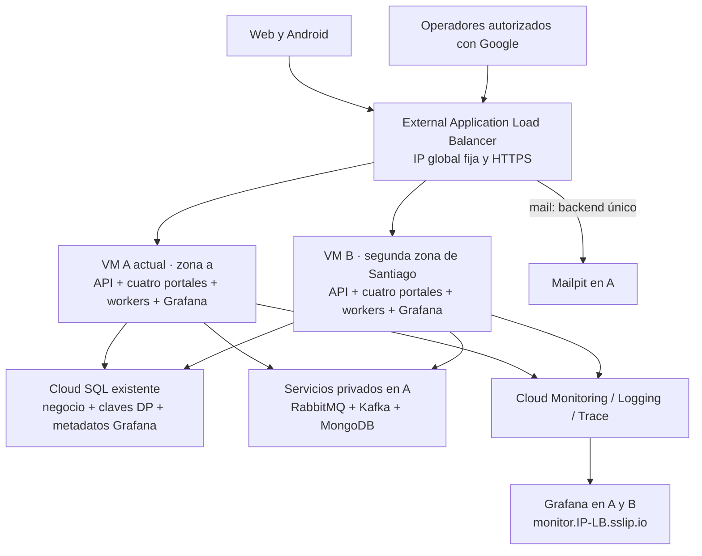

# Plan: dos VMs, balanceador HTTPS y monitorización privada

Estado: implementación local en curso; pendiente validar y desplegar desde `main`. Fecha: 26/10/2026.

## 1. Alcance confirmado

- Dos VMs en total, con reparto de peticiones y continuidad de API/portales ante la caída de una de ellas.
- Se acepta degradación temporal de mensajería y procesos que dependan de servicios alojados en la VM actual.
- Panel privado con CPU, RAM, discos, errores, latencia y estado de servicios; acceso con cuentas Google autorizadas.
- Conservar `sslip.io`, Santiago, sesiones de cuatro horas y operaciones manuales `start/update/stop`.
- Mantener la publicación automática desde `main`, tags de integración e imágenes por digest.

El resultado ofrece redundancia de la capa web. RabbitMQ, Kafka y MongoDB siguen teniendo una sola instancia; Cloud SQL sigue siendo zonal. La caída de la región, de la base o del disco de servicios queda fuera de esta garantía. Un circuito Blazor activo puede necesitar recargar la página después de perder su servidor.

Supuesto operativo: el panel propio funciona durante la sesión de cuatro horas. Las métricas y los logs históricos quedan en Google Cloud y pueden consultarse desde su consola cuando ambas VMs están apagadas.

## 2. Estado actual comprobado en el checkout

Referencia del madre: `23ae885f80a63c13579c3633b052f29f8b2fa191`.
Submódulos: backend `cb628c2b6c1608c2da185ad2f969ed5b48f08bdd`, frontend `10a1768e375708af9263cb422be04ff3d347ffa3`, mobile `e687541b79e4db490f76ba77ea671a94025ac83f`.
Estos SHAs describen el código inspeccionado, no la release actualmente desplegada.

| Pieza | Implementación actual | Consecuencia para el cambio |
| --- | --- | --- |
| Cómputo | Una `n4-highcpu-8`, 8 vCPU/16 GiB, en `southamerica-west1-a`; IP pública regional | La cuota global de 12 vCPU obliga a `n4-custom-6-16384` en ambos nodos; conservar A y sus datos |
| Persistencia local | Hyperdisk de 80 GiB con Docker/containerd, volúmenes y releases bajo `/srv/nexoruta` | No compartir ese disco como filesystem de dos hosts ni copiarlo con servicios escribiendo |
| Datos | Cloud SQL PostgreSQL 18, IP privada, `availability_type = ZONAL`, backups y PITR | Ambas VMs usan la misma base; conservar migraciones y RLS |
| Servicios locales | RabbitMQ, Kafka KRaft de un nodo, MongoDB y Mailpit | Mantenerlos en A y hacer explícita su dependencia desde B |
| Aplicaciones | API, Admin, Backoffice, Commerce, Tracking y workers Rabbit/Kafka/Push en Compose | Separar servicios compartidos, aplicaciones y tareas administrativas |
| Entrada | Caddy recibe 80/443, emite certificados y enruta seis hosts | Trasladar HTTPS y enrutamiento principal al balanceador |
| Sesión | Claves Data Protection en volúmenes locales; Commerce/Tracking usan Interactive Server | Compartir claves por aplicación y configurar afinidad para Blazor |
| Tráfico interno | Los portales usan `http://api:8080/` | Usar el origen HTTPS balanceado para no depender de la API local |
| Salud | API `/health/live` y `/health/ready`; ready comprueba PostgreSQL; portales salvo Tracking tienen ready | Agregar salud uniforme y distinguir proceso, disponibilidad y degradación |
| Telemetría | API instrumentada con OpenTelemetry; despliegue la deshabilita; logs Docker con driver `local` | Activar exportación y configurar recolección real de logs |
| Entrega | CI → tag → seis imágenes → prerelease; `vm_deploy.py` detiene todas las apps y luego las recrea | Una release común, despliegue secuencial por nodo y migración única |
| Sesiones | `demo_session.py` y guard de Workflows conocen un nombre y una zona; límite GCE de cuatro horas | Inventario de dos nodos y vencimiento común, incluso si falla Actions |
| Protección de uso | Rate limiting en memoria por proceso | Duplicar API cambia las cuotas efectivas si no se comparte el contador |

Fuentes locales: [infraestructura](demo/main.tf), [Cloud SQL y endpoints](demo/database.tf), [Compose remoto](../../deploy/gcp/compose.yaml), [proxy](../../deploy/gcp/Caddyfile), [despliegue](../../scripts/gcp/vm_deploy.py), [sesiones](../../scripts/gcp/demo_session.py), [guard](bootstrap/guard.yaml.tftpl), [CI](../../.github/workflows/ci.yml), [entrega](../../.github/workflows/demo-vm.yml), [API](../../backend/src/NexoRuta.Api/Program.cs), [Commerce](../../frontend/src/NexoRuta.Commerce/Program.cs) y [Tracking](../../frontend/src/NexoRuta.Tracking/Program.cs).

## 3. Arquitectura propuesta

### Cómputo y entrada

1. Conservar la VM A `nexoruta-demo`, su zona y su disco. Añadir B en otra zona de Santiago que tenga cuota y soporte N4. Se eligió `n4-custom-6-16384` por nodo para ajustarse a la cuota global de 12 vCPU; medir antes de dimensionar de nuevo.
2. Usar dos grupos de instancias no administrados, uno por zona, con una VM cada uno. Esto conserva el control manual de encendido/apagado y evita que un grupo administrado reponga máquinas al terminar la sesión. No habrá reparación automática de VMs en este alcance.
3. Crear un **global external Application Load Balancer** administrado, una IP global fija, certificado gestionado, URL map por host y redirección HTTP→HTTPS. Los backends siguen en Santiago; el frontal global de Google es una excepción explícita a la localización regional del cómputo.
4. Crear backend services independientes para `api`, `admin`, `backoffice`, `commerce`, `tracking`, `monitor` y `mail`. Cada uno usa su puerto nombrado y health check; `mail` apunta solo a A. Un fallo de un portal no debe retirar los demás.
5. Publicar puertos de contenedores sobre la interfaz privada del host. Permitir entrada desde los rangos oficiales del balanceador/health checks y SSH desde IAP; quitar acceso directo público al terminar la transición. Conservar salida a Internet para paquetes, imágenes, FCM y proveedores externos; inicialmente reutilizar acceso de salida de las VMs para evitar introducir Cloud NAT sin necesidad.
6. API sin afinidad; Commerce y Tracking con cookie de afinidad y soporte WebSocket. Configurar timeouts y drenaje explícitos. La afinidad no replica circuitos Blazor: tras una caída se permite reconexión con recarga y se comprueba el comportamiento visible.

Google documenta [grupos no administrados](https://docs.cloud.google.com/compute/docs/instance-groups/creating-groups-of-unmanaged-instances), [backends y puertos nombrados](https://docs.cloud.google.com/load-balancing/docs/backend-service), [afinidad](https://docs.cloud.google.com/load-balancing/docs/https/request-distribution) y [salud](https://docs.cloud.google.com/load-balancing/docs/health-check-concepts). Microsoft describe las condiciones de [Blazor en varios servidores](https://learn.microsoft.com/en-us/aspnet/core/blazor/host-and-deploy/server/).

### Estado compartido y servicios de A

- Separar Compose en aplicaciones por nodo y servicios persistentes exclusivos de A, con nombres de proyecto/volúmenes estables. Cambiar la organización no debe crear volúmenes vacíos que oculten los existentes. B tiene su propio almacenamiento Docker y nunca monta los volúmenes de A.
- Establecer un nombre privado estable para A y parametrizar RabbitMQ, Kafka, MongoDB y SMTP. Kafka debe anunciar una dirección alcanzable desde ambas VMs; `PLAINTEXT://kafka:9092` solo sirve en la red Docker actual. Usar listeners internos/entre hosts cuando sean necesarios. Los puertos de brokers y Mongo quedan limitados al tráfico privado requerido.
- Ejecutar workers en ambos nodos contra los mismos servicios. Verificar reservas de outbox, vencimiento de leases, confirmaciones, consumer groups e idempotencia antes de habilitar las dos réplicas. No prometer entrega exactamente una vez; no replicar los brokers entre A y B.
- Mantener `worker-push` independiente de RabbitMQ/Kafka. Caída A: la API y webs de B pueden continuar si SQL está disponible; correo y generación de nuevos enlaces/asientos de eventos dependientes de Rabbit/Kafka se retrasan. Los enlaces de seguimiento ya generados y las consultas basadas en SQL deben probarse por separado. La outbox conserva pendientes, respetando expiraciones ya existentes.
- Persistir Data Protection en PostgreSQL usando el proveedor oficial de EF Core, en almacenamiento técnico separado del modelo de negocio y con permisos mínimos. Un anillo por portal; API y worker Rabbit conservan su `ApplicationName` compartido actual. Importar las claves existentes y conservar la posibilidad de descifrar mensajes pendientes y cookies compatibles. Proteger claves nuevas con un certificado de cifrado almacenado en Secret Manager y conservar certificados anteriores para lectura.
- Compartir claves **no** equivale a compartir autenticación entre portales: mantener cookies, discriminadores y límites de permisos separados. Los portales recibirán credenciales SQL técnicas restringidas para su propio anillo, no acceso a datos de negocio.
- Conservar JWT y claves de seguimiento/push/evidencias actuales. No regenerarlas al añadir B. La caché geográfica en memoria puede seguir por instancia porque no es la fuente de verdad.
- Mantener los límites actuales de login, recuperación, registro, refresh, seguimiento y geocodificación mediante contadores atómicos compartidos en PostgreSQL, con ventana, expiración y limpieza acotadas. Probar que alternar A/B no duplica la cuota; no añadir Redis únicamente para esto. Definir respuesta ante indisponibilidad de SQL sin dejar abiertos los endpoints protegidos.
- Configurar proxies de confianza, cadena `X-Forwarded-For`, esquema HTTPS y hosts permitidos. Verificar la IP real del cliente; un encabezado enviado por el usuario no puede elegir su identidad para el rate limit.

Referencias: [claves compartidas con EF Core y cifrado explícito](https://learn.microsoft.com/en-us/aspnet/core/security/data-protection/implementation/key-storage-providers?view=aspnetcore-10.0), [proxies de confianza](https://learn.microsoft.com/en-us/aspnet/core/host-and-deploy/proxy-load-balancer?view=aspnetcore-10.0). El repositorio actual ya implementa reservas de outbox, pero su corrección con dos workers requiere una prueba concurrente.

### Endpoint de monitorización

Propuesta: `https://monitor.<IP-GLOBAL-CON-GUIONES>.sslip.io`, con Grafana OSS en ambas VMs. Su backend compartido será una base `grafana` dentro del Cloud SQL existente, con usuario propio y la misma clave de cifrado de Grafana en los dos nodos. Los dashboards y datasource se provisionan desde Git. Inicializar/actualizar el esquema de Grafana una sola vez antes de incorporar la segunda réplica; fijar una versión comprobada y su digest.

Las métricas se almacenan en Cloud Monitoring, los logs en Cloud Logging y las trazas en Cloud Trace. Grafana usa su datasource incluido de Google Cloud Monitoring y la identidad de la VM, sin claves JSON. Mantener permisos de lectura de monitorización acotados al proyecto. Las alertas se ejecutan en Cloud Monitoring para seguir funcionando si cae Grafana y evitar notificaciones duplicadas entre réplicas.

Para acceso, preferir Google OAuth nativo de Grafana, con los scopes mínimos, PKCE, correos autorizados mediante mapeo estricto de roles y Viewer por defecto para la lista permitida. Una cuenta Google cualquiera no obtiene acceso. Desactivar acceso anónimo y login público por contraseña; conservar un procedimiento administrativo por túnel privado. Cliente OAuth y secretos en Secret Manager. No reutilizar las sesiones comerciales de NexoRuta.

**Dependencia a resolver primero:** comprobar en el proyecto real que Google acepta el callback HTTPS exacto bajo el subdominio `sslip.io`, con la audiencia y usuarios de prueba previstos. Una demo con testers no acredita que el dominio pueda verificarse para producción. Si la configuración exige acreditar propiedad, registrar el impedimento y decidir un dominio propio para `monitor` o un acceso privado por túnel con identidad Google; no dar por cumplido el endpoint acordado usando otra autenticación. IAP también requiere revisar el cliente OAuth y la audiencia, por lo que no elimina esta comprobación.

Panel inicial, sin construir una aplicación web nueva:

| Vista | Señales mínimas |
| --- | --- |
| Infraestructura | Estado y uptime de A/B, CPU, RAM, disco en bytes y porcentaje, I/O, red, reinicios y OOM de contenedores |
| Entrada y API | Backends saludables por servicio, tráfico, 5xx, 429 y latencia p50/p95; distinguir respuesta del LB de respuesta de aplicación |
| Aplicaciones | Peticiones, duración, errores, runtime .NET y versión/release por instancia; desconexiones Blazor relevantes |
| Datos y procesos | Estado/conexiones/almacenamiento SQL, cola y mensajes no confirmados Rabbit, lag Kafka, salud Mongo, heartbeat/progreso de cada worker y antigüedad/cantidad de outbox pendiente/error |
| Sesión | Estado apagada/iniciando/activa/degradada/detenida, vencimiento común, release objetivo y aplicada en cada nodo; última muestra visible |

Instalar Ops Agent en A/B para recursos del host y OTLP; habilitar OpenTelemetry existente en API y extenderlo a portales/workers. Configurar la salida desde Docker hasta el receptor: `localhost` del contenedor no es el host y OTLP no debe publicarse a Internet. Exportar únicamente etiquetas acotadas como servicio, instancia, transporte y release, sin IDs de envíos/usuarios ni direcciones completas.

El driver Docker `local` actual no ofrece archivos JSON de texto para un tail genérico. Definir recolección explícita, por ejemplo salida `json-file` con rotación y receptor de archivos del Ops Agent, antes de esperar logs en Cloud Logging. Confirmar rutas reales bajo el `data-root` persistente y permisos del agente. Los logs deben excluir tokens, cabeceras de autorización, contraseñas, cuerpos sensibles y URLs de seguimiento/Geoapify con secretos; aplicar el mismo criterio a logs del balanceador.

Para contenedores, colas y progreso de workers hacen falta integraciones o métricas adicionales: Ops Agent por sí solo no demuestra esos estados. Empezar con las integraciones compatibles con las versiones existentes y un colector de estado acotado para lo que falte. Las consultas de outbox serán agregadas y usarán un rol técnico de solo lectura autorizado para ese propósito, conservando RLS de los roles normales. Un `kill -0 1` no acredita procesamiento saludable.

Definir umbrales iniciales revisables: nodo/backend perdido durante sesión, disco >80 %, RAM sostenida >85 %, aumento de 5xx y p95, ausencia de heartbeat y crecimiento de pendientes. Medir antes de fijar un SLA de latencia. Usar señales de sesión para suprimir avisos por apagado programado, sin silenciar errores de arranque, ausencia de telemetría durante sesión o un fallo del apagado. Verificar el intervalo de evaluación y su costo para sesiones de cuatro horas.

Referencias: [Ops Agent](https://docs.cloud.google.com/monitoring/agent/ops-agent), [OTLP](https://docs.cloud.google.com/trace/docs/otlp), [Grafana con PostgreSQL compartido](https://grafana.com/docs/grafana/latest/setup-grafana/set-up-for-high-availability/), [datasource Google](https://grafana.com/docs/grafana/latest/datasources/google-cloud-monitoring/configure/), [Google OAuth de Grafana](https://grafana.com/docs/grafana/latest/setup-grafana/configure-access/configure-authentication/google/), [reglas del callback OAuth](https://developers.google.com/identity/protocols/oauth2/web-server#uri-validation) y [condiciones de IAP](https://docs.cloud.google.com/iap/docs/custom-oauth-configuration).

## 4. Cambios en entrega y sesiones

### Publicar una vez; desplegar por nodo

Conservar CI, selección única de SHAs, tag inmutable, build y publicación actuales. Ampliar el bundle/manifiesto con la configuración de dos nodos y monitorización; desplegar exactamente los mismos digests de aplicación en ambos. Los ajustes técnicos de Grafana/agentes también quedan versionados.

Secuencia de `update`:

1. Leer una release completa y fijarla para toda la operación. Validar sesión y salud del nodo que seguirá atendiendo; no iniciar VMs apagadas ni modificar el vencimiento.
2. Realizar un backup de SQL y las comprobaciones previas. Ejecutar migraciones, provisión RLS y bootstrap una sola vez bajo bloqueo de despliegue/migración compartido. El `flock` local actual no bloquea una ejecución desde otra VM. Usar bloqueo PostgreSQL para la sección compartida y mantener la serialización de operaciones manuales en Actions.
3. Exigir migraciones compatibles con la versión anterior mientras conviven A/B. Separar cualquier eliminación incompatible para otra release posterior a retirar la versión antigua.
4. Retirar B de todos sus grupos/backend correspondientes y esperar el drenaje. Actualizar solo sus aplicaciones, workers y Grafana; comprobar directamente su salud y la API con acceso a datos. Reincorporar y esperar a que el balanceador lo declare sano.
5. Repetir con A. Los brokers de A no se reinician en una actualización ordinaria de aplicaciones. Actualizar versiones de brokers será una operación de mantenimiento separada, con degradación prevista.
6. Verificar endpoints públicos, sesiones, procesamiento y ambos IDs de release. Marcar el despliegue completo únicamente cuando ambos nodos estén en la versión objetivo.

Ante fallo, detener el avance, mantener el nodo sano y restaurar los contenedores de la release anterior en el nodo afectado antes de devolverlo al balanceador. Conservar el esquema migrado; no deshacer la base automáticamente. Mostrar explícitamente estado parcial y releases por nodo. Si la migración rompe compatibilidad con la versión anterior, el despliegue se bloquea antes de rotar nodos.

### Las cuatro horas son de la sesión completa

- Inventario validado de nodos con nombre y zona; eliminar el supuesto global `VM_NAME`/una zona en scripts y guard.
- `start`: crear una lease de aprovisionamiento, arrancar SQL y ambos nodos, fijar el vencimiento común desde el primer arranque de la sesión y desplegar una sola release. El inicio requiere ambos nodos saludables. Fallo/cancelación inicial: limpieza de ambos y SQL mediante runner y guard independiente.
- Cada VM mantiene un límite GCE como defensa adicional; el guard debe respetar el vencimiento común y no conceder cuatro horas nuevas al nodo que arranque después. Recuperar un nodo durante una sesión exige respetar la lease existente.
- `update`: no reinicia hosts, no amplía el plazo y no arranca nodos caídos. Si falta un nodo, informar degradación y no declarar la actualización de ambos completada.
- La caída de A o B antes del vencimiento no debe provocar que el guard apague el nodo sano o SQL. El guard actual consulta solo A y debe cambiar antes de habilitar la topología nueva.
- `stop`/vencimiento: cerrar la sesión, retirar tráfico, detener workers y ambas VMs, confirmar sus estados y apagar SQL. Reintentar limpieza aunque falle una de las operaciones; no crear recursos al detener.
- El APK de `start` usa el origen HTTPS estable del balanceador. `update` conserva el comportamiento actual de no generar un nuevo APK.

El balanceador y la IP se mantienen entre sesiones para conservar nombres y certificados. Detener las VMs no elimina esos recursos ni su posible facturación. Al apagar ambas, el panel propio también queda fuera de servicio; el histórico y las alertas del control permanecen en Google Cloud.

## 5. Fases de implementación y aceptación

| Fase | Trabajo y archivos principales | Condición de salida |
| --- | --- | --- |
| 0. Preparación | Verificar release remota, recursos/estado OpenTofu, cuotas para 16 vCPU N4 y segunda zona, presupuesto y acceso Google/sslip.io; inventariar claves/volúmenes y ensayar restauración | Acceso al panel viable; copia recuperable; plan sin pérdida de datos; estimación aceptable |
| 1. Aplicación preparada | Backend/frontend: proveedor DP compartido, importación de claves, rate limits compartidos, forwarded headers, salud de Tracking y pruebas de concurrencia de workers | Dos instancias locales aceptan cookies/formularios cruzados; cuotas globales y RLS correctos; pendientes descifrables |
| 2. Separación de runtime | `deploy/gcp/compose*.yaml`, configuración privada de A, listeners de Kafka, roles SQL técnicos, scripts de arranque/despliegue | A conserva sus volúmenes; B accede a SQL y servicios de A sin puertos públicos de datos |
| 3. Infraestructura | `infra/gcp/demo/main.tf`, nuevos archivos de balanceador y monitorización, `database.tf`, IAM/APIs en `bootstrap/`, startup | A/B y backends saludables, HTTPS válido y entrada directa restringida; estado OpenTofu conserva A/disco/SQL |
| 4. Operación | `delivery.py`, `vm_deploy.py`, `demo_session.py`, guard TF/template y `demo-vm.yml`; ampliar tests de scripts | Start/stop limpian ambos; update secuencial; migración única; plazo común; fallo parcial no apaga nodo sano |
| 5. Telemetría y panel | Ops Agent, OTel API/webs/workers, logs, integraciones de servicios, Grafana provisionado, OAuth y alertas en OpenTofu | CPU/RAM/disco/latencia/errores y estado reales por nodo; Google permitido/denegado; histórico conservado |
| 6. Migración y fallos | Ventana de corte, nuevos hosts, APK y enlaces históricos; actualizar guías y requisitos | Pruebas reales de caída A y caída B con límites observados y procedimiento de rollback |

Instrumentar una línea base de A antes de mover tráfico; completar el panel y las alertas antes de las pruebas de caída. Cada fase es un cambio revisable; no convertir la transición en un único apply sin puntos de recuperación.

### Comprobaciones requeridas durante la implementación

1. **Compilación y validación estática:** backend/frontend afectados, scripts, tests existentes relevantes, validación de Compose, OpenTofu fmt/validate, actionlint y revisión de plan. Extender `check_plan` sin permitir borrados generales: usar `moved`/importaciones para cambios de direcciones de estado que realmente correspondan.
2. **Automatización funcional:** concurrencia de workers/outbox, cuotas entre dos APIs, cookies/antiforgery cruzados, recuperación con claves anteriores, sesión/guard con A caída, B caída, ambas apagadas, limpieza fallida, carrera start/stop y migración fallida. No usar retries ciegos para repetir mutaciones de negocio.
3. **HTTP real en GCP:** certificado, host/rutas, salud por nodo y servicio, reparto visible en logs, identidad IP, puertos cerrados, no acceso a métricas privadas sin login y flujo de login/lectura/escritura con PostgreSQL y RLS.
4. **Revisión en navegador:** login de portales y Google, autorización denegada, formularios, afinidad/reconexión Blazor, panel con datos/retraso/error/sin datos y estado degradado. Aplicar `frontend/DESIGN.md` a cualquier UI propia; comprobar teclado, foco, contraste y tamaños pertinentes. La configuración de Grafana no justifica introducir otro frontend.
5. **Fallos controlados:** detener B y comprobar que A atiende; restaurar dentro del plazo y repetir con A, documentando qué tareas se retrasan. Confirmar que B y SQL permanecen activos hasta el vencimiento. Comprobar pendientes y recuperación al volver A, update con un nodo defectuoso y apagado autónomo si desaparece Actions.
6. **Datos y retorno:** restauración de respaldo ensayada, claves recuperables, migración de volúmenes sin duplicarlos y retorno de contenedores compatible. Preservar operaciones pendientes en Android al cambiar el origen; no borrar almacenamiento ni reinstalar como método de migración.

Informar los resultados por separado: compilación/estático, automatización, HTTP y revisión visual. Definir un objetivo inicial de recuperación de nuevas peticiones de hasta 60 segundos tras una caída de VM, medirlo con los health checks elegidos y registrar errores en vuelo/reconexiones; no presentarlo como SLA demostrado antes de ejecutarlo.

## 6. Migración de nombres, datos y rollback

La IP actual es regional y la del balanceador propuesto es global: no asumir que puede reutilizarse. Al conservar `sslip.io`, cambiar la IP cambia los nombres de API/webs/monitor. Preparar la actualización de configuración pública, APK, enlaces en correo, callbacks OAuth y acceso de usuarios; las cookies del host antiguo no se trasladan al nuevo dominio.

Mantener temporalmente Caddy en A para los hosts anteriores y una tabla explícita de redirecciones a los nuevos, conservando ruta/query sin registrarlas cuando contienen tokens. Comprobar qué enlaces previos siguen válidos y definir cuándo se retiran esos hosts. Los hosts antiguos ligados a A no obtienen redundancia por conservar esta transición.

Antes del cambio: backup SQL, snapshot del disco y copia protegida de claves/configuración. No usar `down -v`, no recrear el disco y no regenerar identificadores/credenciales. Añadir B y LB sin renombrar/reemplazar A; si se cambia a `for_each`, declarar el movimiento de estado y comprobar un plan sin reemplazo de A.

Mantener una release compatible con el nuevo almacenamiento de claves y el esquema anterior/nuevo como punto de retorno. Si falla el balanceador o B, retirar B y volver temporalmente al acceso por Caddy en A con esa release. No intentar volver a una versión que solo conoce claves locales si ya se han emitido nuevas con el almacén compartido; preparar explícitamente exportación/lectura de claves o usar la release compatible. La pérdida física de los servicios de A requiere restauración de disco/respaldo y no queda resuelta por el rollback de contenedores.

## 7. Costos y límites del alcance

El presupuesto actual de [costs.md](costs.md) describe una VM y no sirve como total de esta arquitectura. Recalcular antes del apply: segunda VM, disco de B, direcciones, balanceador, transferencia entre zonas y salida, ingestión/consulta de métricas, logs y trazas, certificados/configuración OAuth cuando aplique, builds e imágenes.

Como referencia de planificación, la [tarifa oficial del balanceador](https://cloud.google.com/load-balancing/pricing) consultada es USD 0,025/h para el primer bloque de hasta cinco reglas globales por proyecto: alrededor de USD 18,25 en 730 horas, antes de tráfico y otros cargos. No multiplicar esa base automáticamente por cada hostname. Mantener LB entre sesiones conserva ese costo aunque las VMs estén apagadas. Volver a verificar tarifas y configuración en la calculadora al implementar; las [tarifas de observabilidad](https://cloud.google.com/products/observability/pricing) dependen de volumen/uso.

No se incorporan en esta propuesta Kubernetes, autoscaling, un tercer host, clústeres de Rabbit/Kafka/Mongo, Cloud SQL regional HA ni una pila local Prometheus/Loki/Tempo. Con dos VMs y servicios únicos en A, la continuidad aceptada tiene los límites de la sección 1. La [documentación de RabbitMQ](https://www.rabbitmq.com/docs/clustering) desaconseja clústeres de dos nodos para consenso; duplicar brokers no completaría esa garantía.

## 8. Estado de implementación

Implementado en el checkout: OpenTofu para los dos nodos/balanceador/métricas/alertas; Compose privado para brokers, apps y Grafana; exportación OTel/Ops Agent; almacenamiento compartido de Data Protection y rate limits; login Google de Grafana con allowlist; operación común de cuatro horas, mutex, despliegue por rotación y procedimiento de migración/rollback. Se ajustaron las VMs a `n4-custom-6-16384` para caber en la cuota de 12 vCPU. La IP global `34.49.146.66` quedó reservada; el callback de OAuth acordado es `https://monitor.34-49-146-66.sslip.io/login/google` y los nombres de sus dos secretos existen en el environment de GitHub.

Validación local realizada: OpenTofu valida en `demo/` y `bootstrap/`; `tofu fmt -check`; `actionlint` en `demo-vm.yml`; validación de Compose y del Caddyfile; 81 pruebas Python (3 omitidas por sus precondiciones); compilación de ambas soluciones .NET; 459 pruebas de integración, 174 unitarias y 3 de arquitectura en backend; 324 pruebas de frontend. El esquema SQL también pasó el harness con permisos restringidos de PostgreSQL y aislamiento de roles. Caddy responde 200 en `/healthz` y 401 sin credenciales en la bandeja. Grafana 13.2.4 se inició localmente y se revisó en navegador el dashboard y la pantalla de acceso Google; sin identidad GCP no hay métricas reales en esta vista ni se probó el OAuth de producción.

El plan remoto de OpenTofu se generó en modo solo lectura desde el estado del proyecto. Propone crear el balanceador y recursos nuevos; A se actualiza sin reemplazo, el disco de datos y Cloud SQL no se destruyen. La nueva versión inmutable del secreto runtime queda retenida junto con las anteriores (`ABANDON`). No se aplicó ese plan.

Pendiente para considerar completado: actualizar/aplicar el estado remoto de bootstrap con permisos y secreto de hosting, publicar estos cambios en `main`, ejecutar el CI/publicación, arrancar la primera sesión de cuatro horas y comprobar certificados, health checks, OAuth, panel con métricas reales, caída de un nodo, drenaje, parada y guard. No se declara tolerancia a fallos operativa hasta superar esas comprobaciones en GCP.
