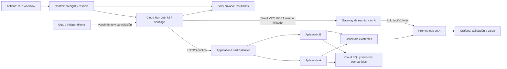

# OPT-06 — Plan de implementación de pruebas de carga remotas

Revision: 05/11/2026. El smoke #41968556341 paso end-to-end desde Actions con el fix del controlador publicado en `789df75`. Dos smoke previos tambien completaron en Cloud Run; el segundo expuso la carrera ya corregida. Baseline, sync, stress y soak siguen pendientes. La captura del usuario confirma visualmente los paneles principales para el run #41964001139; queda por revisar interaccion, accesibilidad y estados vacios/error. La fixture version 1 contiene una cuenta.

Card: [OPT-06 - Pruebas de carga automatizadas en ambiente remoto](https://www.notion.so/40a032f1caff81eaa439c8f4503613e). La infraestructura y el harness estan integrados; el smoke remoto verifico ejecucion, telemetria, API en A/B y limpieza de sesion. La card permanece abierta hasta completar los perfiles restantes y controles operativos; el usuario reviso visualmente los paneles principales y quedan los chequeos de interaccion/accesibilidad.

### Alcance entregado y límites

- `workflow_dispatch` agrega la acción manual `NexoRuta - pruebas de carga`, con perfiles y cancelación por `run_id`. k6 corre en un Cloud Run Job de una tarea, fuera de A/B.
- El Job publica métricas k6 por remote write a un receptor interno de escritura limitada y usa HTTPS público para medir el balanceador. Grafana comparte dashboard JSON entre local y GCP.
- El runner no siembra ni limpia datos de negocio: usa cuentas sintéticas preparadas manualmente y revoca al terminar las sesiones móviles creadas por su autenticación. `baseline` solo lee. Los perfiles `smoke`, `sync`, `stress` y `soak` repiten hasta 50 eventos `Posicion` ya aplicados por jornada para medir reconexión e idempotencia. La secuencia 1 debe ser un `InicioJornada` aplicado y las posiciones ocupan 2–51, como exige el estado operativo del backend. Esto no mide escrituras nuevas, colisiones, aislamiento entre tenants ni conciliación de datos nuevos.
- Las fixtures separan credenciales en Secret Manager (máximo 64 KiB) de los eventos en un objeto privado, con hash SHA-256 verificado y límite de 4 MiB. No se enviarán datos reales ni credenciales al repositorio.
- La infraestructura y las APIs ya se aplicaron; quedan el arreglo del despliegue de aplicación, preparar fixtures sintéticas por los flujos administrativos, arrancar las VMs, probar HTTP y red desde Cloud Run, ejecutar perfiles y revisar Grafana visualmente. Memorystore Basic de 1 GiB ya existe y factura aunque las VMs estén apagadas. No reportar los SLO como medidos.

## 1. Decisión de arquitectura

Ejecutar **k6 OSS dentro de un Cloud Run Job en Santiago (`southamerica-west1`)**, separado de las VMs de aplicación. Dispararlo mediante un workflow manual de GitHub Actions llamado `NexoRuta - pruebas de carga`, con selección de perfil y una operación para cancelar. Actions orquesta, muestra enlaces y publica el resultado; la carga se genera dentro de GCP.

El camino bajo prueba será el HTTPS público real del Application Load Balancer. El Job usará Direct VPC egress exclusivamente para enviar sus métricas a un gateway de escritura limitada en A y acceder a los servicios de control estrictamente necesarios. Grafana seguirá leyendo Prometheus directamente desde la red privada de la demo y mostrará carga ofrecida, rendimiento observado por el cliente, métricas de aplicación e infraestructura y sincronización.

No agregar Kubernetes ni una VM permanente. Cloud Run está disponible en Santiago y admite ejecución de Jobs, parámetros por ejecución, límites y cancelación. [Ubicaciones](https://docs.cloud.google.com/run/docs/locations), [ejecución de Jobs](https://docs.cloud.google.com/run/docs/execute/jobs).

| Alternativa | Evaluación para NexoRuta |
| --- | --- |
| Cloud Run Job + k6 | Recomendada: proceso finito, capacidad independiente, imagen reproducible y pago por ejecución. Verificar cuota regional y conectividad antes de habilitarlo. |
| k6 en las VMs A/B | Consume los mismos recursos que se quieren medir; excluirlo como generador. |
| k6 en GitHub hosted runner | Geografía y capacidad variables; no tiene acceso privado directo a Prometheus. Usarlo para validar scripts con respuestas controladas. |
| VM efímera dedicada | Alternativa si se demuestra saturación del generador o se necesita control del SO/red. Agrega ciclo de vida y compite con las cuotas de Compute; las dos N4 ya suman 12 vCPU. |
| Grafana Cloud k6 / GKE | Implican otro servicio/costo o un clúster sin necesidad actual. Reconsiderar solo ante una necesidad distribuida medida. |

La ejecución en Santiago mide el despliegue y sus dependencias con red cercana. No demuestra latencia desde Uruguay, redes móviles ni experiencia MAUI/Blazor completa; esas verificaciones son complementarias.

## 2. Ambiente analizado: código frente a recursos reales

Fuentes: `infra/gcp/{bootstrap,demo}`, `scripts/gcp`, `.github/workflows`, `deploy/gcp`, `deploy/observability`, controladores de reparto, rate limiting e instrumentación del backend, y `frontend/DESIGN.md`.

#### Inventario previo a aplicar OPT-06

Se hicieron consultas **de solo lectura** mediante gcloud y GitHub CLI el 03/11/2026 y se repitieron el 04/11/2026 en `nexoruta-demo-20261022`. Este corte antecede al apply posterior; no se arrancaron VMs ni se enviaron muestras durante ese inventario.

| Elemento | Evidencia y consecuencia |
| --- | --- |
| Aplicación | Dos VMs `nexoruta-demo` y `nexoruta-demo-b`, zonas Santiago a/b, `n4-custom-6-16384`; ambas continúan `TERMINATED` y conservan el límite de cuatro horas. No hay evidencia de runtime activo. |
| Entrada | IP global `34.49.146.66`, balanceadores y grupos A/B existentes. `get-health` no informa backends sanos con las VMs apagadas y el GET público a `/health/ready` devolvió HTTP 503. Usar los orígenes del manifiesto efectivo, no hardcodear esa IP. |
| Red | VPC `nexoruta-demo`, subred `10.42.0.0/24`, Private Google Access habilitado. La subred `10.42.1.0/26` del Job aún no existía en estado ni en GCP; el apply posterior la agregó sin modificar la subred de aplicación ni el rango privado de SQL. |
| SQL | PostgreSQL 18, `db-g1-small`, estado `RUNNABLE`, política `ALWAYS`; backups y PITR deshabilitados. Es un cuello de botella posible y exige fixtures acotadas y limpieza segura. |
| Redis | En ese corte `redis.googleapis.com` estaba deshabilitada y `google_redis_instance.cache` no estaba en el estado. El apply posterior creó Memorystore Basic de 1 GiB con AUTH/TLS. |
| Cloud Run | En ese corte `run.googleapis.com` estaba deshabilitada y el estado no contenía el Job. El apply posterior habilitó el API y creó `nexoruta-load-tests`. |
| Recursos OPT-06 | En ese corte los buckets, identidades controller/runner, subred, reglas y Job no existían; el bucket de resultados tampoco. El apply posterior creó esos recursos y configuró `GCP_LOAD_SERVICE_ACCOUNT` en GitHub. |
| Observabilidad | El código centraliza Prometheus/Loki/Tempo en A, Grafana en A/B, Collector/Alloy por nodo, Cloud Monitoring vía collector cada 60 s y métricas de aplicación vía OTLP. Esto no acredita esa configuración en ejecución. |
| Diferencia de firewall | La regla remota `nexoruta-demo-shared-services` permite 5672/19092/27017/1025/15692 desde `10.42.0.0/24`. El checkout añade 9090/3100/3200/4317; OPT-06 agrega una subred aparte y una regla limitada a 9091. Conciliar estado, release y reglas antes de afirmar que B exporta telemetría correctamente. |
| Operación | `vm-controls.yml` ofrece start/update/stop y `load-tests.yml` ofrece run/cancel, restringidos a `main` y al environment `nexoruta-demo`, con WIF. La política del environment permite `main`; `GCP_LOAD_SERVICE_ACCOUNT` ya está configurada. |

El primer plan de bootstrap reveló un `for_each` con una clave de rol custom aún desconocida; se corrigió con claves estables. Los planes revisados antes del apply calcularon 17 creaciones, 3 actualizaciones y 2 cambios IAM en bootstrap, y 28 creaciones, 2 actualizaciones y una nueva versión `ABANDON` del secreto runtime en demo; no propusieron borrar VMs, discos, SQL ni balanceador. Ambos módulos ya se aplicaron después de integrar PR #56 y PR #57.

#### Estado remoto verificado después del apply (04/11/2026)

- `run.googleapis.com`, `redis.googleapis.com` y `compute.googleapis.com` están habilitadas. Ambas VMs están `TERMINATED`; Cloud SQL `nexoruta-demo-db` está `RUNNABLE` con activación `ALWAYS`; Memorystore `nexoruta-demo-cache` está `READY`, Basic, 1 GiB.
- Existe la subred `nexoruta-load-tests` (`10.42.1.0/26`), los buckets privados `nexoruta-load-control`, `nexoruta-load-fixtures` y `nexoruta-load-results`, las reglas de ingreso/egreso y el Job `nexoruta-load-tests`.
- Cloud Run reporta el Job `Ready=True`, una tarea, paralelismo 1, `maxRetries=0`, timeout 5400 s, egress `PRIVATE_RANGES_ONLY`, la subred/tag del Job y la cuenta runtime `nexoruta-load-runner`. La imagen `hello` es el placeholder esperado; el workflow la reemplaza por el digest construido antes de cada corrida.
- La regla de ingreso desde la subred del Job permite TCP 9091 al tag de observabilidad. El egress permite TCP 9091 a `10.42.0.2/32` y una regla posterior deniega los demás destinos RFC1918. No se abrió el puerto 9090.
- El secreto `nexoruta-load-fixtures` existe, pero no tiene versiones; el bucket de fixtures está vacío y no hay executions de Cloud Run. El workflow no debe iniciar una prueba hasta preparar y publicar el fixture sintético.
- El deployer tiene `roles/owner` únicamente en `nexoruta-demo-20261022`, por pedido explícito del usuario. El proyecto `nexoruta` (NexoRuta), que se conserva para mobile/Firebase, no se modificó.
- El último inicio de demo falló antes de aplicar las apps porque el Ops Agent del release anterior ocupaba TCP 4317, que Tempo necesita. El fix `633d7dd` instala y reinicia el Ops Agent con la configuración host-metrics antes de iniciar Tempo; pasó el CI del PR #58 y está publicado en `main`. Aún no se volvió a ejecutar el deploy, por lo que no hay evidencia de aplicación saludable ni de dashboard cargado en Grafana.

La revisión local partió del root `fabc324a3ee27ca919764c403dfc136c0351fbe6`, backend `48e947b156cb0116743a77b2d7ed2ccec77cd8c6`, frontend `e584c8033faa9d93debbc2248231b8a07c4077eb` y mobile `d570ddb7c482c56070140e25fafb5a18e51cdbfa`. `scripts/cloud/checkpoint.json` registra otros SHAs para backend/frontend: distinguir ese checkpoint de continuidad de una release desplegada. No actualizar gitlinks para resolver esta feature.

Antes de cualquier nuevo apply o corrida, repetir el inventario y guardar una síntesis sin secretos. La aceptación se valida contra la topología realmente desplegada y una release completa identificada por digests, no contra documentos históricos que afirman estados distintos.

## 3. Arquitectura y recursos

1. Job `nexoruta-load-tests`: una tarea, paralelismo 1, **max retries 0**, inicialmente 2 vCPU y 2 GiB. Los usuarios virtuales viven dentro de esa tarea; no equivalen a instancias Cloud Run. Ajustar recursos solo si CPU/RAM del generador o iteraciones descartadas lo justifican.
2. Imagen k6 y wrapper fijados por versión y digest en Artifact Registry existente; incluir scripts, validación de manifiesto, supervisión y subida de resultados. Cloud Build construye la imagen; no compilar en el Job. Conservar procedencia, SHA de suite y versión de thresholds en cada corrida.
3. Direct VPC egress `private-ranges-only` en la misma VPC, con subred dedicada `10.42.1.0/26`. El código local define A/B en `10.42.0.0/24`; verificar cualquier rango adicional del proyecto remoto antes de aplicar. Google exige al menos /26 y conserva IPs temporalmente después de cada tarea. No hace falta conector Serverless VPC Access ni Cloud NAT para esta ruta: HTTPS público sale por el egress administrado y las IP privadas por la VPC. [Direct VPC](https://docs.cloud.google.com/run/docs/configuring/vpc-direct-vpc).
4. El firewall de entrada permite desde la subred del Job al gateway de escritura de A, TCP 9091. El gateway solo acepta `POST /api/v1/write` y `GET /-/ready`, y los reenvía al Prometheus local; las consultas de Prometheus no se exponen al Job. El puerto 9090 queda fuera de la regla. El firewall de salida permite hacia la IP de A/32 únicamente TCP 9091 y deniega los destinos RFC1918 restantes; así la tarea no puede abrir conexiones privadas a Cloud SQL, Redis, brokers ni puertos de las VMs. Los tags del Job y A limitan las reglas. No abrir Prometheus/Loki/Tempo al público.
5. Resolver la IP privada de A desde inventario autorizado y pasar el destino como configuración validada. Preflight con reintentos acotados de conectividad; el establecimiento de Direct VPC puede demorar. El arranque y esos reintentos no forman parte de la ventana medida.
6. Tres buckets privados con propósitos distintos: resultados con lifecycle de 30 días; control con leases/manifiestos y lifecycle de 30 días; fixtures con versionado, sin expiración automática y borrado protegido. Los checkpoints y resúmenes se crean por `run_id`; la corrida fallida no depende de un trap para conservar los checkpoints previos.
7. Cuenta runtime de Cloud Run exclusiva: lee el secreto sintético de hasta 64 KiB, el dataset versionado de hasta 4 MiB y leases/manifiestos del bucket de control; escribe resultados mediante `objectCreator`. No accede al bucket de estado, SQL, otros secretos ni IAM de despliegue. ADC usa la identidad adjunta, sin claves JSON.
8. WIF distingue `nexoruta-load-controller` del deployer de publicación/VM. El controller obtiene permisos de Cloud Build y lectura de salud, permisos de ejecución/cancelación Cloud Run y acceso a control/resultados. En el bucket de OpenTofu su IAM condicional se limita a `locks/demo-control.json` y `leases/demo.json`; IAP/OS Login se concede solo sobre A y B. Los permisos para actualizar/ejecutar el Job y hacer `actAs` se limitan a la identidad y recurso del Job. [Permisos de Cloud Run](https://docs.cloud.google.com/run/docs/reference/iam/permissions), [roles de Cloud Run](https://docs.cloud.google.com/run/docs/reference/iam/roles).

Los overrides solo llevan identificadores y perfiles admitidos. El contenedor valida límites y el manifiesto: no aceptar URL arbitraria, credenciales, JavaScript libre ni duración sin tope en inputs de Actions.

## 4. Inicio fácil, exclusión y cancelación

Agregar `.github/workflows/load-tests.yml` como botón independiente en Actions:

| Input | Opciones y comportamiento |
| --- | --- |
| `operation` | `run` / `cancel`; default `run`. Cancelar identifica la corrida activa y permite indicar su `run_id`. |
| `profile` | `smoke`, `baseline`, `sync`, `stress`, `soak`; default `baseline`. Cada perfil fija carga máxima, ventanas y presupuesto. |

Uso principal: **Actions → NexoRuta - pruebas de carga → Run workflow → baseline**. La demo debe estar iniciada con el botón start existente; si está apagada o próxima a vencer, informar el motivo y el enlace al control de VM. No encenderla ni extender la sesión silenciosamente. Un futuro checkbox post-start puede reutilizar este orquestador, pero no es necesario para entregar OPT-06.

Secuencia:

1. Validar main/environment/WIF, perfil y permisos. Bajo el mutex existente `control_lock.py`, comprobar que no hay otra corrida activa y reservar una lease GCS mediante precondiciones de generación. Leer la sesión común de `leases/demo.json`.
2. Fijar **la release aplicada en A y B**, comprobar igualdad de digests y salud de ambas, SQL, workers y telemetría. No seleccionar `channels/main.json` como si lo último publicado ya estuviera desplegado. Fijar también digest del generador, fixture y configuración.
3. Exigir tiempo restante suficiente: preparación máxima + ventana de carga + conciliación/exportación + margen de 10 minutos. Rechazar si la sesión de cuatro horas no alcanza. El Job lleva deadline absoluto y timeout propio; nunca cambia el vencimiento de las VMs.
4. El manifiesto inmutable implementado guarda `run_id`, lease/sesión, perfil, release/digests de aplicaciones, integration/source SHAs, versión de fixture, SHA de suite y origen HTTPS. Registra intención de inicio antes de llamar Cloud Run; una respuesta perdida se reconcilia por el ID exacto. El resumen del runner agrega SHA del dataset; los thresholds viven en el archivo de perfil fijado por SHA de suite. No genera seed.
5. El workflow espera el resultado del Job y publica al final enlaces a Grafana, Cloud Run y GCS. GCS conserva checkpoints cada 30 s y resumen; el log k6 crudo no se publica porque puede contener respuestas. El exit code del Job refleja thresholds y errores del runner.
6. `cancel` usa un job de control que **no queda detrás de la concurrency de ejecución**. Marca cancelación y solicita `run.executions.cancel`; conserva execution y evidencia. La reserva en GCS impide dos cargas simultáneas, incluso desde ejecuciones manuales fuera de GitHub. [Cancelación](https://docs.cloud.google.com/run/docs/execute/jobs).

**Coordinación con VM y guard:**

- No reutilizar `nexoruta-gcp-demo-session` como grupo de concurrency durante toda la carga: bloquearía stop. No mantener el mutex de control mientras k6 ejecuta: el guard también lo necesita.
- `update` y `start` consultan la reserva bajo el mutex; rechazan mientras haya prueba activa. `stop` marca cancelación, invalida el permiso de continuar, cancela la execution y espera un plazo acotado; luego apaga VMs aunque falle esa cancelación. Cloud SQL mantiene la política actual de permanecer encendido.
- Extender `guard.tf`/`guard.yaml.tftpl`: además del vencimiento de sesión, detectar lease de carga expirada, corrida huérfana y cancelación pendiente. Autorizarle cancelación y lectura del Job. No prolongar su sección crítica con esperas largas; reconciliar con generaciones y reintentar en la siguiente invocación.
- Wrapper del Job supervisa lease/deadline/salud y detiene k6 al invalidarse; si pierde el control o A/Prometheus dejan de responder más allá del margen, aborta y exporta evidencia a GCS. Un fallo de Actions no deja carga sin plazo.
- La reserva expirada no autoriza otra prueba hasta verificar que la execution anterior terminó. Resolver también cancelación entre reserva y creación, pérdida de respuesta de `jobs.run`, y nombre de execution aún no registrado: reconciliar ejecuciones y exigir dueño válido antes de generar tráfico. No reintentar ciegamente el inicio, porque podría crear dos executions.

## 5. Datos, autenticación y contratos

El flujo implementado recibe cuentas/jornadas sintéticas preparadas manualmente; no crea cuentas, rutas o fixtures. Credenciales e IDs quedan en una versión de Secret Manager de máximo 64 KiB. Las secuencias de operaciones viven en un objeto create-only de `GCP_LOAD_FIXTURES_BUCKET`, bajo una ruta propia por fixture. El secreto fija su ruta y SHA-256; el runner compara el hash y limita el objeto a 4 MiB antes de cargarlo. No hay endpoints de seed ni permisos de SQL en la identidad de carga.

`baseline` ejecuta solamente `GET /api/mobile/perfil`. `smoke`, `sync`, `stress` y `soak` reenvían, una vez por cuenta, hasta 50 operaciones `Posicion` que ya deben estar aplicadas en una jornada sintética. La preparación debe aplicar `InicioJornada` en secuencia 1 antes de las posiciones 2–51; después puede cerrar y liberar la ruta por los flujos normales. Se espera `HTTP 200` y `Resultado=Aplicada`; IDs/payloads repetidos comprueban replay idempotente sin insertar registros. Esto evita limpieza destructiva, pero no cubre escrituras nuevas, conciliación/outbox, tenants cruzados, RLS entre operadores, colisiones de ID ni carga de otras entidades. Esas pruebas requieren otro diseño seguro de preparación y conciliación antes de ampliar OPT-06.

El login real tiene **5 solicitudes/minuto por IP** y refresh 30/minuto, compartidos en PostgreSQL; seguimiento público tiene 20/minuto por IP. El wrapper autentica secuencialmente con una pausa de 12,1 s después de cada respuesta y renueva todas las identidades, aun inactivas, tres minutos antes de vencer el JWT de 15 minutos. Refresh y logout comparten una pausa de 2,1 s después de cada respuesta para evitar ráfagas por latencia variable. Ese tiempo forma parte de la preparación acotada (50 identidades pueden requerir unos 10 minutos). Passwords y refresh tokens permanecen en el wrapper; k6 obtiene únicamente access tokens de un broker loopback privado con capacidad aleatoria. Un rechazo o respuesta perdida de rotación detiene la corrida sin reintentar el token incierto. Se revocan solo las sesiones creadas por la corrida, con presupuesto de 120 s y pendientes explícitos si no alcanza; no se borra historia. No falsificar `X-Forwarded-For`, eliminar límites ni interpretar 429 de login como capacidad máxima de negocio. Una prueba específica de rate limiting verifica esos rechazos por separado.

Contrato concreto de sincronización: `POST /api/mobile/jornadas/{jornadaId}/operaciones`, una operación por petición, límite de 32 KiB. Respetar orden de secuencia por jornada, IDs estables, versiones y `OcurridaEn`; sincronizar muchas jornadas en paralelo. Validar **HTTP y `Resultado` del cuerpo**: un 200 puede contener `Conflicto`. El replay del mismo ID/payload debe conservar el resultado sin duplicar efectos; distinto payload con ID repetido y secuencia adelantada deben seguir el contrato de rechazo. `X-NexoRuta-Pending-Sync` informa pendientes, no constituye una cola ni acredita por sí solo el vaciado.

Mapbox conserva `permanent=false`. Ningún escenario consumirá Mapbox/Geoapify reales: coordenadas y estimaciones sintéticas controladas, rutas de proveedor omitidas o dobles limitados al contexto de prueba. No sustituir globalmente el proveedor de una demo compartida. Correo a Mailpit y push a un transporte controlado para las cuentas sintéticas; verificar el aislamiento antes de correr. Si no es posible aislar un efecto externo, excluir explícitamente ese flujo hasta resolverlo. No afirmar entrega FCM, precisión vial o validación Android a partir de k6.

Al terminar, conciliar antes de limpiar: operaciones únicas, secuencias, versiones, estados, inventario y outbox. Limpieza idempotente, por dueño y `run_id`, con comprobación de dependencias y propagación a proyecciones/caché. Si el dominio no permite borrar historia con seguridad, conservarla identificada y presupuestada; no truncar tablas ni borrar migraciones/volúmenes. La limpieza fallida queda pendiente explícita y recuperable en el reporte. Sin backups automáticos, cualquier ensayo de restauración o prueba destructiva requiere su propio cambio deliberado; no forma parte de esta carga.

## 6. Perfiles y niveles de servicio iniciales

Estos objetivos son **propuestos para la demo actual**, deben quedar versionados antes de la primera medición. No son resultados obtenidos ni SLA de producción. Calibrar la capacidad del generador con un endpoint controlado y efectuar warm-up de aplicación sin contar sus muestras en los SLO.

| Perfil | Carga y ventana medida | Propósito |
| --- | --- | --- |
| smoke | 1 VU, 2 minutos; lectura más replay de 50 eventos preaplicados | Verificar login, endpoint, fixture, telemetría y reporte. |
| baseline | 5 usuarios distintos, solo lectura, 15 minutos | Medición inicial nominal del endpoint autenticado, sin escrituras. |
| sync | 20 jornadas, 50 operaciones preaplicadas cada una, hasta 15 minutos | Replay simultáneo/idempotencia. La sincronización ampliada de 5 usuarios requiere otra ejecución con un dataset de cinco. |
| stress | llegada escalonada 1/3/5/10 iteraciones por segundo, máximo 50 VUs y 50 operaciones preaplicadas por jornada, 25 minutos | Explorar capacidad HTTP y replay acotado; incluir iteraciones descartadas como fallo de umbral. |
| soak | 5 VUs, 60 minutos, 50 operaciones preaplicadas por jornada en la primera iteración | Observar lecturas sostenidas y replay inicial. No representa carga continua de escritura. |

Preparación y postprocesamiento tienen límites aparte; timeout total inicial 55 minutos, excepto soak hasta 85, siempre condicionado al deadline común. Ajustar timeout del workflow por encima del Job para alcanzar exportación y clasificación final. No distribuir carga entre tareas inicialmente; si fuera necesario después, particionar fixtures y tasa total, y agregar histogramas, nunca promediar percentiles de tareas.

| Señal | Objetivo para baseline y nivel nominal de sync |
| --- | --- |
| GET autenticados | p95 ≤ 500 ms; p99 ≤ 1 s, por grupo de endpoint y fase. |
| Escrituras y operación sync | p95 ≤ 1 s; p99 ≤ 2 s. |
| Errores inesperados | < 1%; ningún 401/403 inesperado. Separar 5xx, timeouts, transporte, 429 y rechazos de negocio. |
| Operaciones correctas | En los perfiles sync: todos los replays aceptados y aplicados, IDs únicos entre jornadas, sin errores inesperados. No se usa como evidencia de escrituras nuevas ni de aislamiento multi-tenant. |
| Backlog nominal | Cada batch secuencial se mide desde el inicio de su replay; p95 < 60 s y p99 < 120 s. No representa una cola de cliente real ni vaciado de nuevas operaciones. |
| Recuperación de colas | Pendientes de prueba vuelven al nivel previo o se justifican individualmente en ≤ 120 s desde el fin de envío. |
| Generación | Carga alcanzada acorde al perfil, sin descartes para declarar aprobado el nivel; CPU/RAM sin saturación sostenida del generador. |

Como criterio de aceptación, los niveles de stress y sync ampliado deben reportar el primer escalón que incumple, throughput máximo observado y recuperación; encontrar un límite esperado no implica que baseline esté roto. El runner clasifica SLO incumplido, límite encontrado en stress, cancelación, evidencia incompleta, medición inválida por generador/telemetría y fallo de infraestructura. Un límite encontrado conserva estado fallido para exigir diagnóstico. El reporte por escalón conserva p95/p99 exactos de las muestras individuales, error rate, batches iniciados/completados, primera infracción y máximo throughput HTTP en ventanas completas de 10 s. Los targets de stress corresponden a rampas de llegada y no acreditan niveles constantes de capacidad. La recuperación de colas y la aceptación remota siguen pendientes. Ninguna corrida incompleta es verde: el controlador exige resumen válido, requests medidas, ventana completa y concordancia con Cloud Run.

El target de aborto es pérdida de lease, readiness del gateway, integridad, OOM, falta de espacio o errores sostenidos severos (>5% durante 60 s, tras warm-up). El runner supervisa lease/readiness, un FIFO de métricas k6 y recursos del cgroup v2 del Job. Aborta por más de 5% de fallos HTTP en un minuto medido de segundos completos, nuevos OOM, saturación de CPU/memoria sostenida o falta de espacio. El setup separa 30 s de warm-up de lectura y los thresholds HTTP seleccionan únicamente `phase:measured`; login y warm-up fallidos impiden iniciar la carga. La disponibilidad real de límites cgroup y el comportamiento del FIFO deben verificarse en Cloud Run antes de ampliar perfiles. Un `check` de k6 necesita threshold para fallar el resultado. Los descartes pueden indicar falta de VUs por latencia del sistema o recursos insuficientes del generador y requieren diagnóstico. [Métrica de descartes](https://grafana.com/docs/k6/latest/using-k6/scenarios/concepts/dropped-iterations/).

## 7. Grafana y calidad de telemetría

La implementación reutiliza el Prometheus existente de A y su `--web.enable-remote-write-receiver`, detrás de `prometheus-write-gateway` en el puerto privado 9091. El gateway reenvía solo `POST /api/v1/write` y `GET /-/ready`; no permite consultas, acceso a series ni otros endpoints. Una tarea k6 envía series cada 5 segundos a `http://IP_PRIVADA_A:9091/api/v1/write` por Direct VPC. Imagen y versión están fijadas; el contenedor especifica p95/p99/media y evita tags de URL/IDs de negocio para limitar cardinalidad. k6 documenta que la salida remote-write es experimental; verificar el nombre/unidad de las series en el primer smoke remoto. [Remote write de k6](https://grafana.com/docs/k6/latest/results-output/real-time/prometheus-remote-write/).

El dashboard compartido `deploy/observability/grafana/load-tests.json` muestra RPS y errores de la fase medida, VUs, latencia cliente p95/p99 en segundos, iteraciones descartadas, sync, p95 de servidor por nodo/servicio, tasa 5xx, CPU de VM, m?tricas de sync de la aplicaci?n, conexiones SQL y estado del gateway en A. Agrega paneles de CPU/RAM del generador y anotaciones de inicio/fin. El filtro `run_id` aplica a k6; las series existentes de aplicaci?n se correlacionan por ventana temporal y nodo, sin atribuirles un run ID. Grafana provisiona el mismo JSON en local y en el bundle GCP, enlaza al dashboard general y actualiza cada 10 segundos.

La carga, error de consulta y ausencia de muestras usan estados nativos de Grafana; las consultas no convierten ausencia en cero. El runner expone CPU y memoria del cgroup como fracci?n del l?mite, las exporta con etiquetas de control y exige muestras de ambas para aprobar. Las anotaciones identifican inicio de la ventana medida y fin de corrida por `run_id`. El smoke local y el smoke aislado de CI comprobaron nombres y unidades de series k6; la frescura de m?tricas de la aplicaci?n y los paneles deben confirmarse con un smoke remoto. Logs/trazas enlazados por corrida siguen pendientes.

La pila depende de A: si A cae, no hay vista en vivo; el runner aborta cuando el gateway deja de estar listo y conserva su último checkpoint si GCS sigue disponible. La revisión visual en navegador (tamaño, filtros, teclado, contraste y estados vacíos/error) sigue pendiente porque no se aplicaron recursos ni se arrancaron VMs. El dashboard usa componentes nativos y valores semánticos de Grafana; no se agregó un frontend.

## 8. Entregas y estado

| Fase | Implementación | Condición de salida |
| --- | --- | --- |
| 0. Ambiente | Inventario previo y posterior al apply repetido el 04/11/2026. | APIs OPT-06 habilitadas, buckets/subred/firewall/Job/Redis creados; VMs apagadas, SQL activo y health público no aceptado. |
| 1. Suite | Implementados `tests/load/`, `deploy/load/`, perfiles, login controlado, replay sync, thresholds, hash/sanitización y checkpoints. | Las pruebas Python locales pasan con 3 omisiones por falta de PowerShell Core; el smoke local de `verify_load_runtime.py` pasa usando el daemon como root. La Integrated CI completa no se ejecutó localmente como un solo workflow. No crea ni limpia fixtures. |
| 2. Infraestructura | Bootstrap y demo aplicados; WIF/controller, Job, tres buckets, subred, reglas/IAM y Memorystore existen. Dashboard incluido en delivery. | Cloud Run Job `Ready=True`; no se propone re-aplicar sin plan actualizado. El Job usa imagen inocua al crearse; el workflow debe reemplazarla por digest k6 antes de una corrida. |
| 3. Control | Workflow manual, leases por generación, reserva, reconciliación, cancelación, guard y exclusión con start/update/stop están implementados; APIs/IAM/WIF y `GCP_LOAD_SERVICE_ACCOUNT` están configuradas. | Ensayar carreras, guard, cancelación, stop y deadlines contra GCP antes del uso operativo. |
| 4. Fixtures y telemetria | Buckets, limites, hash y dashboard listos; fixture sintetica version 1 publicada. | Smoke remoto con una cuenta y 50 posiciones replayadas; Prometheus recibio series k6 y metricas de API en A/B. Falta ampliar fixture para los demas perfiles y hacer revision visual del dashboard. |
| 5. Aceptacion remota | Smoke aprobado el 05/11; baseline, sync, stress acotado y soak pendientes. | Comparar perfiles y repetir sobre release/fixture fija; evaluar limites reales y controles de ejecucion contra GCP. |
| 6. Operación y cierre | Guía en `infra/gcp/README.md`, `infra/gcp/github-environment.md` y `tests/load/README.md`. | Presupuestar Memorystore persistente y demás recursos, aplicar, completar revisión visual, adjuntar evidencia en la card y resolver límites de datos indicados en §5. |

Cambios backend/frontend necesarios se publican en sus repositorios y luego se fijan mediante gitlinks exactos del root. Suite y aplicación evolucionan juntas; no mantener aliases ni adaptadores para contratos antiguos. Registrar por separado defectos previos y no relajar aserciones para aprobar la carga.

## 9. Verificación obligatoria contra GCP

**Estático/compilación:** en el worktree actual pasan `python3 -m compileall`, `node --check` del scenario, `node --experimental-vm-modules --test scripts/gcp/load_scenario_test.mjs` (11/11), `tofu fmt -check`, `tofu validate` de bootstrap/demo, `actionlint`, `validate_compose.py` y `bash -n` de `startup.sh`. Las 169 pruebas Python de `scripts/gcp` pasan con 3 omitidas por falta de PowerShell Core; las 15 pruebas enfocadas de `vm_deploy` pasan. El usuario WSL `ignac` no pertenece al grupo `docker`; `verify_load_runtime.py` se ejecutó como root en Ubuntu WSL sin cambiar permisos persistentes. La Integrated CI completa local no se ejecutó como un único workflow. La ejecución manual #41909517446 y el CI del PR #58 (#41911950135) pasaron todos los jobs en GitHub. El PR #58 quedó mergeado a `main` como `e3fdb353f3ace4982302d70adb7ab7480de37a80`. El plan remoto de bootstrap detectó y corrigió el `for_each` desconocido antes del apply; la infraestructura luego se aplicó.

**Automatización controlada:** la suite Python local anterior obtuvo 168 aprobadas y 7 omitidas; después del último ajuste, las 31 pruebas enfocadas de despliegue pasan, incluyendo la comprobación de que el bundle GCP contiene el dashboard OPT-06. El scenario JS obtuvo 11/11. El smoke WSL con Docker/k6 pasó con servicios controlados e incluyó autenticación, 50 replays, telemetría y limpieza. Además, `verify_load_runtime.py` pasó localmente en Ubuntu WSL: autenticación sintética, 50 replays, remote-write a Prometheus, métricas p95/unidades y recursos CPU/memoria del generador. Usó red Docker interna aislada y no levantó NexoRuta ni accedió a GCP. La ejecución manual #41909517446 pasó todos los jobs del Integrated CI, incluido el harness de carga en GitHub. Cancelación completa, guard, deadlines y carreras con start/update/stop siguen requiriendo ensayo GCP. No consumir proveedores cartográficos/FCM/SMTP reales.

**HTTP y runtime reales en GCP (parcial):** el smoke #41968556341, con commit `789df75`, actualizo imagen k6, inicio la Execution en Cloud Run, autentico y accedio por HTTPS al API real, guardo resumen y completo la lease end-to-end. Grafana health devolvio HTTP 200/DB ok; Prometheus registro metricas del generador y del API en A/B durante la ventana. Faltan validar de forma aislada las reglas de egress/ingress y los perfiles restantes.

**Revisión visual en navegador (parcial; captura del usuario):** la captura de Grafana para `3fc78d3c-7861-47cb-844f-9336a7525d9e` muestra el filtro de corrida, solicitudes k6, p95/p99, fallos por endpoint, latencia del API por nodo y CPU de VM. Quedan por comprobar teclado/foco, contraste, zoom, estados loading/error/no data y el enlace desde el summary Actions. El health HTTP 200 no sustituye esta revisión.

**Carga y fallos de operacion reales (parcial):** smoke remoto aprobado con fixture version 1. Baseline, sync, stress y soak requieren ampliar la fixture con cuentas distintas; aun falta probar cancelacion desde Actions, stop durante carga, deadline, guard y reporte parcial ante cancelacion. Ejecutar una caida intencional de A solo en una sesion de fallo separada.

**Integridad y repetibilidad (alcance actual):** tres ejecuciones del runner sobre la misma fixture de 50 posiciones terminaron con una sola tanda de sync y cero errores o resultados inesperados; esto verifica replay repetido para la cuenta fixtureada. La segunda corrida se reconcilio por la referencia exacta de Cloud Run luego de revelar la carrera del controlador. Esta suite no prueba tenants distintos, generación de nuevas filas ni limpieza. Registrar UTC, release/digests, versión/hash de fixture, tamaño de datos y recursos efectivos.

Cada reporte separará evidencia de **estático/compilación, automatización, HTTP real, revisión visual y medición de carga**. La ejecución remota es requisito de aceptación de esta feature y no puede sustituirse por CI local.

## 10. Costos, reporte final y cierre

Presupuestar antes del primer apply: Cloud Run CPU/memoria por tarea y tiempo total, transferencia vía LB/VPC, peticiones al LB, imágenes/builds, GCS/operaciones/retención y volumen de logs/métricas. Ejemplo de dimensionamiento, no tarifa: una tarea de 2 vCPU/2 GiB por 40 minutos consume 4.800 vCPU-segundos y 4.800 GiB-segundos. No asumir cobertura gratuita; Santiago usa tarifas regionales y la cuota Run se verifica por separado de Compute. Memorystore Basic M1 figura a USD 0,049/GiB-h como precio de referencia: 1 GiB encendido todo un mes de 730 horas equivale a unos USD 35,77, sujeto a la tarifa regional de Santiago. Memorystore factura desde que se crea, incluso si queda inactivo. [Precios de Cloud Run](https://cloud.google.com/run/pricing), [precios de Memorystore](https://cloud.google.com/memorystore/docs/redis/pricing).

Una sola corrida simultánea, retries 0, límites por perfil y deadline absoluto acotan el consumo; el presupuesto de GCP es una alerta, no un corte. Job, bucket e imágenes persisten; CPU del Job se consume al ejecutar. SQL/Redis/discos/LB mantienen los costos ya propios de la demo aunque termine la prueba o se apaguen las VMs. Verificar disponibilidad de cuota Cloud Run y no cambiar de región silenciosamente.

Artefactos implementados por `run_id`: manifiesto inmutable sin credenciales, `progress.json`, checkpoints periódicos, `k6-summary.json` cuando k6 alcanza a generarlo y `summary.json` al finalizar el wrapper. El controlador agrega `controller-summary.json` con el veredicto final, incluso cuando el contenedor termina sin resumen; una caída del controlador puede demorar ese artefacto hasta reanudar `wait` sobre la execution exacta. El bucket privado de resultados retiene objetos 30 días; Actions imprime el resultado JSON en el log del paso y publica enlaces a Grafana, Cloud Run y GCS en el resumen. No se genera HTML. Una ejecución abrupta conserva el último checkpoint y los logs de Cloud Run según la retención de GCP. Las métricas por fase/endpoint se consultan en Prometheus/Grafana. El manifiesto registra release/digests/SHAs y fixture, pero el dataset completo y credenciales no se copian al resultado. No habilitar acceso público ni incluir payloads, JWT o cadenas de conexión.

OPT-06 queda lista para cerrar cuando una persona puede iniciar y cancelar desde Actions, la carga se ejecuta fuera de A/B, Grafana permite correlacionarla con la aplicación mientras corre, los SLO y la sincronización se evalúan con integridad, el guard detiene corridas huérfanas y existen resultados reproducibles contra el ambiente remoto. Un límite de capacidad hallado debe quedar explicado y asociado a la topología medida. Anexar las evidencias a la card al completar la implementación; conservar pendientes operativos previos como pendientes.

## 11. Evidencia de implementación y aceptación pendiente

- CI del PR #54: todos los checks pasaron en `8ed058a18a2f6cea692f94d440b014e73f129a01`; el smoke usó Docker/k6 y servicios controlados, no GCP ni las VMs de la demo.
- Inventario GCP previo al apply del 04/11: confirmó A/B `TERMINATED`, SQL `RUNNABLE`, Run/Redis API deshabilitadas, recursos OPT-06 ausentes y health público HTTP 503.
- Estado GCP posterior al apply del 04/11: Run/Redis/Compute APIs habilitadas; subred `10.42.1.0/26`, tres buckets y reglas de egress/ingress presentes; Cloud Run Job `Ready=True`, configuración de una tarea, retries 0, egress privado y cuenta runtime dedicada. Secret Manager no tiene versión de fixture, el bucket de fixtures está vacío y no hay ejecuciones. VMs A/B `TERMINATED`, SQL `RUNNABLE` y Memorystore `READY` Basic 1 GiB.
- La variable `GCP_LOAD_SERVICE_ACCOUNT` está configurada. `nexoruta-demo-deployer` tiene `roles/owner` solo en el proyecto demo, conforme al pedido explícito del usuario; el proyecto `nexoruta` no se modificó.
- El último workflow de inicio falló preparando observabilidad en A porque el Ops Agent anterior mantenía 4317 ocupado. El fix `633d7dd` actualiza la configuración del agente antes de iniciar Tempo; pasan la prueba unitaria enfocada, `verify_load_runtime.py` local y las ejecuciones manual #41909517446 y de PR #41911950135. El cambio está publicado en `main` mediante PR #58, merge commit `e3fdb353f3ace4982302d70adb7ab7480de37a80`.
- OpenTofu local contra el estado remoto: los planes pre-apply calcularon 17 altas, 3 actualizaciones y 2 cambios IAM para bootstrap, y 28 altas, 2 actualizaciones y una versión `ABANDON` del secreto runtime para demo. Los módulos ya se aplicaron; no volver a aplicar sin revisar un plan actualizado.
- Automatización local: 169 pruebas Python de `scripts/gcp` aprobadas y 3 omitidas por falta de PowerShell Core; las 15 pruebas de `test_vm_deploy.py` y las 31 pruebas de `test_delivery.py` pasan; scenario JS 11/11. `verify_load_runtime.py` pasó en WSL Ubuntu como root, usando servicios sintéticos en red interna y sin cambiar permisos persistentes. Evidencia temporal sanitizada: `/tmp/nexoruta-load-runtime-local.json`.
- Integrated CI manual #41909517446 para `d066d8c37b9c852cb01ef810a057f9823826ae47` y CI del PR #58, ejecución #41911950135: todos los jobs pasaron en GitHub el 04/11/2026, incluidos los shards de backend integration, Android, infraestructura y el harness de carga. El PR #58 se mergeó a `main` en `e3fdb353f3ace4982302d70adb7ab7480de37a80`.
- Cancelación completa, guard, deadlines y carreras con start/update/stop requieren ensayo remoto. No consumir proveedores cartográficos/FCM/SMTP reales.
- HTTP real, perfiles smoke/baseline/sync/stress/soak, Grafana visual y aceptación de workflow/GCP siguen pendientes de desplegar una release saludable y de preparar fixture sintética independiente.
- Revisión visual en navegador: pendiente de una corrida real y Grafana disponible.
- Esta evidencia no acredita capacidad, SLO, Redis operativo ni telemetría remota funcional hasta completar la aceptación contra el ambiente remoto.

## Seguimiento remoto 04/11/2026

La repeticion del smoke (#41949780377) fallo durante la reserva, antes de iniciar una execution de Cloud Run: faltaba el servicio `otel-collector` en la VM A. La inspeccion IAP encontro OOMKilled (codigo 137) en A y B, con limite de 256 MiB. Prometheus rechazaba muestras antiguas del WAL remoto por out-of-order/out-of-bounds; el volumen persistente se conserva.

El cambio local sube el limite del colector a 512 MiB, a?ade `memory_limiter`/`GOMEMLIMIT`, limita los reintentos a 5 minutos y acepta muestras atrasadas hasta 6 horas con la sintaxis `storage.tsdb` de Prometheus 3.15.1. El validador de OpenTelemetry 0.164.0 y `promtool` 3.15.1 pasaron en una VM, con archivos temporales eliminados. Todavia no se desplego la correccion; no hubo trafico de carga ni datos persistentes borrados.

Para evitar Integrated CI al validar en GCP, `vm-controls.yml` ejecutado desde `develop` ahora construye los seis contenedores desde el commit raiz y los gitlinks exactos, publica `channels/develop.json` y luego despliega. `load-tests.yml` acepta esa rama. Este canal comparte las VMs y Cloud SQL con `main`. El environment GitHub y el provider OIDC del proyecto `nexoruta-demo-20261022` ya permiten solo los workflows definidos en `main`/`develop`; la carga real y la revision visual de Grafana siguen pendientes.

## Seguimiento remoto 05/11/2026

- Smoke remoto aprobado desde `develop`: GitHub Actions #41964001139, commit `e805e9986d41102d00600a51f1eef23e91580a33`, Cloud Run Execution `nexoruta-load-tests-rjwxn`, corrida `3fc78d3c-7861-47cb-844f-9336a7525d9e`. La lease quedo `completed`, el controlador guardo el resumen y Cloud Run reporto `CONDITION_SUCCEEDED`.
- Evidencia del runner: 172 requests medidas (122 lecturas y 50 operaciones de sync), cero errores HTTP, resultados inesperados o iteraciones descartadas; un batch de sync completo. Latencias: lectura p95 58.58 ms / p99 69.36 ms; sync p95 61.84 ms / p99 63.85 ms; vaciado del batch 2.948 s. La ventana completa cumplio los SLO del perfil smoke.
- Telemetria del generador: 26 muestras de CPU y 26 de memoria, sin OOM ni saturacion; muestra final de CPU 2.1% y memoria 93.7 MB de 2 GiB. Se creo una sesion y se revoco correctamente (1/1).
- Prometheus consultado por IAP durante la ventana medida: las series k6 conservaron `run_id` y `phase=measured`; en 03:58 UTC habia 107 requests acumuladas, p95 de API de 71 ms en nodo A y 35 ms en nodo B. La tasa del API aumento sobre su linea previa en ambos nodos. El endpoint de salud de Grafana respondio HTTP 200 con base de datos `ok`, version 13.2.3.
- Grafana para la revision visual del usuario: `https://monitor.34-49-146-66.sslip.io/d/nexoruta-load-tests?from=now-2h&to=now&var-run_id=3fc78d3c-7861-47cb-844f-9336a7525d9e`. La captura posterior confirma los paneles principales; los chequeos restantes se detallan en §9.
- Esta evidencia solo valida el perfil smoke con fixture version 1, que contiene una cuenta. Baseline (5), sync (20), stress (50) y soak (5) siguen pendientes hasta ampliar la fixture con cuentas y jornadas activas distintas. La identidad disponible `repartidor_demo` no tiene permiso `usuarios.gestionar`; `DatosDemoSeeder` genera contrasenas no recuperables y sus jornadas terminan sin las 50 posiciones requeridas. Hace falta un flujo autorizado de administracion/seeding para preparar esa fixture; no se alteraron datos con SQL directo.
- Segundo smoke: Actions #41967096588 (run_id `b3cd452c-e3db-423b-8fcb-d16e8db9d94a`) lanzo Cloud Run Execution `nexoruta-load-tests-9f5xp`, que finalizo `CONDITION_SUCCEEDED`. El runner midio 173 requests (123 lecturas, 50 sync), cero errores HTTP/resultados inesperados/iteraciones descartadas; lectura p95/p99 54.13/68.49 ms, sync 69.85/95.07 ms, drenaje 3.013 s, autenticacion y revocacion 1/1. Los 26 muestreos de CPU/memoria estuvieron completos. `load_tests.py run` fallo al intentar guardar la operacion por el lock compartido justo despues de que GCP aceptara `jobs.run`; se recupero y completo el resumen con `load_tests.py wait` usando la execution exacta. Por eso el estado general de Actions quedo fallido aunque el runner y Cloud Run terminaron bien.
- Fix publicado para la carrera: `load_tests.py` reintenta hasta 60 s exclusivamente el error conocido de lock ocupado en pasos posteriores al lanzamiento y en recuperacion/cancelacion; la reserva y preflight conservan rechazo inmediato. Las 15 pruebas de `test_load_tests.py` pasan, incluidas dos nuevas pruebas para reintento y vencimiento del plazo. El smoke end-to-end siguiente confirma el flujo desde Actions.
- Smoke end-to-end tras el fix: Actions #41968556341, commit `789df755f4956ec9bcb4efcb6205e347373e040b`, Cloud Run Execution `nexoruta-load-tests-4vlnd`, run_id `cc617d73-62e5-4ca4-abdd-3be7edb9b701`; terminó success en 7m40s, `CONDITION_SUCCEEDED`, lease `completed`. La referencia exacta de operacion/ejecucion quedo persistida sin error.
- Resultado: 174 requests medidos (124 lecturas, 50 sync), 0 HTTP errors, resultados inesperados o iteraciones descartadas; un batch completo. Lectura p95/p99 53.07/54.65 ms; sync 45.64/59.53 ms; drenaje 1.845 s. 26 muestras de CPU y 26 de memoria; 91.7 MB de 2 GiB al cierre, sin OOM/saturacion. Login y revocacion completados 1/1. Dashboard: `https://monitor.34-49-146-66.sslip.io/d/nexoruta-load-tests?from=now-2h&to=now&var-run_id=cc617d73-62e5-4ca4-abdd-3be7edb9b701`.
- La captura visual aportada por el usuario corresponde al primer smoke y permite inspeccionar los paneles principales; quedan interaccion/foco/accesibilidad y estados vacios/error. La evidencia de smoke solo cubre una cuenta: ampliar fixture mediante un flujo administrativo autorizado para baseline (5), sync (20), stress (50) y soak (5), sin SQL directo.
