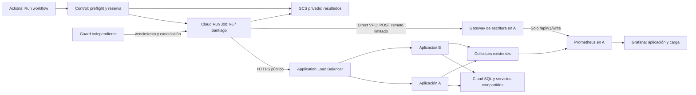

# OPT-06 — Plan de implementación de pruebas de carga remotas

Fecha: 03/11/2026. Estado: implementación local en código; pendiente de aplicar y aceptar en GCP.

Card: [OPT-06 — Pruebas de carga automatizadas en ambiente remoto](https://www.notion.so/40a032f1caff81eaa439c8f4503613e0). Se implementaron en el checkout la orquestación, suite inicial, recursos, controles y dashboard. El bootstrap y la demo no se aplicaron; no se generó carga ni se revisó Grafana en navegador. La card permanece abierta hasta completar la aceptación remota.

### Alcance entregado y límites

- `workflow_dispatch` agrega la acción manual `NexoRuta - pruebas de carga`, con perfiles y cancelación por `run_id`. k6 corre en un Cloud Run Job de una tarea, fuera de A/B.
- El Job publica métricas k6 por remote write a un receptor interno de escritura limitada y usa HTTPS público para medir el balanceador. Grafana comparte dashboard JSON entre local y GCP.
- El runner no siembra ni limpia datos de negocio: usa cuentas sintéticas preparadas manualmente y revoca al terminar las sesiones móviles creadas por su autenticación. `baseline` solo lee. Los perfiles `smoke`, `sync`, `stress` y `soak` repiten hasta 50 eventos `Posicion` ya aplicados por jornada para medir reconexión e idempotencia. Esto no mide escrituras nuevas, colisiones, aislamiento entre tenants ni conciliación de datos nuevos.
- Las fixtures separan credenciales en Secret Manager (máximo 64 KiB) de los eventos en un objeto privado, con hash SHA-256 verificado y límite de 4 MiB. No se enviarán datos reales ni credenciales al repositorio.
- Aplicar OpenTofu, crear fixtures, habilitar APIs, arrancar VMs, probar HTTP remoto, comprobar reglas de red y revisar Grafana visualmente quedan pendientes de la sesión operativa de aceptación. No reportar los SLO como medidos.

## 1. Decisión de arquitectura

Ejecutar **k6 OSS dentro de un Cloud Run Job en Santiago (`southamerica-west1`)**, separado de las VMs de aplicación. Dispararlo mediante un workflow manual de GitHub Actions llamado `NexoRuta - pruebas de carga`, con selección de perfil y una operación para cancelar. Actions orquesta, muestra enlaces y publica el resultado; la carga se genera dentro de GCP.

El camino bajo prueba será el HTTPS público real del Application Load Balancer. El Job usará Direct VPC egress exclusivamente para enviar sus métricas a un gateway de escritura limitada en A y acceder a los servicios de control estrictamente necesarios. Grafana seguirá leyendo Prometheus directamente desde la red privada de la demo y mostrará carga ofrecida, rendimiento observado por el cliente, métricas de aplicación e infraestructura y sincronización.

No agregar Kubernetes ni una VM permanente. Cloud Run está disponible en Santiago y admite ejecución de Jobs, parámetros por ejecución, límites y cancelación. [Ubicaciones](https://docs.cloud.google.com/run/docs/locations), [ejecución de Jobs](https://docs.cloud.google.com/run/docs/execute/jobs).

| Alternativa | Evaluación para NexoRuta |
| --- | --- |
| Cloud Run Job + k6 | Recomendada: proceso finito, capacidad independiente, imagen reproducible y pago por ejecución. Verificar cuota regional y conectividad antes de habilitarlo. |
| k6 en las VMs A/B | Consume los mismos recursos que se quieren medir; excluirlo como generador. |
| k6 en GitHub hosted runner | Geografía y capacidad variables; no tiene acceso privado directo a Prometheus. Usarlo para validar scripts con respuestas controladas. |
| VM efímera dedicada | Alternativa si se demuestra saturación del generador o se necesita control del SO/red. Agrega ciclo de vida y compite con las cuotas de Compute; las dos N4 ya suman 12 vCPU. |
| Grafana Cloud k6 / GKE | Implican otro servicio/costo o un clúster sin necesidad actual. Reconsiderar solo ante una necesidad distribuida medida. |

La ejecución en Santiago mide el despliegue y sus dependencias con red cercana. No demuestra latencia desde Uruguay, redes móviles ni experiencia MAUI/Blazor completa; esas verificaciones son complementarias.

## 2. Ambiente analizado: código frente a recursos reales

Fuentes: `infra/gcp/{bootstrap,demo}`, `scripts/gcp`, `.github/workflows`, `deploy/gcp`, `deploy/observability`, controladores de reparto, rate limiting e instrumentación del backend, y `frontend/DESIGN.md`.

Se hicieron consultas **de solo lectura** mediante gcloud y GitHub CLI el 03/11/2026 al proyecto `nexoruta-demo-20261022`. No se arrancaron VMs, habilitaron APIs, aplicaron planes ni enviaron carga.

| Elemento | Evidencia y consecuencia |
| --- | --- |
| Aplicación | Dos VMs `nexoruta-demo` y `nexoruta-demo-b`, zonas Santiago a/b, `n4-custom-6-16384`; ambas estaban `TERMINATED`. No hay evidencia de funcionamiento actual del runtime. |
| Entrada | IP global `34.49.146.66`, balanceador con grupos A/B configurados para API. `get-health` no devolvió instancias sanas mientras estaban apagadas. Usar los orígenes del manifiesto efectivo, no hardcodear esa IP. |
| Red | VPC `nexoruta-demo`, subred `10.42.0.0/24`, Private Google Access habilitado. Proponer otra subred para el Job, sin modificar esta ni el rango de Private Service Access de SQL. |
| SQL | PostgreSQL 18, `db-g1-small`, estado `RUNNABLE`, política `ALWAYS`; backups y PITR deshabilitados. Es un cuello de botella posible y exige fixtures acotadas y limpieza segura. |
| Redis | El checkout define Memorystore Basic 1 GiB con AUTH/TLS, pero la consulta remota devolvió `SERVICE_DISABLED` para `redis.googleapis.com`. No dar por provisionado ni operativo el caché. Resolver la diferencia con el despliegue objetivo antes de medirlo. |
| Cloud Run | `run.googleapis.com` está deshabilitada. No fue posible inventariar Jobs con esa API; habilitarla declarativamente será parte de implementar, no de este análisis. |
| Observabilidad | El código centraliza Prometheus/Loki/Tempo en A, Grafana en A/B, Collector/Alloy por nodo, Cloud Monitoring vía collector cada 60 s y métricas de aplicación vía OTLP. Esto no acredita esa configuración en ejecución. |
| Diferencia de firewall | La regla remota `nexoruta-demo-shared-services` permite 5672/19092/27017/1025/15692 desde `10.42.0.0/24`. El checkout añade 9090/3100/3200/4317; OPT-06 agrega una subred aparte y una regla limitada a 9091. Conciliar estado, release y reglas antes de afirmar que B exporta telemetría correctamente. |
| Operación | `vm-controls.yml` ofrece start/update/stop, restringido a main y environment `nexoruta-demo`, con WIF. Últimos start/stop consultados: 30–31/10, SHA `b0b6252b8d7d628e1be1d45872c34bd18ac10e3d`; no prueban el checkout actual. |

La revisión local partió del root `fabc324a3ee27ca919764c403dfc136c0351fbe6`, backend `48e947b156cb0116743a77b2d7ed2ccec77cd8c6`, frontend `e584c8033faa9d93debbc2248231b8a07c4077eb` y mobile `d570ddb7c482c56070140e25fafb5a18e51cdbfa`. `scripts/cloud/checkpoint.json` registra otros SHAs para backend/frontend: distinguir ese checkpoint de continuidad de una release desplegada. No actualizar gitlinks para resolver esta feature.

Antes de implementar, repetir el inventario y guardar una síntesis sin secretos. El diseño se acepta contra la topología realmente desplegada y una release completa identificada por digests, no contra documentos históricos que afirman estados distintos.

## 3. Arquitectura y recursos

1. Job `nexoruta-load-tests`: una tarea, paralelismo 1, **max retries 0**, inicialmente 2 vCPU y 2 GiB. Los usuarios virtuales viven dentro de esa tarea; no equivalen a instancias Cloud Run. Ajustar recursos solo si CPU/RAM del generador o iteraciones descartadas lo justifican.
2. Imagen k6 y wrapper fijados por versión y digest en Artifact Registry existente; incluir scripts, validación de manifiesto, supervisión y subida de resultados. Cloud Build construye la imagen; no compilar en el Job. Conservar procedencia, SHA de suite y versión de thresholds en cada corrida.
3. Direct VPC egress `private-ranges-only` en la misma VPC, con subred dedicada `10.42.1.0/26`. El código local define A/B en `10.42.0.0/24`; verificar cualquier rango adicional del proyecto remoto antes de aplicar. Google exige al menos /26 y conserva IPs temporalmente después de cada tarea. No hace falta conector Serverless VPC Access ni Cloud NAT para esta ruta: HTTPS público sale por el egress administrado y las IP privadas por la VPC. [Direct VPC](https://docs.cloud.google.com/run/docs/configuring/vpc-direct-vpc).
4. El firewall de entrada permite desde la subred del Job al gateway de escritura de A, TCP 9091. El gateway solo acepta `POST /api/v1/write` y `GET /-/ready`, y los reenvía al Prometheus local; las consultas de Prometheus no se exponen al Job. El puerto 9090 queda fuera de la regla. El firewall de salida permite hacia la IP de A/32 únicamente TCP 9091 y deniega los destinos RFC1918 restantes; así la tarea no puede abrir conexiones privadas a Cloud SQL, Redis, brokers ni puertos de las VMs. Los tags del Job y A limitan las reglas. No abrir Prometheus/Loki/Tempo al público.
5. Resolver la IP privada de A desde inventario autorizado y pasar el destino como configuración validada. Preflight con reintentos acotados de conectividad; el establecimiento de Direct VPC puede demorar. El arranque y esos reintentos no forman parte de la ventana medida.
6. Tres buckets privados con propósitos distintos: resultados con lifecycle de 30 días; control con leases/manifiestos y lifecycle de 30 días; fixtures con versionado, sin expiración automática y borrado protegido. Los checkpoints y resúmenes se crean por `run_id`; la corrida fallida no depende de un trap para conservar los checkpoints previos.
7. Cuenta runtime de Cloud Run exclusiva: lee el secreto sintético de hasta 64 KiB, el dataset versionado de hasta 4 MiB y leases/manifiestos del bucket de control; escribe resultados mediante `objectCreator`. No accede al bucket de estado, SQL, otros secretos ni IAM de despliegue. ADC usa la identidad adjunta, sin claves JSON.
8. WIF distingue `nexoruta-load-controller` del deployer de publicación/VM. El controller obtiene permisos de Cloud Build y lectura de salud, permisos de ejecución/cancelación Cloud Run y acceso a control/resultados. En el bucket de OpenTofu su IAM condicional se limita a `locks/demo-control.json` y `leases/demo.json`; IAP/OS Login se concede solo sobre A y B. Los permisos para actualizar/ejecutar el Job y hacer `actAs` se limitan a la identidad y recurso del Job. [Permisos de Cloud Run](https://docs.cloud.google.com/run/docs/reference/iam/permissions), [roles de Cloud Run](https://docs.cloud.google.com/run/docs/reference/iam/roles).

Los overrides solo llevan identificadores y perfiles admitidos. El contenedor valida límites y el manifiesto: no aceptar URL arbitraria, credenciales, JavaScript libre ni duración sin tope en inputs de Actions.

## 4. Inicio fácil, exclusión y cancelación

Agregar `.github/workflows/load-tests.yml` como botón independiente en Actions:

| Input | Opciones y comportamiento |
| --- | --- |
| `operation` | `run` / `cancel`; default `run`. Cancelar identifica la corrida activa y permite indicar su `run_id`. |
| `profile` | `smoke`, `baseline`, `sync`, `stress`, `soak`; default `baseline`. Cada perfil fija carga máxima, ventanas y presupuesto. |

Uso principal: **Actions → NexoRuta - pruebas de carga → Run workflow → baseline**. La demo debe estar iniciada con el botón start existente; si está apagada o próxima a vencer, informar el motivo y el enlace al control de VM. No encenderla ni extender la sesión silenciosamente. Un futuro checkbox post-start puede reutilizar este orquestador, pero no es necesario para entregar OPT-06.

Secuencia:

1. Validar main/environment/WIF, perfil y permisos. Bajo el mutex existente `control_lock.py`, comprobar que no hay otra corrida activa y reservar una lease GCS mediante precondiciones de generación. Leer la sesión común de `leases/demo.json`.
2. Fijar **la release aplicada en A y B**, comprobar igualdad de digests y salud de ambas, SQL, workers y telemetría. No seleccionar `channels/main.json` como si lo último publicado ya estuviera desplegado. Fijar también digest del generador, fixture y configuración.
3. Exigir tiempo restante suficiente: preparación máxima + ventana de carga + conciliación/exportación + margen de 10 minutos. Rechazar si la sesión de cuatro horas no alcanza. El Job lleva deadline absoluto y timeout propio; nunca cambia el vencimiento de las VMs.
4. El manifiesto inmutable implementado guarda `run_id`, lease/sesión, perfil, release/digests de aplicaciones, integration/source SHAs, versión de fixture, SHA de suite y origen HTTPS. Registra intención de inicio antes de llamar Cloud Run; una respuesta perdida se reconcilia por el ID exacto. El resumen del runner agrega SHA del dataset; los thresholds viven en el archivo de perfil fijado por SHA de suite. No genera seed.
5. El workflow espera el resultado del Job y publica al final enlaces a Grafana, Cloud Run y GCS. GCS conserva checkpoints cada 30 s y resumen; el log k6 crudo no se publica porque puede contener respuestas. El exit code del Job refleja thresholds y errores del runner.
6. `cancel` usa un job de control que **no queda detrás de la concurrency de ejecución**. Marca cancelación y solicita `run.executions.cancel`; conserva execution y evidencia. La reserva en GCS impide dos cargas simultáneas, incluso desde ejecuciones manuales fuera de GitHub. [Cancelación](https://docs.cloud.google.com/run/docs/execute/jobs).

**Coordinación con VM y guard:**

- No reutilizar `nexoruta-gcp-demo-session` como grupo de concurrency durante toda la carga: bloquearía stop. No mantener el mutex de control mientras k6 ejecuta: el guard también lo necesita.
- `update` y `start` consultan la reserva bajo el mutex; rechazan mientras haya prueba activa. `stop` marca cancelación, invalida el permiso de continuar, cancela la execution y espera un plazo acotado; luego apaga VMs aunque falle esa cancelación. Cloud SQL mantiene la política actual de permanecer encendido.
- Extender `guard.tf`/`guard.yaml.tftpl`: además del vencimiento de sesión, detectar lease de carga expirada, corrida huérfana y cancelación pendiente. Autorizarle cancelación y lectura del Job. No prolongar su sección crítica con esperas largas; reconciliar con generaciones y reintentar en la siguiente invocación.
- Wrapper del Job supervisa lease/deadline/salud y detiene k6 al invalidarse; si pierde el control o A/Prometheus dejan de responder más allá del margen, aborta y exporta evidencia a GCS. Un fallo de Actions no deja carga sin plazo.
- La reserva expirada no autoriza otra prueba hasta verificar que la execution anterior terminó. Resolver también cancelación entre reserva y creación, pérdida de respuesta de `jobs.run`, y nombre de execution aún no registrado: reconciliar ejecuciones y exigir dueño válido antes de generar tráfico. No reintentar ciegamente el inicio, porque podría crear dos executions.

## 5. Datos, autenticación y contratos

El flujo implementado recibe cuentas/jornadas sintéticas preparadas manualmente; no crea cuentas, rutas o fixtures. Credenciales e IDs quedan en una versión de Secret Manager de máximo 64 KiB. Las secuencias de operaciones viven en un objeto create-only de `GCP_LOAD_FIXTURES_BUCKET`, bajo una ruta propia por fixture. El secreto fija su ruta y SHA-256; el runner compara el hash y limita el objeto a 4 MiB antes de cargarlo. No hay endpoints de seed ni permisos de SQL en la identidad de carga.

`baseline` ejecuta solamente `GET /api/mobile/perfil`. `smoke`, `sync`, `stress` y `soak` reenvían, una vez por cuenta, hasta 50 operaciones `Posicion` que ya deben estar aplicadas en una jornada sintética. Se espera `HTTP 200` y `Resultado=Aplicada`; IDs/payloads repetidos comprueban replay idempotente sin insertar registros. Esto evita limpieza destructiva, pero no cubre escrituras nuevas, conciliación/outbox, tenants cruzados, RLS entre operadores, colisiones de ID ni carga de otras entidades. Esas pruebas requieren otro diseño seguro de preparación y conciliación antes de ampliar OPT-06.

El login real tiene **5 solicitudes/minuto por IP** y refresh 30/minuto, compartidos en PostgreSQL; seguimiento público tiene 20/minuto por IP. El wrapper autentica secuencialmente con una pausa de 12,1 s después de cada respuesta y renueva todas las identidades, aun inactivas, tres minutos antes de vencer el JWT de 15 minutos. Refresh y logout comparten una pausa de 2,1 s después de cada respuesta para evitar ráfagas por latencia variable. Ese tiempo forma parte de la preparación acotada (50 identidades pueden requerir unos 10 minutos). Passwords y refresh tokens permanecen en el wrapper; k6 obtiene únicamente access tokens de un broker loopback privado con capacidad aleatoria. Un rechazo o respuesta perdida de rotación detiene la corrida sin reintentar el token incierto. Se revocan solo las sesiones creadas por la corrida, con presupuesto de 120 s y pendientes explícitos si no alcanza; no se borra historia. No falsificar `X-Forwarded-For`, eliminar límites ni interpretar 429 de login como capacidad máxima de negocio. Una prueba específica de rate limiting verifica esos rechazos por separado.

Contrato concreto de sincronización: `POST /api/mobile/jornadas/{jornadaId}/operaciones`, una operación por petición, límite de 32 KiB. Respetar orden de secuencia por jornada, IDs estables, versiones y `OcurridaEn`; sincronizar muchas jornadas en paralelo. Validar **HTTP y `Resultado` del cuerpo**: un 200 puede contener `Conflicto`. El replay del mismo ID/payload debe conservar el resultado sin duplicar efectos; distinto payload con ID repetido y secuencia adelantada deben seguir el contrato de rechazo. `X-NexoRuta-Pending-Sync` informa pendientes, no constituye una cola ni acredita por sí solo el vaciado.

Mapbox conserva `permanent=false`. Ningún escenario consumirá Mapbox/Geoapify reales: coordenadas y estimaciones sintéticas controladas, rutas de proveedor omitidas o dobles limitados al contexto de prueba. No sustituir globalmente el proveedor de una demo compartida. Correo a Mailpit y push a un transporte controlado para las cuentas sintéticas; verificar el aislamiento antes de correr. Si no es posible aislar un efecto externo, excluir explícitamente ese flujo hasta resolverlo. No afirmar entrega FCM, precisión vial o validación Android a partir de k6.

Al terminar, conciliar antes de limpiar: operaciones únicas, secuencias, versiones, estados, inventario y outbox. Limpieza idempotente, por dueño y `run_id`, con comprobación de dependencias y propagación a proyecciones/caché. Si el dominio no permite borrar historia con seguridad, conservarla identificada y presupuestada; no truncar tablas ni borrar migraciones/volúmenes. La limpieza fallida queda pendiente explícita y recuperable en el reporte. Sin backups automáticos, cualquier ensayo de restauración o prueba destructiva requiere su propio cambio deliberado; no forma parte de esta carga.

## 6. Perfiles y niveles de servicio iniciales

Estos objetivos son **propuestos para la demo actual**, deben quedar versionados antes de la primera medición. No son resultados obtenidos ni SLA de producción. Calibrar la capacidad del generador con un endpoint controlado y efectuar warm-up de aplicación sin contar sus muestras en los SLO.

| Perfil | Carga y ventana medida | Propósito |
| --- | --- | --- |
| smoke | 1 VU, 2 minutos; lectura más replay de 50 eventos preaplicados | Verificar login, endpoint, fixture, telemetría y reporte. |
| baseline | 5 usuarios distintos, solo lectura, 15 minutos | Medición inicial nominal del endpoint autenticado, sin escrituras. |
| sync | 20 jornadas, 50 operaciones preaplicadas cada una, hasta 15 minutos | Replay simultáneo/idempotencia. La sincronización ampliada de 5 usuarios requiere otra ejecución con un dataset de cinco. |
| stress | llegada escalonada 1/3/5/10 iteraciones por segundo, máximo 50 VUs y 50 operaciones preaplicadas por jornada, 25 minutos | Explorar capacidad HTTP y replay acotado; incluir iteraciones descartadas como fallo de umbral. |
| soak | 5 VUs, 60 minutos, 50 operaciones preaplicadas por jornada en la primera iteración | Observar lecturas sostenidas y replay inicial. No representa carga continua de escritura. |

Preparación y postprocesamiento tienen límites aparte; timeout total inicial 55 minutos, excepto soak hasta 85, siempre condicionado al deadline común. Ajustar timeout del workflow por encima del Job para alcanzar exportación y clasificación final. No distribuir carga entre tareas inicialmente; si fuera necesario después, particionar fixtures y tasa total, y agregar histogramas, nunca promediar percentiles de tareas.

| Señal | Objetivo para baseline y nivel nominal de sync |
| --- | --- |
| GET autenticados | p95 ≤ 500 ms; p99 ≤ 1 s, por grupo de endpoint y fase. |
| Escrituras y operación sync | p95 ≤ 1 s; p99 ≤ 2 s. |
| Errores inesperados | < 1%; ningún 401/403 inesperado. Separar 5xx, timeouts, transporte, 429 y rechazos de negocio. |
| Operaciones correctas | En los perfiles sync: todos los replays aceptados y aplicados, IDs únicos entre jornadas, sin errores inesperados. No se usa como evidencia de escrituras nuevas ni de aislamiento multi-tenant. |
| Backlog nominal | Cada batch secuencial se mide desde el inicio de su replay; p95 < 60 s y p99 < 120 s. No representa una cola de cliente real ni vaciado de nuevas operaciones. |
| Recuperación de colas | Pendientes de prueba vuelven al nivel previo o se justifican individualmente en ≤ 120 s desde el fin de envío. |
| Generación | Carga alcanzada acorde al perfil, sin descartes para declarar aprobado el nivel; CPU/RAM sin saturación sostenida del generador. |

Como criterio de aceptación, los niveles de stress y sync ampliado deben reportar el primer escalón que incumple, throughput máximo observado y recuperación; encontrar un límite esperado no implica que baseline esté roto. El runner clasifica SLO incumplido, límite encontrado en stress, cancelación, evidencia incompleta, medición inválida por generador/telemetría y fallo de infraestructura. Un límite encontrado conserva estado fallido para exigir diagnóstico. El reporte por escalón conserva p95/p99 exactos de las muestras individuales, error rate, batches iniciados/completados, primera infracción y máximo throughput HTTP en ventanas completas de 10 s. Los targets de stress corresponden a rampas de llegada y no acreditan niveles constantes de capacidad. La recuperación de colas y la aceptación remota siguen pendientes. Ninguna corrida incompleta es verde: el controlador exige resumen válido, requests medidas, ventana completa y concordancia con Cloud Run.

El target de aborto es pérdida de lease, readiness del gateway, integridad, OOM, falta de espacio o errores sostenidos severos (>5% durante 60 s, tras warm-up). El runner supervisa lease/readiness, un FIFO de métricas k6 y recursos del cgroup v2 del Job. Aborta por más de 5% de fallos HTTP en un minuto medido de segundos completos, nuevos OOM, saturación de CPU/memoria sostenida o falta de espacio. El setup separa 30 s de warm-up de lectura y los thresholds HTTP seleccionan únicamente `phase:measured`; login y warm-up fallidos impiden iniciar la carga. La disponibilidad real de límites cgroup y el comportamiento del FIFO deben verificarse en Cloud Run antes de ampliar perfiles. Un `check` de k6 necesita threshold para fallar el resultado. Los descartes pueden indicar falta de VUs por latencia del sistema o recursos insuficientes del generador y requieren diagnóstico. [Métrica de descartes](https://grafana.com/docs/k6/latest/using-k6/scenarios/concepts/dropped-iterations/).

## 7. Grafana y calidad de telemetría

La implementación reutiliza el Prometheus existente de A y su `--web.enable-remote-write-receiver`, detrás de `prometheus-write-gateway` en el puerto privado 9091. El gateway reenvía solo `POST /api/v1/write` y `GET /-/ready`; no permite consultas, acceso a series ni otros endpoints. Una tarea k6 envía series cada 5 segundos a `http://IP_PRIVADA_A:9091/api/v1/write` por Direct VPC. Imagen y versión están fijadas; el contenedor especifica p95/p99/media y evita tags de URL/IDs de negocio para limitar cardinalidad. k6 documenta que la salida remote-write es experimental; verificar el nombre/unidad de las series en el primer smoke remoto. [Remote write de k6](https://grafana.com/docs/k6/latest/results-output/real-time/prometheus-remote-write/).

El dashboard compartido `deploy/observability/grafana/load-tests.json` muestra RPS y errores de la fase medida, VUs, latencia cliente p95/p99 en segundos, iteraciones descartadas, sync, p95 de servidor por nodo/servicio, tasa 5xx, CPU de VM, m?tricas de sync de la aplicaci?n, conexiones SQL y estado del gateway en A. Agrega paneles de CPU/RAM del generador y anotaciones de inicio/fin. El filtro `run_id` aplica a k6; las series existentes de aplicaci?n se correlacionan por ventana temporal y nodo, sin atribuirles un run ID. Grafana provisiona el mismo JSON en local y en el bundle GCP, enlaza al dashboard general y actualiza cada 10 segundos.

La carga, error de consulta y ausencia de muestras usan estados nativos de Grafana; las consultas no convierten ausencia en cero. El runner expone CPU y memoria del cgroup como fracci?n del l?mite, las exporta con etiquetas de control y exige muestras de ambas para aprobar. Las anotaciones identifican inicio de la ventana medida y fin de corrida por `run_id`. El smoke local y el smoke aislado de CI comprobaron nombres y unidades de series k6; la frescura de m?tricas de la aplicaci?n y los paneles deben confirmarse con un smoke remoto. Logs/trazas enlazados por corrida siguen pendientes.

La pila depende de A: si A cae, no hay vista en vivo; el runner aborta cuando el gateway deja de estar listo y conserva su último checkpoint si GCS sigue disponible. La revisión visual en navegador (tamaño, filtros, teclado, contraste y estados vacíos/error) sigue pendiente porque no se aplicaron recursos ni se arrancaron VMs. El dashboard usa componentes nativos y valores semánticos de Grafana; no se agregó un frontend.

## 8. Entregas y estado

| Fase | Implementación | Condición de salida |
| --- | --- | --- |
| 0. Ambiente | Inventario GCP de solo lectura previo a implementar. | Repetir contra el proyecto actual al preparar la aceptación; VMs, Cloud Run y Redis no estaban disponibles en la consulta anterior. |
| 1. Suite | Implementados `tests/load/`, `deploy/load/`, perfiles, login controlado, replay sync, thresholds, hash/sanitización y checkpoints. | Requiere lint/compilación estática local y luego smoke remoto. No crea ni limpia fixtures. |
| 2. Infraestructura | Implementados APIs/WIF/controlador separado en `bootstrap/`; Job, tres buckets, subred, reglas/IAM en `demo/load-tests.tf`; dashboard incluido en delivery. | Requiere `tofu validate/plan` y revisión de cambios antes de apply. El Job usa una imagen inocua al crearse; cada corrida debe actualizarla a la imagen k6 fijada por digest antes de ejecutar. |
| 3. Control | Implementados workflow manual, leases por generación, reserva, reconciliación de arranque, cancelación, guard y exclusión con start/update/stop. | Requiere aplicar IAM/WIF y ensayar carrera/cancelación contra GCP antes de uso operativo. |
| 4. Fixtures y telemetría | Implementados buckets separados de control, resultados y fixtures, controles de límite/hash, dashboard común y métricas cliente/API. | Crear cuentas/jornadas y cargar dataset sintético; comprobar remote-write, nombres/unidades y lectura de ambos nodos en Grafana. |
| 5. Aceptación remota | Pendiente: smoke → baseline → sync → stress acotado → soak, con repetición y comparación. | Evidencia de SLO y límites reales; esta fase no se sustituye con pruebas locales. |
| 6. Operación y cierre | Guía en `infra/gcp/README.md`, `infra/gcp/github-environment.md` y `tests/load/README.md`. | Presupuestar, aplicar recursos, completar revisión visual, adjuntar evidencia en la card y resolver límites de datos indicados en §5. |

Cambios backend/frontend necesarios se publican en sus repositorios y luego se fijan mediante gitlinks exactos del root. Suite y aplicación evolucionan juntas; no mantener aliases ni adaptadores para contratos antiguos. Registrar por separado defectos previos y no relajar aserciones para aprobar la carga.

## 9. Verificación obligatoria contra GCP

**Estático/compilación:** pasan AST de Python, `node --check` del scenario, parseo JSON, `yamldecode` de workflow/Compose GCP/guard y OpenTofu fmt/validate. No hay actionlint. La imagen Docker y el ejecutor k6 requieren Docker/k6 disponibles; si no se compilan localmente, demostrar en Cloud Build antes del smoke. El plan remoto requiere identidad de controller y revisión manual para asegurar que no reemplace VM, discos, SQL ni load balancer. Las rutas nuevas están en el root: el selector actual de CI las trata como cambios de pipeline y fuerza validación completa, así que no se requiere optimizar `ci_plan.py` para habilitar el camino.

**Automatización controlada:** 78 pruebas unitarias locales pasan (1 omitida), incluyendo los módulos de sesión, leases, despliegue y validación de variables. Los tests del controlador cubren lease pre-lanzamiento expirada, recuperación del start por `run_id`, duplicados ambiguos y bloqueo con execution activa. Cancelación completa, guard, deadlines y carreras con start/update/stop requieren ensayo en GCP. El scenario k6 y el acceso del runner a Secret Manager/GCS/gateway aún deben probarse mediante un smoke. No consumir proveedores cartográficos/FCM/SMTP reales.

**HTTP y runtime reales en GCP (pendiente):** aplicar bootstrap y demo con VMs apagadas después de revisar `tofu plan`; verificar cuotas, subredes reales, APIs, reglas efectivas, release, DNS/certificados, SQL y estado de Redis. Iniciar por el workflow de VM y comprobar readiness/login/API. Desde Cloud Run verificar gateway privado permitido, consultas al puerto 9090 y destinos RFC1918 restantes denegados, y HTTPS público hacia el LB permitido. Correr smoke y comprobar k6 + A/B en Grafana antes de subir carga.

**Revisión visual en navegador (pendiente):** abrir el dashboard durante una corrida, comprobar filtro `run_id`, datos en movimiento de k6 y ambos nodos, unidades p95/p99, errores y sync. Revisar ancho, teclado/foco, contraste, zoom y estados loading/error/no data; comprobar el enlace desde el summary Actions. No presentar una respuesta HTTP como revisión visual.

**Carga y fallos de operación reales (pendiente):** correr perfiles y guardar resultados; validar cancel desde el botón, stop durante carga y vencimiento del plazo. Confirmar ejecución no huérfana, rechazo de update, un solo start ante reintentos, lease de demo intacta al terminar, reporte parcial ante cancelación y pérdida de telemetría. Una caída intencional de A requiere sesión de fallo separada.

**Integridad y repetibilidad (alcance actual):** verificar que replay no altera las 50 filas preexistentes, conserva orden y `Resultado=Aplicada`, y comparar dos corridas sobre la misma release/fixture. Esta suite no prueba tenants distintos, generación de nuevas filas ni limpieza. Registrar UTC, release/digests, versión/hash de fixture, tamaño de datos y recursos efectivos.

Cada reporte separará evidencia de **estático/compilación, automatización, HTTP real, revisión visual y medición de carga**. La ejecución remota es requisito de aceptación de esta feature y no puede sustituirse por CI local.

## 10. Costos, reporte final y cierre

Presupuestar antes del primer apply: Cloud Run CPU/memoria por tarea y tiempo total, transferencia vía LB/VPC, peticiones al LB, imágenes/builds, GCS/operaciones/retención y volumen de logs/métricas. Ejemplo de dimensionamiento, no tarifa: una tarea de 2 vCPU/2 GiB por 40 minutos consume 4.800 vCPU-segundos y 4.800 GiB-segundos. No asumir cobertura gratuita; Santiago usa tarifas regionales y la cuota Run se verifica por separado de Compute. [Precios oficiales](https://cloud.google.com/run/pricing).

Una sola corrida simultánea, retries 0, límites por perfil y deadline absoluto acotan el consumo; el presupuesto de GCP es una alerta, no un corte. Job, bucket e imágenes persisten; CPU del Job se consume al ejecutar. SQL/Redis/discos/LB mantienen los costos ya propios de la demo aunque termine la prueba o se apaguen las VMs. Verificar disponibilidad de cuota Cloud Run y no cambiar de región silenciosamente.

Artefactos implementados por `run_id`: manifiesto inmutable sin credenciales, `progress.json`, checkpoints periódicos, `k6-summary.json` cuando k6 alcanza a generarlo y `summary.json` al finalizar el wrapper. El controlador agrega `controller-summary.json` con el veredicto final, incluso cuando el contenedor termina sin resumen; una caída del controlador puede demorar ese artefacto hasta reanudar `wait` sobre la execution exacta. El bucket privado de resultados retiene objetos 30 días; Actions imprime el resultado JSON en el log del paso y publica enlaces a Grafana, Cloud Run y GCS en el resumen. No se genera HTML. Una ejecución abrupta conserva el último checkpoint y los logs de Cloud Run según la retención de GCP. Las métricas por fase/endpoint se consultan en Prometheus/Grafana. El manifiesto registra release/digests/SHAs y fixture, pero el dataset completo y credenciales no se copian al resultado. No habilitar acceso público ni incluir payloads, JWT o cadenas de conexión.

OPT-06 queda lista para cerrar cuando una persona puede iniciar y cancelar desde Actions, la carga se ejecuta fuera de A/B, Grafana permite correlacionarla con la aplicación mientras corre, los SLO y la sincronización se evalúan con integridad, el guard detiene corridas huérfanas y existen resultados reproducibles contra el ambiente remoto. Un límite de capacidad hallado debe quedar explicado y asociado a la topología medida. Anexar las evidencias a la card al completar la implementación; conservar pendientes operativos previos como pendientes.

## 11. Evidencia de esta tarea de planificación

- Realizado: lectura de la card, revisión de código/configuración y consultas GCP de solo lectura al inventario, salud, SQL, subred, firewall, APIs y workflows; documentación oficial de Google/Grafana.
- Estático/compilación local: `tofu fmt -check` y `tofu validate` pasan en bootstrap y demo; AST de Python, parseo de JSON, `node --check` del scenario y `yamldecode` de workflow/Compose GCP/guard pasan. No hay actionlint. No se construyó la imagen ni se ejecutó k6: Docker/k6 no están disponibles.
- Automatización de la feature: 78 pruebas unitarias locales pasan (1 omitida); incluyen despliegue, recuperación de leases/ejecuciones ambiguas, validador de variables y un servidor local que comprueba que el gateway permite solo remote write/readiness y bloquea consultas. No equivalen a una ejecución de carga.
- HTTP real contra aplicación, smoke/baseline/sync/stress/soak y aceptación del workflow/GCP: pendientes de entorno remoto aplicado y sesión operativa.
- Revisión visual en navegador: pendiente de una corrida real y Grafana disponible.
- Esta evidencia no acredita capacidad, SLO, Redis operativo ni telemetría remota funcional hasta completar la aceptación contra el ambiente remoto.
